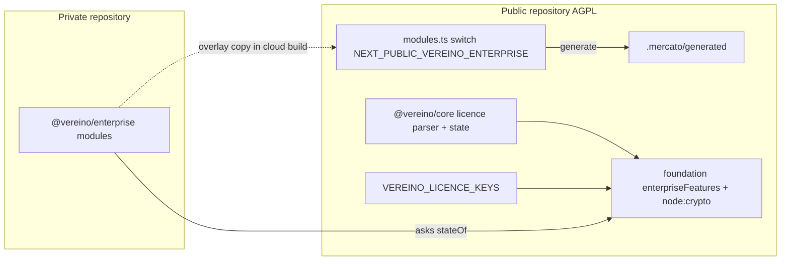

# Vereino Enterprise: a private package switched on per tenant by a licence key

**Date**: 2026-11-23
**Status**: Ready for implementation (issue #649, epic E23 #646, decision D-035 point 2; owner decision of 2026-11-23 on PR #660: Q-E01…Q-E05 answered as recommended, the Ask First items of phases 1a and 1b approved.)

## TLDR

D-035 makes the core AGPL-3.0-only and puts what organisations with a budget need into **Vereino Enterprise**, a
separate commercial package `@vereino/enterprise` that is switched on per tenant by a licence key. This spec says how
the package lives next to the public repository without the public build ever needing it. The package sits in a
**private repository** and is copied into `packages/enterprise` only by the build of the shared cloud (and by
maintainers with access); the public lockfile and CI never mention it. Its modules are registered in `modules.ts` only
when the build sets `NEXT_PUBLIC_VEREINO_ENTERPRISE=true`. A **licence key** is an Ed25519-signed token naming one tenant, the
enabled features and an expiry; it is verified offline. Enterprise modules ask one public
service, `enterpriseFeatures.isEnabled(scope, feature)`; the core contains no Enterprise code path and never depends on
the package. After expiry and a grace period an Enterprise feature becomes read-only; the core never stops. The skeleton
ships in two PRs: phase 1a the gate, the key verifier and the status CLI; phase 1b the conditional loading, the overlay
build and one demo module, proving in public CI that the build passes with and without the package.

## Problem Statement

- D-035 point 2 decides that Enterprise is a separate private package loaded as Open Mercato modules and switched on
  per tenant by a licence key, "the same pattern as `@open-mercato/enterprise` (ADR-023)". Nothing in the repository
  supports that today:
  - `packages/app/src/modules.ts` registers only `@app` and platform modules; the `OM_ENABLE_ENTERPRISE_MODULES*`
    blocks were removed with `@open-mercato/enterprise` in #466.
  - The workspace glob is `packages/*` and CI installs with `yarn install --immutable`
    (`.github/workflows/ci.yml`); a package that exists only for some builds would change `yarn.lock` and fail that
    install. With `nmHoistingLimits: workspaces` (`.yarnrc.yml`) a workspace is visible to the app only when
    `packages/app/package.json` lists it (`@vereino/core|db|ui` as `workspace:*`), and each workspace resolves its own
    imports from its own `node_modules`.
  - The platform generator reads `modules.ts` **statically**: it parses `enabledModules.push({ … })` calls and evaluates
    `if` conditions only over literals, `process.env` reads, local constants and a few known helpers such as
    `parseBooleanWithDefault` (recognised by name) (`@open-mercato/cli/dist/lib/resolver.js`, `parseModulesFromSource`).
    A run-time "is the package installed?" check in `modules.ts` would not be seen by the generator. `modules.ts` is also
    evaluated again in the browser (`ClientBootstrap.tsx`), where only `NEXT_PUBLIC_` variables exist.
  - `scripts/check-licenses.mjs` (`yarn licenses:check`) walks the production dependencies of every workspace and fails
    on a third-party licence outside the allowlist; workspace packages themselves are walked through but not listed, so
    an overlaid `@vereino/enterprise` would be skipped while its own third-party dependencies would be checked.
    `scripts/check-forbidden-packages.mjs` forbids only `@open-mercato/enterprise`, matches line by line, and scans every
    file under `packages/` and `scripts/` outside build folders.
- There is no licence concept at all: no key format, no verifier, no per-tenant switch, no rule for what happens at
  expiry.
- Contributors without access to the private repository must still clone, build, test and run Vereino unchanged, and
  public CI must stay green with no secret.

Affected: the owner (sells Enterprise, signs keys), maintainers who build the shared cloud (D-034), partners of the Gold
tier (D-035 point 6) who resell Enterprise, and every outside contributor (must notice nothing).

## Overview and Success Measures

- **Primary outcome:** one Enterprise demo feature is on for tenant A and off for tenant B on the same instance, and the
  public repository builds, tests and boots with the package absent (AC-E01, AC-E02).
- **Leading indicators:** the public CI job `enterprise-overlay` (with the fixture package) and every existing job
  (without it) are green on every PR; `yarn licenses:check` and `yarn forbidden-packages:check` pass in both shapes.
- **Baseline:** no package, no gate, no key.
- **Market / product reference:** open-core products split the same way. GitLab keeps `ee/` in the same repository
  under a proprietary licence and switches features by a signed licence file; Odoo keeps Enterprise addons in a private
  repository added to the addons path; Cal.com keeps `/ee` in-repo with a licence key checked against its server;
  Grafana Enterprise is a separate build with a signed JWT licence verified offline; Open Mercato publishes
  `@open-mercato/enterprise` to npm under a commercial licence and enables its modules with environment switches.
  Adopted: a separate private source (Odoo), registration by switch (Open Mercato), a signed key verified offline
  (Grafana, GitLab). Rejected: proprietary code inside this AGPL repository (GitLab, Cal.com — it mixes licences in one
  tree and needs a CLA story for `ee/` first); an online licence server (Cal.com — a network dependency for a feature
  check, and a single point of failure for clubs).

## Goals

- **REQ-E01** — The public repository builds, passes `yarn verify` and the integration suite, and boots with no
  Enterprise package and no secret; contributors need nothing new.
- **REQ-E02** — A build with the package present registers its modules; a build without it registers none, and no
  public file imports the package.
- **REQ-E03** — A licence key is a signed, offline-verifiable token naming exactly one tenant, a set of feature ids, an
  issue date and an expiry; a key for one tenant enables nothing for another.
- **REQ-E04** — One DI service answers `isEnabled(scope, feature)` and `stateOf(scope, feature)` (`on`, `read_only`,
  `off`); core code never branches on Enterprise beyond asking it.
- **REQ-E05** — After expiry, plus a grace period, a feature is `read_only`: its reads keep working, its writes are
  refused with a declared error code; the core is never affected.
- **REQ-E06** — `yarn licenses:check` and `yarn forbidden-packages:check` give the right answer with the package
  present and absent; Enterprise's own third-party dependencies stay permissive (D-035 point 4).
- **REQ-E07** — A written boundary rule decides what may go into Enterprise, with the D-035 list and the first candidate
  modules.

## Non-goals

- Any real Enterprise feature (municipality view, accounting, KSeF, SSO, …). Each gets its own spec and story.
- Billing, prices, payment for licences, a customer portal for keys (D-035 "Not decided here").
- An admin screen for installing keys. Keys are installed by the operator through configuration in this version
  (Q-E05 recommends a screen later).
- Technical protection against someone patching the gate in an AGPL fork. The protection is the licence of the private
  package, the trademark and the agreement (D-035 points 2 and 5); the key check keeps honest operators and partners
  compliant, it is not DRM.
- The CLA (#648) and the relicensing (#647).

## Proposed Solution

### Design Decisions and Alternatives

| Decision | Rationale | Alternative considered | Why rejected / deferred |
|---|---|---|---|
| **DD-E01** The package lives in a **private GitHub repository** (`wladku/vereino-enterprise`, name Q-E01) containing only the package `@vereino/enterprise` (`package.json` with `"private": true`, `"license": "SEE LICENSE IN LICENSE.md"`, `src/modules/<id>/`, `src/index.ts`, its own tests and CI) | The public tree stays one licence (AGPL); no proprietary file is ever in a public commit; contributors are unaffected | Proprietary `ee/` folder inside this repository (GitLab, Cal.com) | Two licences in one public tree; every PR touching `ee/` needs the CLA (#648) first; easy to copy by mistake |
| **DD-E02** **Overlay install**: a build that wants Enterprise checks the private repository out into `packages/enterprise` (gitignored in the public repository) at a pinned tag, then runs `scripts/enterprise-overlay.mjs`, which adds `"@vereino/enterprise": "workspace:*"` to `packages/app/package.json` (the app sees a workspace only when it lists it, `nmHoistingLimits: workspaces`) and runs `yarn install` without `--immutable`. The package declares **no third-party package the public lockfile does not already resolve**: its imports are `peerDependencies` repeated as `devDependencies` with exactly the app's ranges (the `@vereino/ui` pattern, `packages/ui/package.json`), so its own `node_modules` resolves react, zod and `@open-mercato/*` to the versions already locked. It exports `./modules/*` because the generator imports `<from>/modules/<id>`. The script then checks the lockfile diff: a new `@vereino/enterprise@workspace` stanza, one new dependency line in the `@vereino/app` stanza, and **no third-party resolution added or changed** | Public `yarn.lock`, `package.json` and CI never mention the package; the overlay build stays reproducible because it resolves no third-party version the public CI has not tested | Publish to a private npm registry (GitHub Packages) as an `optionalDependency` | The public lockfile would list it, so every public install would try to fetch it from a registry that needs credentials; whether Yarn 4 tolerates that fetch failure for an optional package is unverified and would be a fragile contract either way |
| | | Git submodule at `packages/enterprise` | `.gitmodules` points at a private URL in the public tree; Yarn sees the workspace whenever the submodule is checked out, so the public `yarn.lock` must contain it — and then `--immutable` fails for everyone without access |
| | | A private "distribution" repository that contains the public one as a submodule plus the package | Doubles the repository a release must be cut from; the Dockerfile and CI of the public repository would not be the ones that ship |
| **DD-E03** **Registration by switch**: `modules.ts` gets one block `if (parseBooleanWithDefault(process.env.NEXT_PUBLIC_VEREINO_ENTERPRISE, false)) { enabledModules.push({ id: 'enterprise_demo', from: '@vereino/enterprise' }, …) }` listing the Enterprise module ids. `modules.ts` imports `parseBooleanWithDefault` under that exact name (the parser recognises it by name). The variable is `NEXT_PUBLIC_` because `modules.ts` is evaluated again in the browser (`ClientBootstrap.tsx`) and the decision is a build-time one; Enterprise entries carry no `overrides`. The overlay build sets it for `yarn generate` and `next build`; `next.config.ts` adds `@vereino/enterprise` to `transpilePackages` and `globals.css` gets the package's `@source` line (written by the overlay script, gitignored include file) under the same switch. The build writes the decision into a generated constant; at boot `foundation` compares it with the resolvable package and with the registered module ids and fails fast on a mismatch (switch on but package missing, or package present but no Enterprise module registered) | The generator evaluates `process.env` in `if` conditions (`resolver.js`), so a switch is the only condition it understands; the same mechanism Open Mercato used for its enterprise modules; comparing at boot with the build-time decision catches a runtime environment that differs from the build | Detect the package with `fs.existsSync`/`require.resolve` in `modules.ts` | The generator does not evaluate function calls; the condition would be ignored |
| | | Keep the Enterprise module list in the package and read it at generate time | Same reason; the public file names only module ids, which carry no code |
| **DD-E04** **The licence key** (format Q-E02): `vereino-lic.v1.<payload>.<signature>`, both parts base64url. Payload is canonical JSON `{ "v": 1, "kid": "2026-1", "lid": "<licence id>", "instance": "<deployment id>", "tenantId": "<uuid>", "features": ["enterprise_demo", …], "issuedAt": "<ISO date>", "expiresAt": "<ISO date>", "graceDays": 14 }`; the signature is Ed25519 over the ASCII bytes of `vereino-lic.v1.<payload>`. `instance` must equal the instance's `VEREINO_INSTANCE_ID` (the shared cloud has one; each dedicated instance its own), so a key cannot be replayed on a dedicated instance that recreates the same tenant UUID. Verified with Node's built-in `crypto.verify` against public keys compiled into the server-only `foundation/lib/licence-public-keys.ts` and selected by `kid`; the private key never enters any repository, CI or server (owner's offline signing, a script in the private repository reads it from a local file) | Offline (no server to reach, no failure mode for clubs); small; no new dependency; `kid` allows key rotation; binding to `instance` and `tenantId` limits a leaked key to the one tenant it was sold for (the binding is enforced by the public gate, so it protects honest operators, not against a patched fork) | A JWT (EdDSA) via a library | Adds a dependency and the `alg` confusion class of bugs for no gain; the format is ours either way |
| | | A licence server checked online | Network dependency inside a feature check; outage blocks paying clubs; more infrastructure |
| | | A plain list of tenant ids in an environment variable | No expiry, no feature list, no proof of who issued it; a partner instance could enable anything |
| **DD-E05** **Where keys live (version 1)**: the instance reads keys from `VEREINO_LICENCE_KEYS` (newline- or comma-separated, Railway sealed variable) or `VEREINO_LICENCE_KEYS_FILE`. Keys are verified at boot (a variable changes only with a restart); invalid keys are logged by `lid` (never the key) and ignored. Several keys may name one tenant (renewal); the latest valid expiry wins per feature. **Expired keys stay installed**: they keep the feature `read_only` (DD-E07); `licence-status` warns when a tenant has data in an Enterprise module but no key at all | No migration and no new table in the public core; installing a key is one sealed variable change, the same as any secret (S8.10); a handful of Enterprise tenants is expected before a screen pays off | A tenant-scoped table and an admin screen | A migration and UI before the first paying tenant; Q-E05 keeps it for later |
| **DD-E06** **One gate service**, `enterpriseFeatures` in the `foundation` module (exported from `@/modules/foundation`): `stateOf({ tenantId }, featureId) → 'on' \| 'read_only' \| 'off'`, `isEnabled(scope, featureId) → boolean` (`on` only), and `assertWritable(scope, featureId)`, which throws `enterprise_feature_read_only` (409) or `enterprise_feature_disabled` (404). Parsing, payload validation and the state calculation are pure functions in `@vereino/core` (`licence/parse-licence-key.ts`, `licence/feature-state.ts`, 100 % unit tested) that take a `verifySignature(message, signature, kid)` callback, so core stays free of `node:` imports (it is bundled into client components through `@vereino/ui`); the `node:crypto` call and the public-key list live in server-only `foundation/lib/licence-verify.ts`. The service is always present: without the package and without keys every feature is `off` | The core asks one question and owns no Enterprise behaviour; the gate is public, auditable AGPL code; the decision logic is a pure function with a fixed clock in tests | A gate implemented inside the private package, with a no-op default in the core | The key format would be invisible to the public; the public tests could not prove the per-tenant switch; two implementations to keep in step |
| **DD-E07** **Expiry degrades to read-only** (Q-E03): `on` until `expiresAt + graceDays`, with a localized renewal notice from `expiresAt`; then `read_only`, and it **stays `read_only`** while the expired key is installed, so the tenant can always read and export what it stored in an Enterprise module; `off` only when no installed key names the tenant and feature — removing the last key is the operator's deliberate end of access after the customer's export or termination. Enterprise modules call `assertWritable` in every command and write route, and hide or disable their create/edit actions when `read_only` with a localized notice | Data held in Enterprise stays reachable (no hostage data, and GDPR access and export keep working); the core is never touched by a licence state; the grace period covers a late renewal | Turn the feature off at expiry | Locks a customer out of its own records; legally and commercially worse |
| | | Keep working after expiry and only warn | No incentive to renew; partners could resell beyond the term |
| **DD-E08** **Enterprise modules are ordinary Open Mercato modules** in `@vereino/enterprise/src/modules/<id>/`, under the same `AGENTS.md` rules (tenant scope, ACL features, i18n en/pl, `makeCrudRoute`, integration tests). They may import `@vereino/core`, `@vereino/ui`, the `foundation` public helpers and `@open-mercato/*`; **nothing in the public repository imports `@vereino/enterprise`** (enforced, DD-E10). Cross-module effects go through events, enrichers and injection widgets, as between core modules. Every Enterprise route and page adds `requireFeatures` (ACL) **and** the gate check; the ACL decides who, the licence decides whether | One set of rules for all modules; the core needs no hook it would not offer any other module | Enterprise code calling into core internals | Couples the private package to non-public internals; breaks on every refactor |
| **DD-E09** **Boundary rule** (REQ-E07): a capability may go into Enterprise only if (1) a small club can run without it, (2) it fulfils no legal duty of a club or of Vereino as processor (GDPR access, export, erasure, retention, accounting duties a club itself has), and (3) it does not take away or degrade anything that exists in the core today. D-035's list is the starting catalogue. **Candidate first modules:** the municipality view over many facilities and clubs, and accounting with KSeF (Q-E04 picks one) | Turns D-035's sentence into three yes/no tests a reviewer can apply; rule (3) protects contributors and clubs from features being moved behind a key | Decide case by case | No predictable answer for partners and contributors |
| **DD-E10** **Licence and import checks with the package present**: `licenses:check` needs no change: an overlaid workspace is walked but not listed, and every third-party package it pulls in through `dependencies` is checked against the allowlist — run in the overlay shape by the `enterprise-overlay` job, so the shipped image is checked. `forbidden-packages:check` keeps `@open-mercato/enterprise` forbidden and gains a second rule: no public file may import `@vereino/enterprise`. Allowed exceptions are by file **and** marker: in `modules.ts` only lines between `// enterprise-switch:start` and `// enterprise-switch:end`, and the same markers in `next.config.ts`. `packages/enterprise/` and the fixture folder are skipped explicitly; the overlay's `packages/app/package.json` line exists only in the overlay build and is accepted there by an `--overlay` flag | The checks stay strict for third parties (D-035 point 4) and prove that the core does not depend on Enterprise | A licence exception for `@vereino/enterprise` | Has no effect: workspace packages are never listed (`check-licenses.mjs`, `collectPackages`) |
| **DD-E11** **Public CI proves both shapes with a fixture**, not with the private package: `packages/app/.ai/qa/fixtures/enterprise-overlay/` holds a minimal AGPL package named `@vereino/enterprise` with one module `enterprise_demo`. The folder is excluded from the app `tsconfig.json` and from Jest so the public shape never compiles it. A CI job `enterprise-overlay` copies it to `packages/enterprise`, runs `scripts/enterprise-overlay.mjs --ci`, `yarn generate`, typecheck, `yarn licenses:check`, `yarn forbidden-packages:check --overlay`, the production build and `ENT-TEST-03` (tagged `@enterprise-overlay` and skipped by the default integration run). `--ci` writes a generated, gitignored file that adds the **test key pair's** `kid` (the pair is committed as a fixture, its private half signs test keys only) to the trusted list; the Dockerfile never runs it, and boot refuses a trusted test `kid` unless `VEREINO_CI=true` and logs a warning whenever one is trusted. Every other job runs without the overlay | Public CI needs no secret yet exercises the real loading path; the private repository starts as a copy of the fixture | Public CI with a deploy key for the private repository | A secret in public CI and pull requests from forks cannot use it; exposes the private code to workflow logs |
| **DD-E12** **The cloud build** (shared cloud and dedicated instances, which Vereino builds; partners receive images, not the private source, unless an agreement says otherwise): the Dockerfile's three stages change only when the build argument `ENTERPRISE_REF` and the secret `enterprise_token` are set. Builder: clone the private repository at that tag into `packages/enterprise` and run `enterprise-overlay.mjs` **before** `yarn install` (the builder copies manifests one by one, so the clone comes first), then build with `NEXT_PUBLIC_VEREINO_ENTERPRISE=true`. Runner: copy the builder's patched `packages/app/package.json` and `yarn.lock` and `packages/enterprise` (manifest and sources) before `yarn workspaces focus @vereino/app --production`, then a smoke step that resolves `@vereino/enterprise` from `packages/app`. Without the argument every stage is exactly as today. The token is a fine-grained read-only token for that one repository, passed as a Railway build variable into a BuildKit secret mount (phase 1b verifies Railway's support; otherwise a multi-stage build that discards the clone stage), never an image layer | One Dockerfile ships both shapes; a fork or contributor building the image gets the public image | A second Dockerfile in the private repository | Two image recipes drift apart |

### What belongs in Enterprise (boundary)

| Capability (D-035) | Small club needs it to run? | Legal duty? | Enterprise? |
|---|---|---|---|
| Municipality and sports-centre view over many facilities and clubs | no | no | yes (candidate first module) |
| Grant settlement | no (N07 non-goal for 1.0) | no | yes |
| Accounting, KSeF, bank statement matching | no (Stripe payments and charges stay core) | the club's own bookkeeping duty is met by its accountant; Vereino's core keeps the records it already holds and their export | yes (candidate first module) |
| PZPN and SMS integrations | no | no | yes |
| SSO, audit log export, federation reports | no | no (GDPR export and the audit trail itself stay core) | yes |
| Dedicated instances with an SLA | no | no | yes (a service, not a module) |
| GDPR export, anonymisation, retention | — | yes | never |
| People, groups, calendar, attendance, declarations, communication, Stripe payments, facility basics, public page, spreadsheet import | yes | — | never (D-035 point 1) |

## Domain Vocabulary and Business Rules

| Term / invariant | Precise meaning or rule | Source of truth | Failure behavior |
|---|---|---|---|
| Enterprise package | `@vereino/enterprise`, proprietary, in the private repository | DD-E01 | absent: every feature `off`, nothing registered |
| Overlay build | a build with `packages/enterprise` present and `NEXT_PUBLIC_VEREINO_ENTERPRISE=true` | DD-E02, DD-E12 | switch on, package missing: boot fails with `NEXT_PUBLIC_VEREINO_ENTERPRISE is set but @vereino/enterprise is not installed` |
| Feature id | snake_case id of one licensable capability, equal to the Enterprise module id (`enterprise_demo`) | DD-E04 | unknown id in a key: ignored, logged by `lid` |
| Licence key | `vereino-lic.v1.<payload>.<signature>` | DD-E04 | bad signature, unknown `kid`, malformed: ignored, logged by `lid` when readable |
| Feature state | `on` / `read_only` / `off` per tenant and feature | DD-E06, DD-E07 | — |
| Invariant: one tenant per key | a key's `tenantId` is the only tenant it affects | `@vereino/core` verifier | — |
| Invariant: the core never depends on Enterprise | the gate lives in the core and is called by Enterprise modules; no core command, route or job changes its behaviour by licence state, and no public file imports the package | DD-E06, DD-E10 | a public import of `@vereino/enterprise` fails `forbidden-packages:check` |

## Users, Permissions, and Scope

| Actor / role | Can see | Can do | Scope source | Denial behavior |
|---|---|---|---|---|
| Owner | — | signs keys offline | private key on the owner's machine | — |
| Operator (maintainer of the shared cloud) | key status per tenant (`yarn mercato foundation licence-status`, prints `lid`, tenant, features, state, expiry; never the key) | installs keys through the sealed variable | instance configuration | — |
| Club staff of a tenant with a feature `on` | the Enterprise module's pages | what the module's ACL features allow | session tenant + organization | ACL: 403 as today |
| Club staff, feature `read_only` | the module's pages and data, a renewal notice | read and export only | same | writes: 409 `enterprise_feature_read_only` |
| Club staff, feature `off` | nothing of the module (menu hidden) | — | same | routes: 404 `enterprise_feature_disabled` (like an unknown route, D-034 isolation rule) |

The gate takes the tenant only from the trusted request or command scope, never from a payload.

## Reuse and Ownership Map

| Need | Reused primitive | Owner | New code |
|---|---|---|---|
| Module loading | Open Mercato `modules.ts` + generator, `transpilePackages` | platform / app | one switch block |
| Signature check | Node `crypto.verify` (Ed25519) | Node | pure parser/state in `@vereino/core`, `node:crypto` call in `foundation/lib` |
| Gate service | Awilix DI in `foundation/di.ts` | `foundation` | `enterpriseFeatures` |
| Error codes | `foundation/lib/error-codes.ts` + `api/errors.ts` (S6.7) | `foundation` | two codes |
| Secrets | Railway sealed variables (S8.10) | ops | two variables |
| Licence checks | `check-licenses.mjs`, `check-forbidden-packages.mjs` | repo tooling | one import rule with markers, `--overlay` flag |

## Architecture and Data Flow

Takeaway: the arrow from Enterprise to the gate is the only runtime dependency; nothing points from the public core into
the private package.

## User Journeys

### Journey J-E01 — The owner sells the demo feature to a club

1. The owner signs a key for tenant A with `features: ["enterprise_demo"]`, `expiresAt` one year ahead.
2. The operator adds it to `VEREINO_LICENCE_KEYS` and restarts; `licence-status` shows tenant A `enterprise_demo on`.
3. Staff of club A see the demo page; staff of club B do not (404, no menu entry).

### Journey J-E02 — The licence expires

1. From `expiresAt` club A sees a renewal notice; after the grace period the state becomes `read_only`: the page shows a
   localized "licence expired, read-only" notice and no save actions; a write returns 409. The expired key stays
   installed.
2. The owner signs a renewal; the operator adds it; the state returns to `on`.

### Journey J-E03 — A contributor without access

1. Clones the public repository, `yarn install --immutable`, `yarn dev`, `yarn verify` — as today; no Enterprise menu,
   no error, `licence-status` prints "no licence keys installed".

## UI and Interaction Contracts

The core adds no UI. Enterprise modules follow `.ai/guides/backend-ui.md`; the `read_only` notice uses the platform
`Notice` / `Alert` primitive with a status variant (never `brand`), text from the module's `i18n/en.json` and
`i18n/pl.json`. The demo module's page is one backend page `/backend/enterprise-demo` showing the feature state of the
current tenant; it exists to be tested, not used.

## Data Models

No entity, no migration in the public repository (DD-E05). The demo module has no entity.

## API, Command, and Error Contracts

| Surface | Contract | Tier (`BACKWARD_COMPATIBILITY.md`) |
|---|---|---|
| `@vereino/core` exports `parseLicenceKey(key, verifySignature) → { ok: true, licence } \| { ok: false, reason }`, `featureState(licences, { instance, tenantId }, featureId, now) → state` | new public export | internal until the first Enterprise module ships, then protected |
| `foundation` DI `enterpriseFeatures` (`stateOf`, `isEnabled`, `assertWritable`) | new seam used by the private package | protected once released: the private package depends on it |
| Error codes `enterprise_feature_disabled` (404), `enterprise_feature_read_only` (409) | new codes | protected |
| Environment `NEXT_PUBLIC_VEREINO_ENTERPRISE`, `VEREINO_INSTANCE_ID`, `VEREINO_LICENCE_KEYS`, `VEREINO_LICENCE_KEYS_FILE` | new config | protected |
| CLI `yarn mercato foundation licence-status` | new, read-only | internal |
| Demo route `GET /api/enterprise_demo/state` (fixture and private package) → `{ state }` | fixture only | none |
| Key format `vereino-lic.v1` | new, versioned by its prefix | protected: a new format gets `v2`, `v1` keys stay valid until they expire |

## Events, Jobs, Notifications, and Cross-Module Flows

None in the skeleton. A later version may notify the club administrator 30 days before expiry (Q-E05).

## Security, Privacy, and Compliance

- **Key forgery:** Ed25519 with public keys compiled into server-only code; the private key offline. The committed
  test key pair is trusted only in a build that ran `enterprise-overlay.mjs --ci` and only with `VEREINO_CI=true`; the
  Dockerfile never does either, and a trusted test `kid` logs a warning at boot. Abuse case: an operator edits the
  public key in an AGPL fork — accepted (Non-goals); the private package's licence forbids running it without a key.
- **Cross-tenant and cross-instance use of a key:** the key names one `instance` and one `tenantId`; the gate compares
  them with `VEREINO_INSTANCE_ID` and the trusted scope. Abuse case:
  a staff user sends another tenant id in a payload — ignored, scope comes from the session.
- **Leaking keys:** keys are not secret in the cryptographic sense but name customers; they are sealed variables, never
  logged (only `lid`), never in run logs or specs.
- **Supply chain:** the overlay adds no third-party dependency (DD-E02); the private CI and the `enterprise-overlay`
  job run `licenses:check`.
- **Build token:** read-only, one repository, BuildKit secret, never in a layer or log.
- **Personal data:** none in keys. Enterprise modules handling personal data follow the core's rules and the
  processor register; GDPR duties stay in the core (DD-E09).
- **Licence compliance:** the public repository stays AGPL-only; the fixture package is AGPL; the private package's
  EULA is written by the lawyer (epic #646 owner action).

## Integration Coverage

| Test ID | Level | Setup / fixture | Actions | Assertions | Requirement IDs |
|---|---|---|---|---|---|
| ENT-TEST-01 | unit (`@vereino/core` and `foundation/lib`, 100 %) | the committed test key pair | parse valid, tampered payload, tampered signature, unknown `kid`, wrong prefix, malformed base64, wrong instance, wrong tenant, several keys for one tenant; state before `expiresAt`, in the grace period, after it; test `kid` refused without `VEREINO_CI` | `ok`/`reason` per case; `on` (notice in grace) → `read_only` → stays `read_only`; latest expiry wins | REQ-E03, REQ-E05 |
| ENT-TEST-02 | integration, public shape (every CI run) | no package; `VEREINO_LICENCE_KEYS` empty | boot the production build; run `licence-status`; read the generated module registry | boot succeeds; status prints "no licence keys installed"; no module from `@vereino/enterprise` is registered | REQ-E01, REQ-E02 |
| ENT-TEST-03 | integration, overlay shape (job `enterprise-overlay`, tagged, skipped by default) | fixture package; keys signed with the committed test key pair, trusted through `--ci` and `VEREINO_CI=true`; two tenants; a key for tenant A, an expired key for tenant C | call the demo route and page as staff of A, B and C; attempt the demo write | A `on`; B 404; C `read_only` and the write returns 409 | REQ-E02, REQ-E04, REQ-E05 |
| ENT-TEST-04 | script unit tests (100 %) | fixture trees | `forbidden-packages:check` on a public file importing `@vereino/enterprise`; on a `modules.ts` line inside and outside the markers; the app manifest line with and without `--overlay`; `licenses:check` on an overlay workspace whose `dependencies` hold a non-permissive package | fail naming the file; pass inside / fail outside; pass / fail; fail naming the package | REQ-E06 |
| ENT-TEST-05 | script unit tests + CI | lockfile fixtures; `enterprise-overlay` job | overlay install | only the new `@vereino/enterprise` stanza and one `@vereino/app` dependency line; any added or changed third-party resolution fails | REQ-E01, REQ-E02 |

## Implementation Phases

### Phase 1a — Licence gate, key format and status CLI (E23-S03 second PR, #649)

- **Depends on:** this spec approved; Q-E02 and Q-E03 answered.
- **Outcome:** the public core can verify keys and answer `stateOf` per tenant; nothing loads yet.
- **Deliverables:** `@vereino/core` `licence/` (parser, state); `foundation/lib/licence-verify.ts` (`node:crypto`,
  production public key list with the owner's first `kid`, test-`kid` rule); `enterpriseFeatures` service, two error
  codes, `licence-status` CLI; committed test key pair fixture; `.env.example` and `docs/ops/deploy.md` (key installation,
  `VEREINO_INSTANCE_ID`); `BACKWARD_COMPATIBILITY.md` rows.
- **Requirements closed:** REQ-E03, REQ-E04 (service), REQ-E05 (state)
- **Tests:** ENT-TEST-01; ENT-TEST-02 (status part).
- **Validation:** `yarn verify`, `yarn test:integration:vereino --filter ENT-TEST-02`.
- **Exit gate:** `licence-status` on staging lists a test-signed key as rejected (production build, no test `kid`).

### Phase 1b — Conditional loading, overlay build and demo module (E23-S03 third PR, #649)

- **Depends on:** phase 1a; Q-E01 answered.
- **Outcome:** the public build is green with and without the package; the demo feature is on for one tenant only.
- **Deliverables:** `modules.ts` switch block with markers; `next.config.ts` conditional `transpilePackages` with
  markers; conditional `globals.css` `@source` include; generated build-time constant and boot check; `.gitignore`
  entries `packages/enterprise/` and the generated files; fixture package
  `packages/app/.ai/qa/fixtures/enterprise-overlay/` with module `enterprise_demo` (excluded from `tsconfig.json` and
  Jest); `scripts/enterprise-overlay.mjs` (manifest patch, install, lockfile-diff check, `--ci`); CI job
  `enterprise-overlay`; `check-forbidden-packages.mjs` import rule; the three Dockerfile stages (DD-E12);
  `--modules-root` parameter for `route-isolation:check`, `contracts:check` and the i18n checks so the private CI can
  run them on `packages/enterprise/src/modules`; `CONTRIBUTING.md` (contributors need nothing; local-patch rows for
  `modules.ts`, `next.config.ts`, `globals.css`, Dockerfile); lesson on the static `modules.ts` parser.
- **Independent slices / estimated commits:** loading switch + fixture + CI job (1), checks (1), Dockerfile (1),
  check parameters (1), docs (1).
- **Requirements closed:** REQ-E01, REQ-E02, REQ-E04 (demo), REQ-E05 (read-only route), REQ-E06
- **Tests:** ENT-TEST-02…ENT-TEST-05.
- **Validation:** `yarn generate`, `yarn verify`, `yarn test:scripts`, the `enterprise-overlay` job (locally:
  `node scripts/enterprise-overlay.mjs --ci && yarn test:integration:vereino --filter ENT-TEST-03`), a public Docker
  build without the argument.
- **Exit gate:** both CI shapes green on the PR; the public-shape image is byte-for-byte the same recipe as before.

### Phase 2 — The private repository (owner action, then E23 follow-up)

- **Depends on:** phase 1b merged; the owner creates the private repository (Q-E01) and the signing key pair.
- **Outcome:** `wladku/vereino-enterprise` holds `@vereino/enterprise` (copied from the fixture), its EULA placeholder,
  its CI (overlay against the public `main`, `yarn verify`, the lockfile-diff check, the module checks with
  `--modules-root`) and the offline signing script.
- **Exit gate:** a staging image built with `ENTERPRISE_REF` shows the demo feature for one staging tenant only.

### Phase 3 — First real Enterprise module (own spec, Q-E04)

Out of this spec: the chosen module gets its own spec under the boundary rule DD-E09.

### Ask First items (approved by the owner on 2026-11-23, PR #660, for phases 1a and 1b as defined here)

| Item | Phase | Why Ask First |
|---|---|---|
| `modules.ts`, `next.config.ts`, `globals.css`, Dockerfile changes | 1b | local patches to platform-owned files (CONTRIBUTING) and the image that ships |
| New public contracts (`enterpriseFeatures`, error codes, env variables, key format) | 1a | contract surfaces (`BACKWARD_COMPATIBILITY.md`) |
| Creating the private repository, the signing key, the build token | 2 | owner's credentials and repositories |

## Requirement Traceability

| Requirement | Journey / surface | Data/API/event contracts | Phase | Tests | Acceptance criterion |
|---|---|---|---|---|---|
| REQ-E01 | J-E03 | public CI, Dockerfile default | 1b | ENT-TEST-02, ENT-TEST-05 | AC-E01 |
| REQ-E02 | J-E01 | `modules.ts` switch, boot check | 1b | ENT-TEST-02, ENT-TEST-03 | AC-E02 |
| REQ-E03 | J-E01 | key format, verifier | 1a | ENT-TEST-01 | AC-E03 |
| REQ-E04 | J-E01 | `enterpriseFeatures` | 1a, 1b | ENT-TEST-03 | AC-E04 |
| REQ-E05 | J-E02 | `featureState`, `assertWritable`, error codes | 1a, 1b | ENT-TEST-01, ENT-TEST-03 | AC-E05 |
| REQ-E06 | — | `licenses:check`, `forbidden-packages:check` | 1b | ENT-TEST-04 | AC-E06 |
| REQ-E07 | — | boundary rule DD-E09 | spec | review | AC-E07 |

## Rollout, Migration, and Rollback

- **Phases 1a and 1b:** with `NEXT_PUBLIC_VEREINO_ENTERPRISE` unset and no keys, every instance behaves exactly as
  today; the deploy is safe. Rollback: revert the PR; nothing persistent was created.
- **Keys:** adding a key is a variable change and a restart. Expired keys stay installed (read-only access); removing
  every key for a tenant turns its features `off` and is done only after the customer's export or termination (data of
  an Enterprise module stays in its tables).
- **Key rotation:** a new `kid` is added to `@vereino/core` in a release before keys signed with it are issued; old
  `kid`s stay until their last key expires.
- **Observability:** `licence-status`; a boot log line with the count of valid keys and the `lid`s of rejected ones.

## Risks and Tradeoffs

| Risk / tradeoff | Impact | Mitigation / detection | Residual risk |
|---|---|---|---|
| Public core gains a dependency on Enterprise by accident | AGPL core cannot build alone | DD-E10 import rule; ENT-TEST-02 on every PR | low |
| The overlay install resolves a different third-party version than the public lockfile | the shipped image differs from what CI tested | no own dependencies (DD-E02); ENT-TEST-05 lockfile-diff check | low |
| Platform upgrade changes the static `modules.ts` parser | Enterprise modules silently not registered | boot check (build-time switch on but no Enterprise module registered → fail); `enterprise-overlay` job on every PR | low |
| Enterprise modules escape the module checks (route isolation, contracts, i18n) that read only `packages/app/src/modules` | a cross-tenant leak in a paid module | `--modules-root` parameter (phase 1b) run by the private CI | low |
| An operator removes expired keys | the club loses read access to its Enterprise data | rule in `docs/ops/deploy.md`; `licence-status` warns when a tenant has Enterprise data and no key | low |
| Clock skew on the server | early or late expiry | grace period (DD-E07); server time is NTP-synced on Railway | low |
| Owner loses the signing key | no new keys | second offline copy; rotation by `kid` | owner action |
| Features gated by ACL only, not by licence | a tenant without a key uses a feature | the demo module and the module template call the gate on every route; review checklist item | medium until a lint rule exists |
| Partners expect an online activation | sales friction | out of scope; Q-E05 revisits | accepted |

## Acceptance Criteria

- [ ] **AC-E01** — Without the package and without any secret, `yarn install --immutable`, `yarn verify`, the
  integration suite and the Docker build pass unchanged.
- [ ] **AC-E02** — With the fixture overlay, the demo module is registered; without it, it is not, and no public file
  imports `@vereino/enterprise`.
- [ ] **AC-E03** — A key verifies offline; a key for tenant A enables nothing for tenant B or on another instance;
  tampered, unknown-`kid` and (outside CI) test-`kid` keys are rejected.
- [ ] **AC-E04** — Enterprise code asks only `enterpriseFeatures`; no public file imports the package; the demo module
  is `on` for A, `off` for B.
- [ ] **AC-E05** — After expiry plus the grace period the feature is read-only (reads work, writes 409) and stays so
  while the key is installed; the core keeps working.
- [ ] **AC-E06** — `licenses:check` and `forbidden-packages:check` pass in both shapes and fail on a non-permissive
  overlay dependency and on a public import of the package.
- [ ] **AC-E07** — The boundary rule and the first-module candidates are recorded and approved by the owner.
- [ ] Every affected API and UI path has self-contained integration coverage and the configured validation gate passes.

## Final Compliance Report

| Check | Status | Evidence / resolution |
|---|---|---|
| Applicable `AGENTS.md` files and routed guides/skills reviewed | pass | root `AGENTS.md`, `.ai/guides/spec-delivery.md`, D-035, ADR-023, `check-licenses.mjs`, `check-forbidden-packages.mjs`, the generator's `resolver.js` |
| Data models, APIs, events, UI, and tests are internally consistent | pass | traceability table |
| Every workflow completes end to end without a catch-all integration phase | pass | phase 1a (gate) and 1b (loading) each ship working |
| Platform-native reuse and extension points were chosen before custom code | pass | module registration, DI, error-code registry, Node crypto |
| UI contracts identify references, canonical components, and theme/state coverage | pass | one notice, one demo page |
| Every phase has dependencies, bounded slices, tests, value, and an observable exit gate | pass | *Implementation Phases* |

Verdict: `Ready for implementation — Q-E01…Q-E05 answered by the owner on 2026-11-23 (PR #660); the Ask First items of phases 1a and 1b approved. Phase 2 still waits for the owner to create the private repository and the signing key pair.`

## Open Questions

The owner's choices, answered on 2026-11-23 in a comment on PR #660; every answer takes the recommendation the design above assumes.

| ID | Question | Owner | Blocking? | Resolution / decision date |
|---|---|---|---|---|
| Q-E01 | How is the private package distributed: **private repository + overlay copy in the cloud build** (recommended, DD-E01/E02/E12), a private npm registry, or a git submodule? And the repository name (`wladku/vereino-enterprise`)? | Władek Kuć | yes — phases 1b and 2 | **Decided 2026-11-23 (owner, PR #660):** private repository + overlay (`wladku/vereino-enterprise`), copied into `packages/enterprise` by the cloud build only. If the repository does not exist yet when phase 2 starts, the implementer stops and asks the owner to create it; private keys and the private package are never committed to the public repository. A registry or submodule puts the package into the public lockfile and breaks `--immutable` installs for everyone without access |
| Q-E02 | Key format: **own `vereino-lic.v1` token, Ed25519, verified offline, bound to one instance and one tenant** (recommended, DD-E04), a JWT through a library, or an online licence server? | Władek Kuć | yes — phase 1a | **Decided 2026-11-23 (owner, PR #660):** own `vereino-lic.v1` token, Ed25519, verified offline, bound to instance + tenant (DD-E04). Keys are installed as a sealed variable in version 1 (DD-E05) |
| Q-E03 | Expiry: **full use for a 14-day grace period after `expiresAt` (with a renewal notice), then read-only for as long as the expired key stays installed** (recommended, DD-E07), or off after the grace period? | Władek Kuć | yes — phase 1a | **Decided 2026-11-23 (owner, PR #660):** 14-day grace period with full use, then read-only while the expired key stays installed (DD-E07). Off would lock a club out of records it stored in an Enterprise module |
| Q-E04 | First real Enterprise module: **municipality view over many facilities** (recommended: builds on the facilities core and D-035 names municipalities as the first Enterprise customer) or **accounting with KSeF**? | Władek Kuć | no — phase 3 only | **Decided 2026-11-23 (owner, PR #660):** the municipality view over many facilities. D-035 orders the first module "at about 15–20 clubs or the first municipality" |
| Q-E05 | Later, not now: an admin screen and table for keys and a 30-day expiry notice instead of the sealed variable? | Władek Kuć | no | **Decided 2026-11-23 (owner, PR #660):** admin screen for keys and the expiry notice later, not before the fifth Enterprise tenant |

## Changelog

Each change is its own file in `.ai/specs/changelog/2026-11-23-vereino-enterprise-package/`.
