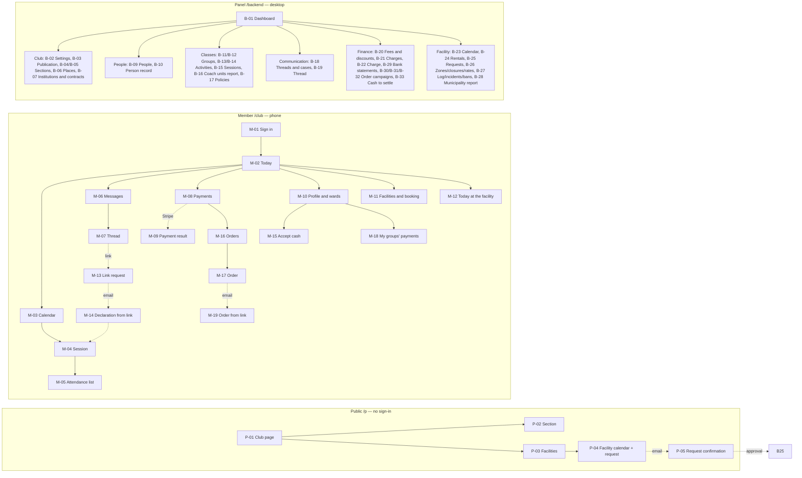

# Vereino — preliminary UX concept

**Version:** 0.1 · **Date:** 2026-10-20 · **Status:** concept for discussion (not an implementation specification)

**Source of truth:** [`.ai/specs/2026-10-20-vereino-club-management.md`](../../.ai/specs/2026-10-20-vereino-club-management.md) (Draft). This document translates the specification into people, flows and screens. Routes, endpoints, statuses and business rules are copied from the specification; where they differ, the specification wins. Requirement (`REQ-…`), journey (`J-…`) and decision (`DD-…`) identifiers refer to it.

**Mockups:** [`mockups/index.html`](mockups/index.html) — open the file in a browser (no server needed). Source: `mockups/app.ts` + `mockups/styles.css`; `mockups/app.js` is generated with `node docs/ux-concept/mockups/build.mjs`.

Screen ID convention: **M-** member interface `/club` (phone), **B-** `/backend` panel (desktop), **P-** public pages `/p/...` (no sign-in). The same ID is shown on every mockup screen.

---

## 1. System users and their needs

The subject is a **small multi-section club** (association), with a football academy as its main section and equal-standing non-football sections (swimming, zumba, pilates). One person has one record and one account, and roles add up (D-005) — e.g. Wojtek is the Żaki coach and the academy coordinator.

| User | Who they are (pilot: KS Gwiazda) | Key needs | Key tasks in the system | Device / channel | Pain today |
|---|---|---|---|---|---|
| **Legal guardian** ("Kasia") | parent of two children in different sections (Jaś — Żaki and Basen, Ola — Trampkarze) | know today whether there are sessions; one calendar for all children; "attending / not attending" with one tap; pay without looking up the account number; learn about cancellations in time | Today, calendar, declaration, confirming a teenager's declaration, online payment, consents, message to the coach | phone; email; link from Messenger | 3–4 Messenger groups, missed cancellations, paying "whenever she remembers" |
| **Participant 13+** ("Ola", 14) | player with her own account and a limited view | check the schedule without asking a parent; sign up for a match | Today, calendar, declaration (per policy), group messages — no payments (the guardian pays) | phone | knows the schedule from her parent |
| **Adult participant** | zumba or pilates participant | schedule, cancellations, membership fee | same as a guardian, but for herself | phone | announcements in the group chat |
| **Coach / instructor** ("Wojtek", "Piotr", "Anna") | runs 1–3 groups, often on a contract; paid "base + units" | know who will come; attendance in 30 s; substitution without arguing about money; one announcement to the group; book the pitch for a tournament without phoning | attendance list, closing a session, reporting an absence, cancellation, announcement + text for the group chat, facility calendar and booking, tournament, view of own units | phone | polls get lost in the chat; substitutions and bookings by phone |
| **Section coordinator** ("Wojtek" — academy, "Aneta" — Basen) | responsible for the groups, schedule and coaches of one or more sections | a schedule without collisions; see sessions without a coach; quickly assign a substitute coach; one announcement to the whole section; a register of difficult cases; run the section page | groups and rosters, activity wizard, sessions "needing a coach" and "unsettled", substitutions, section coach units report, cases, section public content | desktop + phone | schedule in their head and in Excel; substitutions by phone |
| **Club administrator** ("Aneta", may also act as treasurer) | runs the club after hours: people, roles, money, facility | know who is overdue without Excel; automatic charge generation and discounts; coach settlement and municipality report in one click; decide on external requests; control what the club publishes | person and family records, accounts, roles, fee schedules, discounts, charges, recording payments, approving requests, zones and rates, reports, publication settings | desktop | manual reminders; coach units and Orlik (municipal sports pitch complex) hours from memory |
| **Treasurer** ("Beata") | responsible only for the club's money | know who is overdue and who holds cash; reconcile the bank statement and cash from coaches without Excel | charges, statements, cash, order campaigns, settlements with coaches — no access to person records, groups or facilities | desktop | cash from coaches "on trust", a notebook of payments |
| **Facility attendant** ("Tomek") | opens and closes the Orlik, enforces the rules | know who is at the facility today; enter a booking after a phone call; keep the log and report an incident | Today at the facility, log, incident, rental by phone, `no_show` | phone at the facility | notebook, phone calls to the club |
| **Guest — parent looking for activities** | someone from outside the club | see what sections and activities exist, for whom, when, at what price, who runs them; whom to contact | club page, section page, materials | phone / desktop | no single source of information about the club |
| **External renter** (another club, school, company) | wants to rent the Orlik or the small hall | see free slots; submit a request without phoning; know whether it was accepted | public facility calendar, request, email confirmation, email with the decision | desktop / phone | calls the club, cannot see free hours |
| **Technical administrator** | the person installing the instance | launch the club, modules and configuration | built-in Open Mercato pages | desktop | — |
| **Municipality (facility owner)** | no account | a reliable Orlik usage report | receives a CSV/PDF report from the administrator | email | report compiled by hand |

---

## 2. Key use cases and flows

### 2.1 Use case catalog

| ID | Actor | Goal | Priority | Requirements | Phase |
|---|---|---|---|---|---|
| UC-01 | Administrator | Build the club structure: sections with coordinators, places, institutions | Must | REQ-003 | 1 |
| UC-02 | Administrator | Set up a family: guardian, children, guardianship, consents, accounts | Must | REQ-001, REQ-002 | 1 |
| UC-03 | Guardian | Check "Today" and declare attendance for children from different sections | Must | REQ-006, REQ-007 | 2 |
| UC-04 | Guardian | Confirm or reject a teenager's match declaration | Must | REQ-007 | 2 |
| UC-05 | Coach | Tick off attendance and close the session | Must | REQ-007, REQ-008 | 2 |
| UC-06 | Coach + coordinator | Report an absence and arrange a substitute coach | Must | REQ-008 | 2 |
| UC-07 | Coordinator | Create a recurring activity without collisions | Must | REQ-005 | 2 |
| UC-08 | Coach | Cancel a session and notify parents (with text for the group chat) | Must | REQ-005, REQ-009 | 2–3 |
| UC-09 | Coach / instructor | Book a facility for a tournament or training course without approval | Must | REQ-023, REQ-027 | 2, 5 |
| UC-10 | External renter | Submit an online booking request and get a decision | Must | REQ-024 | 5 |
| UC-11 | Administrator | Approve or reject an external request | Must | REQ-024 | 5 |
| UC-12 | Attendant | Enter a rental after a phone call, keep the log, report an incident | Must / Should | REQ-013, REQ-016 | 5 |
| UC-13 | Treasurer | Generate the period's membership fees and collect overdue amounts | Must | REQ-011 | 4 |
| UC-14 | Guardian | Pay charges online | Must | REQ-012 | 4 |
| UC-15 | Treasurer | Settle coaches (coach units report + CSV) | Must / Should | REQ-008, REQ-021 | 2 |
| UC-16 | Coordinator / parent | Hold a conversation in a thread and mark it as a case | Must | REQ-009, REQ-010 | 3 |
| UC-17 | Guardian without sign-in | Declare attendance from a personal link | Should | REQ-017 | 3 |
| UC-18 | Guest | Get to know the club, its sections and activities | Must | REQ-025, REQ-026 | 1–4 |
| UC-19 | Administrator | Configure what the club publishes | Must | REQ-025 | 1 |
| UC-20 | Administrator | Generate the municipality report | Must | REQ-015 | 5 |
| UC-21 | Administrator | Create an order form (e.g. kit) and send the link to the Messenger group | Must | REQ-032 | 4 |
| UC-22 | Guardian | Order kit for a child (in the app or from a personal link) and pay | Must | REQ-032 | 4 |
| UC-23 | Coach + treasurer | Check their group's payments (fees and kit), accept cash, hand over kit, settle cash from the coach | Must | REQ-033, REQ-034 | 4 |

### 2.2 Complete flows

Each flow: preconditions → main path (with screens) → branches and errors → outcome. All branches are covered in the mockups via the state switcher or test data.

#### F-01 Family onboarding (UC-01, UC-02)
- **Preconditions:** administrator signed in; the club has its settings.
- **Path:** B-01 Dashboard → B-04 Sections → "Add section" (B-05: name, coordinator) → B-09 People → "Add person" (Kasia, email) → save → B-10 Person record → "Guardianship" tab → "Add ward" (Jaś, date of birth; Ola) → check "primary payer", consents → "Account" tab → "Create account" → message "Password setup email sent".
- **Branches:** email already taken → field error (409); for Jaś (age 9) the "Create account" button is disabled with the explanation "below the account age threshold (13)"; a second "primary payer" → 409 "This ward already has a primary payer"; stale record version → conflict dialog "Someone changed this record" (refresh / overwrite not available); missing permissions → "Access denied" page.
- **Outcome:** Kasia signs in (M-01) and sees the children's profiles on M-02.

#### F-02 Today and attendance declaration (UC-03, UC-04)
- **Preconditions:** Kasia has an account; sessions have been generated.
- **Path:** M-01 Sign in → M-02 Today: Calendar tile ("Tue 17:00 Jaś — Żaki training, Boisko piłkarskie", "Thu 16:00 Jaś — Class, Basen") → "Attending" next to Jaś's session → the button changes to "Attending ✓", with a screen reader announcement. Attendance tile: "Ola signed up for Saturday's match — do you confirm?" → M-04 Session → "Confirm" → status "Confirmed".
- **Branches:** the session has already started → "Declarations closed" (409), buttons disabled; no guardian decision within 24 h → the policy default applies, the tile disappears; no sessions today → empty state with the next session; network error → message and "Try again" (the declaration is not lost).
- **Outcome:** the coach sees the declarations on M-05.

#### F-03 Training: attendance, substitution, settlement (UC-05, UC-06, UC-15)
- **Preconditions:** Wojtek is the Żaki coach; Piotr is the Trampkarze coach.
- **Path A (substitution):** Wojtek → M-02 → Friday session → M-04 → "Report absence" (reason) → the session goes to "Needing a coach". Coordinator → B-01 widget "Sessions needing a coach" → B-15 ("Needing a coach" perspective) → "Assign substitute" → picks Piotr (the list shows the coach's collisions) → save → notification for Piotr.
- **Path B (attendance):** Piotr → M-02 → session → M-05 Attendance list: declared 11/2/3, present/absent/late toggles → "Close session" (confirmation) → session `done`.
- **Path C (settlement):** treasurer → B-16 Coach units report → month → Wojtek: given away 1, Piotr: taken over 1 → "Export CSV".
- **Branches:** two people tick at the same time → the second save gets 409, conflict dialog, list refreshed without losing selections; coach from outside the group → 403; session unsettled 24 h after it ends → B-15 "Unsettled" and the widget.

#### F-04 New recurring activity (UC-07)
- **Path:** B-13 Activities → "New activity" → B-14 wizard: section/group, type (match/friendly/tournament unavailable for `class_group`), name, place, coach, weekdays, times, period → preview of the first sessions and collisions → "Create" → session list in B-15.
- **Branches:** collision at the place (e.g. Tuesday 17:00 Boisko piłkarskie with Żaki) → list of collisions, "Create" button blocked until the times/place are changed; end time ≤ start time → field error; period without any session → "The rule produces no sessions".

#### F-05 Cancellation and announcement (UC-08, UC-16)
- **Path:** coach → M-05 → "Cancel session" → reason → confirmation → recipients get a notification and an email → M-07 session thread → "Copy text for group chat" → text with a summary and link in the clipboard.
- **Case:** a parent writes in the group thread (M-07) → coordinator in B-19 → "Mark as case" (warning: irreversible) → thread labeled "Case", the message "Delete" button disappears; an attempt via the API → 409.

#### F-06 Declaration from a link without sign-in (UC-17)
- **Path:** a parent clicks a link from Messenger → M-13 "Session: Żaki training, Tue 17:00 — to declare, enter your email" → "Send me a link" → always "If the address is registered with the club, we have sent a link" → email → M-14 with a list of their children in this group → "Attending".
- **Branches:** expired link (410) → "Link expired, request a new one"; after the session starts → "Declarations closed".

#### F-07 Membership fees: generation, overdue, payment (UC-13, UC-14)
- **Treasurer path:** B-20 Fees (Żaki PLN 150, Basen PLN 120, Trampkarze PLN 160; sibling discount −30%) → B-21 Charges → "Generate period 2026-12" → summary "created 12, skipped 0, without payer 1" (in the pilot: approx. 140) → "Overdue" perspective → B-22 charge → "Record payment" (cash PLN 100) → status "partially paid".
- **Guardian path:** M-02 Payments tile "349 zł due 10.11" → M-08 list of charges (Ola 160, Jaś Żaki 105 — discount, Jaś Basen 84 — discount) → select → "Pay 349 zł" → Stripe page (mock) → return to M-09 "Payment received" → statuses "Paid".
- **Branches:** payment canceled → "Payment interrupted — charges are still open"; webhook delayed → "Payment in progress, refresh in a moment"; overpayment when recording → field error "Amount exceeds the remaining 50 zł"; charge without a payer → cannot be paid online, visible in the administrator's widget.

#### F-08 Coach books the pitch for a tournament (UC-09) — J-006
- **Path:** Wojtek → M-11 Facilities → "Boisko piłkarskie" → Saturday → day timeline with zones and occupancy → selects 9:00–12:00 → "Book" → dialog: "For a group" (Żaki or Trampkarze) / "General purpose", type "Tournament", invited teams → "Book" → slot "Turniej o Puchar Gwiazdy" on the timeline; an external request pending for that time is marked "overridden" (email to the requester).
- **Variant:** the zumba instructor books the "Salka szkoleniowa" for "Instructor training" (general purpose).
- **Branches:** slot taken → 409 with a list of collisions (staff see names); outside opening hours or during a closure → "Facility closed at this time"; a group that is not one's own → 403; `tournament` for a class group → unavailable in the type field.

#### F-09 External request and administrator decision (UC-10, UC-11) — J-007
- **Renter path:** P-01 club page → "Facilities" → P-03 → Orlik — Boisko piłkarskie → P-04 month calendar → "bookable" slot → "Request a booking" → form (organization, contact, email, phone, category, units, purpose, rules ✓) → "Send" → "Check your inbox and confirm the request" → link → P-05 "The request is awaiting administrator approval (up to 48 h)". Slot shown publicly as: "requested — pending".
- **Administrator path:** notification → B-01 widget "Requests awaiting approval" → B-25 queue → details (collisions: none; ban register: none; expires in 47 h) → "Approve" (assign an institution or create a new one) → rental `requested` + charge to the municipality's account → email to the renter with the amount and account number. P-04 shows "booked".
- **Branches:** a second request for the same slot → "This slot has already been requested — choose another"; rules not accepted → field error; requests disabled in the configuration → no button; "Reject" requires a reason → email; 48 h without a decision → "expired"; club booking → "overridden"; link opened after 1 h → "Link expired".

#### F-10 Attendant at the facility (UC-12)
- **Path:** M-12 Today at the facility → "Open facility" → log: condition before, time → list of today's groups and rentals (adult supervisor present ✓) → "Report incident" (type, description, action taken, photo) → "Close facility" (condition after).
- **Rental by phone:** B-23 facility calendar → "bookable" slot → "New rental" → renter (institution search), category, units → calculated amount and dates → "Save".
- **Branches:** renter with an active ban → 409 "The renter is banned from entry until 31.12"; `no_show` after the time → status, and the charge remains.

#### F-11 Guest explores the club; administrator configures publication (UC-18, UC-19) — J-008
- **Guest path:** P-01 → "Basen" tile → P-02: description, groups (age, days, times, place), terms, membership fee, instructor (with consent), materials, contact.
- **Administrator path:** B-03 Publication → turns off "Prices" → save → P-02 without the prices block (the API does not return it). B-05 section → "Public page" tab → description, terms, contact, materials, "Public section" ✓.
- **Branches:** page disabled → P-01 "The club does not publish a page"; non-public section → 404; instructor without consent → "Section instructors".

#### F-12 Municipality report (UC-20)
- **Path:** B-28 → facility, period → hours by zone (including club time: sessions + internal bookings), rentals (count, value), payments to the municipality's account, incidents, maintenance → "Export CSV".

#### F-13 Kit orders and settlement (UC-21, UC-22, UC-23)
- **Administrator path:** B-30 Order campaigns → "New order form" (B-31) → "Load template" (shirt, shorts, socks, set PLN 120, tracksuit PLN 180/200, rain jacket, cap, water bottle) → Academy groups, orders until 20.11, payment until 04.12, name and number for printing → "Save and open collection" → text with the link in the clipboard → pasted into the Messenger group.
- **Guardian path:** link → M-17 (signed in: children from the campaign's groups; no account: email → personal link → M-19) → set with sizes, tracksuit, print "JAŚ 8" → live total → "Place order" → copy by email, charge in M-08 → "Pay online", bank transfer with the payer code, or cash to the coach.
- **Coach path (phone):** M-02 "My groups' payments" tile → M-18: the group's children with fees and kit to pay → "Accept cash" (cash receipt (KP), email to the parent) → "Cash with you" → "Remind guardians"; after delivery "Hand over kit".
- **Treasurer path (Beata or Aneta):** B-33 Cash to settle → "Accept handover" (RG/2026/11/001); B-32 → "Close orders" → Supplier summary (quantities per product and size, prints, CSV) → "Ordered from supplier" → "Delivered" (email "ready for pickup from the coach") → "Complete campaign".
- **Branches:** set without a sock size → field error; number taken in the group → error with the name of the child who has it; a change below the amount paid or canceling a paid order → 409; after the deadline the form is closed; handover before delivery → 409; handing over an unpaid order → warning and confirmation; 14-year-old participant → no orders.

#### F-14 Group payments for the coach and cash handover (UC-23)
- **Administrator path:** B-20 → "Coaches and payments": fees and orders with cash (default) / fees view-only / orders only.
- **Coach path (phone):** M-02 tile "My groups' payments: 5 people have charges, 3 of them overdue; cash with you 300 zł" → M-18 → "Orlik młodszy" chip, "To pay" filter → Bartek: October fee (overdue), November fee and kit → "Accept cash": fee 10/2026 and kit selected, PLN 235 → one cash receipt (KP), email to his mother → "Cash with you: 535 zł"; Adam: "Send reminder" → email to his father with the list of overdue items.
- **Treasurer path:** B-01 dashboard with finances only → B-33 → Wojtek Malinowski PLN 535 (3 payments) → "Accept handover" → RG/2026/11/001.
- **Branches:** child without a payer → visible, no cash acceptance ("a matter for the treasurer"); "view only" setting → no "Accept cash" for fees; the coach does not see fees of other sections or discount reasons; amount larger than the selected charges → 422.

---

## 3. Screen and navigation map

### 3.1 Navigation

| Shell | Structure | Who sees it |
|---|---|---|
| **Member `/club`** | bottom bar: **Today · Calendar · Messages · Payments · More** (More: Profile, Facilities, Today at the facility, Orders, My groups' payments, Accept cash, Sign out); in the header a child switcher (guardian) and a role context switcher ("as guardian / as coach") — only when the person has more than one role | items filtered by ACL features: Payments — `payments.view_own` (adults only: guardian, adult participant; a minor participant does not have this item); Facilities — `facilities.view`; Today at the facility — `facilities.log.write` |
| **Panel `/backend`** | side menu in groups: **Dashboard · Club** (Sections, Places, Institutions, Contracts, Settings, Publication) **· People** (People) **· Classes** (Groups, Activities, Sessions, Coach units report, Declaration policies) **· Communication** (Threads, Cases) **· Finance** (Fees and discounts, Charges, Bank statements, Order campaigns, Cash to settle) **· Facility** (Calendar, Rentals, Requests, Zones and rates, Log and incidents, Municipality report) | groups and items according to the pages' `requireFeatures`; the coordinator does not see Finance; the attendant sees only Facility |
| **Public `/p/[klub]`** | header: **Club · Sections · Facilities**; footer: contact, rules, privacy policy (`/privacy` of the `content` module) | everyone; blocks according to the publication settings |

### 3.2 Route index

| ID | Route | Name | Roles (feature) | Phase |
|---|---|---|---|---|
| M-01 | `/login` (`auth` module) | Sign in | everyone with an account | 1 |
| M-02 | `/club` | Today | `people.self` | 1–5 |
| M-03 | `/club/calendar` | Calendar | `people.self` | 2 |
| M-04 | `/club/occurrences/[id]` | Session | participant, guardian, coach | 2 |
| M-05 | `/club/occurrences/[id]/attendance` | Attendance list | `activities.coach` | 2 |
| M-06 | `/club/messages` | Messages | `communication.view` | 3 |
| M-07 | `/club/messages/[threadId]` | Thread | thread participant | 3 |
| M-08 | `/club/payments` | Payments | `payments.view_own` (adults only) | 4 |
| M-09 | `/club/payments/return` | Payment result | `payments.pay_online` | 4 |
| M-10 | `/club/profile`, `/club/wards/[personId]` | Profile and wards | `people.self` | 1 |
| M-11 | `/club/places`, `/club/places/[placeId]` | Facilities and booking | `facilities.view` + `facilities.bookings.create` | 5 (tournament from the group level — 2) |
| M-12 | `/club/facility` | Today at the facility | `facilities.log.write` | 5 |
| M-13 | `/club/link` | Link request | no sign-in | 3 |
| M-14 | `/club/d/[token]` | Declaration from link | token | 3 |
| M-15 | `/club/cash` | Accept cash | `payments.cash.record` | 4 |
| M-16 | `/club/orders` | Orders | `payments.orders.place` | 4 |
| M-17 | `/club/orders/[campaignId]` | Order (form and summary) | `payments.orders.place`; without a session — entry via sign-in or link request | 4 |
| M-18 | `/club/coach/payments` | My groups' payments | `payments.groups.view` (+ `payments.groups.collect`) | 4 |
| M-19 | `/club/o/[token]` | Order from link | token | 4 |
| B-01 | `/backend` | Dashboard | staff | 1–5 |
| B-02 | `/backend/club/settings` | Club settings | `club_core.manage` | 1 |
| B-03 | `/backend/club/publication` | Publication | `club_core.publication.manage` | 1 |
| B-04 / B-05 | `/backend/club/sections`, `…/[id]/edit` | Sections | `club_core.view` / `club_core.manage` | 1 |
| B-06 | `/backend/club/places` | Places | `club_core.manage` | 1 |
| B-07 | `/backend/club/institutions`, `/backend/club/contracts` | Institutions and contracts | `club_core.manage`, `club_core.contracts.manage` | 1–2 |
| B-09 / B-10 | `/backend/people/persons`, `…/[id]` | People, person record | `people.view` / `people.manage` | 1 |
| B-11 / B-12 | `/backend/groups/groups`, `…/[id]` | Groups | `groups.view` / `groups.manage` | 2 |
| B-13 / B-14 | `/backend/activities/activities`, `…/create` | Activities, wizard | `activities.manage` | 2 |
| B-15 | `/backend/activities/occurrences` | Sessions | `activities.view` | 2 |
| B-16 | `/backend/activities/reports/coach-units` | Coach units report | `activities.reports.view` | 2 |
| B-17 | `/backend/activities/policies` | Declaration policies | `activities.manage` | 2 |
| B-18 / B-19 | `/backend/communication/threads`, `…/[id]` | Threads and cases | `communication.view` | 3 |
| B-20 | `/backend/payments/fees` | Fees and discounts | `payments.manage` | 4 |
| B-21 / B-22 | `/backend/payments/charges`, `…/[id]` | Charges | `payments.view` / `payments.manage` | 4 |
| B-29 | `/backend/payments/bank` | Bank statements | `payments.bank.import` | 4 |
| B-30 | `/backend/payments/orders` | Order campaigns | `payments.orders.manage` | 4 |
| B-31 | `/backend/payments/orders/create`, `…/[id]/edit` | Order form wizard | `payments.orders.manage` | 4 |
| B-32 | `/backend/payments/orders/[id]` | Campaign: orders, summary, stages | `payments.orders.manage` | 4 |
| B-33 | `/backend/payments/cash-custody` | Cash to settle | `payments.cash.settle` (treasurer, administrator) | 4 |
| B-23 | `/backend/facilities/calendar` | Facility calendar | `facilities.view` | 5 |
| B-24 | `/backend/facilities/rentals` | Rentals | `facilities.rentals.manage` | 5 |
| B-25 | `/backend/facilities/requests` | Requests awaiting approval | `facilities.rentals.approve` | 5 |
| B-26 | `/backend/facilities/zones` (+ `/closures`, `/rates`) | Zones, closures, rates | `facilities.manage` | 5 |
| B-27 | `/backend/facilities/logs` (+ `/incidents`, `/bans`) | Log, incidents, bans | `facilities.log.write` / `facilities.incidents.manage` | 5 |
| B-28 | `/backend/facilities/reports/owner` | Municipality report | `facilities.reports.view` | 5 |
| P-01 | `/p/[clubSlug]` | Club page | public | 1 |
| P-02 | `/p/[clubSlug]/sections/[sectionSlug]` | Section page | public | 1–4 |
| P-03 | `/p/[clubSlug]/places` | Club facilities | public | 5 |
| P-04 | `/p/[clubSlug]/places/[placeSlug]` | Facility calendar + request | public | 5 |
| P-05 | `/p/[clubSlug]/requests/verify/[token]` | Request confirmation | token | 5 |

---

## 4. Screen specification

Common rules (they apply to every screen and are not repeated):

- **Components:** panel — `Page`, `PageBody`, `DataTable` (filters, search, perspectives, export, `RowActions`), `CrudForm` (field groups, `updatedAt` → 409), `StatusBadge`, `EmptyState`, `LoadingMessage`, `ErrorMessage`, `useConfirmDialog`, dialogs with Ctrl/Cmd+Enter and Escape; references to other records always as a selector with the route of the options source, never a UUID. Member and public pages — the same design system primitives in a mobile layout.
- **States:** **loading** — a skeleton in place of the content, actions disabled; **empty** — explanation + next action; **error** — message without technical details + "Try again", form data preserved; **success** — toast or in-place status change; **conflict (409)** — shared dialog "The record has changed in the meantime"; **403** — "Access denied".
- **Validation:** client-side for convenience, server-side (Zod in the route) as the source of truth; a server error is mapped to the field by the shared error adapter.
- **API:** all calls via `apiCall`/`apiCallOrThrow`; club scope taken from the session.

### Member interface (phone)

#### M-01 Sign in — `/login`
- **Goal:** enter the app with one account for all roles (Q-001).
- **Features:** email + password, "Forgot password" (`/reset`), remember this device.
- **Components:** the installed `auth` page; after sign-in, redirect to `/club` (staff without a member role → `/backend`).
- **States:** loading — button with a spinner; error — "Incorrect email or password" (no distinction); success — redirect.
- **Validation:** email required and valid; password required.
- **API:** `auth` module sign-in (installed); `GET /api/people/me` after sign-in.

#### M-02 Today — `/club`
- **Goal:** within 5 seconds, know what is happening today and tomorrow for me and my children, and respond.
- **Features:** **Calendar** tile (today's/tomorrow's sessions of all wards and one's own, with section and place; "Attending / Not attending" in place); **Attendance** tile (`pending_guardian` decisions to make; for the coach — "My sessions today" with entry into the list); **Messages** tile (unread); **Payments** tile (total of open charges, nearest due date, "Pay") — adults only; a minor participant does not see it; child and role context switcher.
- **Components:** header with a greeting and switchers; grid of 4 tiles (1 column < 640 px); segmented declaration buttons; `StatusBadge` (canceled, declarations closed, awaiting confirmation); bottom navigation bar.
- **States:** loading — tile skeletons; empty — "No sessions today. Next session: Thu 16:00 Basen" + link to the calendar; phase 3–4 tiles are not rendered until the module is enabled; error — per tile ("Couldn't load payments" + retry), the rest keeps working; success — on declaration "Saved: Jaś attending".
- **Validation:** declaration only until `start_at`; a ward with the `guardian_only` policy — buttons only for the guardian.
- **API:** `GET /api/people/me`; `GET /api/activities/calendar?as=self&from&to`; `POST /api/activities/attendance/declare`; `GET /api/communication/threads?unread=1` (f3); `GET /api/payments/my-charges?status=open` (f4).

#### M-03 Calendar — `/club/calendar`
- **Goal:** one calendar for all children from all sections (REQ-006).
- **Features:** week view (default) / month list; person filter (everyone / Jaś / Ola / me); section legend; declaration status on each session; navigation to M-04.
- **Components:** week/month switcher, list of days with session cards (time, activity, group, section, place, person, status), schedule component family (V-8).
- **States:** loading — day skeletons; empty — "No sessions this week" + "Next week"; error — message + retry; success — n/a.
- **Validation:** range ≤ 62 days (400 from the server → range trimmed in the UI).
- **API:** `GET /api/activities/calendar?as=guardian|self|coach&from&to&personId`.

#### M-04 Session — `/club/occurrences/[id]`
- **Goal:** details of a single session and attendance decisions.
- **Features:** date, times, place (with address and map — Could), coach (with a substitution marker), status; for each of my wards "Attending / Not attending"; guardian decision on `pending_guardian` (Confirm / Reject); for a match — opponent, away trip; for the coach — buttons "Attendance list", "Report absence", "Cancel", "Message the group"; parent duty — "Sign up for duty" (Could).
- **Components:** session header, `StatusBadge`, list of people with segmented buttons, reason dialogs (absence, cancellation) with `useConfirmDialog`.
- **States:** loading — skeleton; empty — n/a (404 → "The session does not exist or you do not have access to it"); error — retry; success — toasts "Declaration saved", "Absence reported — the coordinator has been notified", "Session canceled — notifications sent".
- **Validation:** declaration before `start_at` (otherwise 409 `declaration_closed`); cancellation reason required (3–200 characters); absence reason optional.
- **API:** `GET /api/activities/occurrences/{id}`; `POST /api/activities/attendance/declare`; `POST /api/activities/attendance/{id}/guardian-decision`; `POST /api/activities/occurrences/{id}/absence`; `POST /api/activities/occurrences/{id}/cancel`.

#### M-05 Attendance list — `/club/occurrences/[id]/attendance`
- **Goal:** tick off attendance in 30 seconds and close the session (REQ-007, REQ-008).
- **Features:** declaration summary (yes / no / none); list of group members on the session date ∪ people with a declaration; for each: present / absent / late; "All declared present" (quick fill); "Close session".
- **Components:** list with toggles (large touch targets), counter, bottom action bar, `useConfirmDialog` on closing, conflict dialog.
- **States:** loading — list skeleton; empty — "The group has no members on the session date" (coordinator: link to the roster); error — save failed, selections preserved, retry; success — "Session closed — 14 present", navigation to M-02.
- **Validation:** the session must not be canceled; closing before the session ends requires confirmation; session version (409 on concurrent editing).
- **API:** `GET /api/activities/occurrences/{id}/attendance`; `PUT /api/activities/occurrences/{id}/attendance` (`entries`, `complete`).

#### M-06 Messages — `/club/messages`
- **Goal:** one place for club announcements instead of Messenger groups (REQ-009).
- **Features:** thread list (scope: club / section / group / session / direct), unread, "Case" label; filter by child; coach/coordinator: "New announcement" (scope chosen from their own).
- **Components:** thread list with a scope icon, unread counter, floating "New" button, new announcement dialog (`CrudForm`).
- **States:** loading — skeleton; empty — "No messages. Announcements from coaches and the club will appear here"; error — retry; success — "Sent to 18 people (email + in-app)".
- **Validation:** scope required and within the author's permissions (403); subject 3–120 characters; body 1–5000 characters.
- **API:** `GET /api/communication/threads`; `POST /api/communication/threads`.

#### M-07 Thread — `/club/messages/[threadId]`
- **Goal:** read and reply; coach — share the text with the group chat.
- **Features:** messages with author and role; reply; "Copy text for group chat" (summary + link); email delivery status per recipient (for the author); label "Case — messages cannot be deleted".
- **Components:** message component family, reply field, copy button with clipboard and confirmation.
- **States:** loading; empty — n/a; error — sending failed, content preserved; success — "Text copied — paste it into the group chat".
- **Validation:** reply body 1–5000 characters; thread participants only (403).
- **API:** `GET /api/communication/threads/{id}`; `POST /api/communication/threads/{id}/replies`; `GET /api/communication/share-text?threadId|occurrenceId`.

#### M-08 Payments — `/club/payments`
- **Goal:** see how much I pay and for what, and pay in two taps (REQ-012). The screen exists only for adults (guardian, adult participant); a participant under 18 gets 403, and the item does not appear in the navigation (REQ-002).
- **Features:** list of the payer's open charges (person, description, period, amount, discount with the rule name, due date); select and "Pay X zł" (Stripe); history of paid charges; bank transfer information (the club's account number).
- **Components:** `DataTable` in a mobile layout (cards), checkboxes, total, primary button, `StatusBadge` (open, partially paid, paid, overdue).
- **States:** loading; empty — "All paid" + payment history; error — retry; success — redirect to Stripe.
- **Validation:** at least one charge; only `open`; a charge with `payer_missing` cannot be selected, with an explanation.
- **API:** `GET /api/payments/my-charges`; `POST /api/payments/checkout` → `{ redirectUrl }`.

#### M-09 Payment result — `/club/payments/return`
- **Goal:** confirm the payment result after returning from Stripe.
- **Features:** "Payment received" with the list of charges; "Payment in progress" (the webhook has not arrived yet — automatic refresh every few seconds for 30 s); "Payment interrupted" with a way back to M-08.
- **Components:** status message (`Alert`), list, back button.
- **States:** loading — "Checking your payment…"; error — "Couldn't check the status"; success — paid.
- **Validation:** none.
- **API:** `GET /api/payments/my-charges` (charge status after the `payment_gateways.payment.captured` webhook).

#### M-10 Profile and wards — `/club/profile`, `/club/wards/[personId]`
- **Goal:** contact details, consents on behalf of children, consent to publishing one's name (coach).
- **Features:** my details (phone, contact email); list of wards with groups and sections; consents (rules, image, trips) with date; coach: "I consent to my first and last name being published on the club page"; password change (link to `auth`).
- **Components:** `CrudForm`, consent toggles with date and author.
- **States:** loading; empty — "You have no wards" (for a person without children the section is hidden); error; success — "Consents saved"; conflict — 409.
- **Validation:** phone in PL/E.164 format; email; consents can be changed only by the guardian (the ward sees them read-only).
- **API:** `GET /api/people/me`; `PUT /api/people/persons/{id}`; `PUT /api/people/guardianships/{id}`.

#### M-11 Facilities and booking — `/club/places`, `/club/places/[placeId]`
- **Goal:** staff of every section see facility occupancy and book right away (REQ-023, REQ-027).
- **Features:** list of club facilities (Orlik — pitches, small hall, pool) with today's occupancy; day timeline 8–22 with zones and entries (sessions, internal bookings, rentals, pending requests, closures); day picker; selecting a free range → **Book**: "For a group" (event: tournament/other, invited teams) or "General purpose" (description); canceling one's own booking.
- **Components:** list of facility cards, day picker, timeline with blocks (text legend), booking dialog (`CrudForm`), list of collisions in the error.
- **States:** loading — timeline skeleton; empty — "The facility has no zone rules — contact the administrator"; error — retry; success — the block appears on the timeline + "Booked: Sat 9:00–12:00 Boisko piłkarskie"; conflict — 409 with a list of collisions (with names, since this is staff).
- **Validation:** end > start; within opening hours; not during a closure; no collisions; group within one's own scope; `tournament` only for `team`; purpose required for a general booking (3–120 characters).
- **API:** `GET /api/facilities/calendar?placeId&from&to`; `POST /api/facilities/internal-bookings`; `DELETE /api/facilities/internal-bookings/{id}`; `POST /api/activities/events`.

#### M-12 Today at the facility — `/club/facility`
- **Goal:** the attendant runs the day at the facility from a phone (REQ-013, REQ-016).
- **Features:** "Open facility" (condition before, time); list of today's sessions and rentals with fields: number of people, adult supervisor present; "No-show" (`no_show`); "Report incident" (type, description, action taken, photo, people involved); "Close facility" (condition after, notes).
- **Components:** list of day cards, `CrudForm` dialogs, photo upload (`attachments`).
- **States:** loading; empty — "Nothing is scheduled at the facility today"; error; success — "Facility opened 15:58", "Incident reported".
- **Validation:** condition before required on opening; condition after on closing; incident description 10–2000 characters; `no_show` only after `starts_at`.
- **API:** `GET /api/facilities/today`; `POST/PUT /api/facilities/logs`; `POST /api/facilities/incidents`; `POST /api/facilities/rentals/{id}/no-show`.

#### M-13 Link request — `/club/link`
- **Goal:** a parent coming from a Messenger link gets a personal link without creating an account (REQ-017).
- **Features:** basic session information (no personal data); email field; "Send me a link".
- **Components:** public page with a design system form.
- **States:** loading — button with a spinner; error — "Try again in a moment" (429); success — always "If the address is registered with the club, we have sent a link".
- **Validation:** valid email; rate limit.
- **API:** `POST /api/activities/declaration-links`.

#### M-14 Declaration from link — `/club/d/[token]`
- **Goal:** declare children's attendance without signing in.
- **Features:** session; list of my children in this group with "Attending / Not attending"; link "Sign in to see the full calendar".
- **Components:** public page, segmented buttons.
- **States:** loading; error — 410 "Link expired — request a new one" (link to M-13), 404; success — "Saved".
- **Validation:** only people from the token (403); before `start_at`.
- **API:** `GET /api/activities/declaration-links/{token}`; `POST /api/activities/declaration-links/{token}`.

### Panel (desktop)

#### B-01 Dashboard — `/backend`
- **Goal:** one glance at what needs action today.
- **Features:** permission-dependent widgets: **Sessions needing a coach** (14 days), **Unsettled sessions**, **Overdue** (total, number of families), **Charges without a payer**, **Requests awaiting approval** (with time to expiry), **Today at the facility**, **Sections without a coordinator**; each row leads to a list with a perspective.
- **Components:** `dashboards` (module widgets), KPI cards, lists.
- **States:** loading — widget skeletons; empty per widget ("All sessions have a coach"); error per widget; success — n/a.
- **Validation:** none.
- **API:** `GET /api/activities/occurrences?unassigned=1`, `?unsettled=1`; `GET /api/payments/overdue`; `GET /api/payments/charges?payerMissing=1`; `GET /api/facilities/rentals?status=pending_approval`; `GET /api/facilities/today`; `GET /api/club_core/sections`.

#### B-02 Club settings — `/backend/club/settings`
- **Goal:** club details and operating parameters.
- **Features:** short name, **club logo** (upload, replace, remove; preview in the header), time zone, currency, account age threshold (13–18), public slug, contact phone.
- **Components:** `CrudForm` (`pageContext: 'settings'`).
- **States:** loading, error, success ("Saved"), conflict.
- **Validation:** slug `^[a-z0-9-]{3,40}$`, globally unique (409); threshold 13–18; phone; logo PNG/JPG/WebP up to 2 MB (SVG rejected, 422), square ≥ 256 px recommended.
- **API:** `GET/PUT /api/club_core/settings`.

#### B-03 Publication — `/backend/club/publication`
- **Goal:** decide what the club shows publicly (REQ-025, Q-024).
- **Features:** enable the club page; blocks: description and schedule, terms, prices, instructors, materials, contact, facility calendar, online requests — each with a description of its effect; public page preview.
- **Components:** `CrudForm` with toggles, "Preview" link.
- **States:** loading, error, success, conflict.
- **Validation:** "Online requests" require "Facility calendar"; the page requires a public club slug.
- **API:** `GET/PUT /api/club_core/settings` (`publication`).

#### B-04 Sections — `/backend/club/sections`
- **Goal:** list of sections with coordinators (a first-class entity, D-011).
- **Features:** columns: name, coordinators, number of groups, public, active; "without coordinator" warning; add; deactivate.
- **Components:** `DataTable`, `StatusBadge`, `RowActions`.
- **States:** loading; empty — "The club has no sections yet" + "Add section"; error; success; deactivating a section with groups → 409 with the list of groups.
- **Validation:** n/a (form in B-05).
- **API:** `GET /api/club_core/sections`.

#### B-05 Section — `/backend/club/sections/[id]/edit`
- **Goal:** section details, coordinators and public page content.
- **Features:** tabs **Details** (name, internal description, **section logo** — upload or remove; without its own logo the section uses the club logo, which is visible in the preview), **Coordinators** (assign a person, period), **Public page** (public ✓, slug, description, terms, contact for publication, materials with a "public" flag).
- **Components:** `CrudForm` with `CollapsibleSection`/tabs, person selector, file upload.
- **States:** loading, error, success, conflict.
- **Validation:** name 2–80 characters, unique; public requires a slug; logo as in B-02; contact email and phone in a valid format; materials PDF/JPG/PNG ≤ 10 MB.
- **API:** `GET/PUT /api/club_core/sections/{id}`; `POST/DELETE /api/people/role-assignments`; attachments via `attachments`.

#### B-06 Places — `/backend/club/places`
- **Goal:** facility hierarchy (complex → pitch, small hall, pool).
- **Features:** list with parent, kind, owner, `capacity_groups`, "public schedule", "accepts requests"; form with rules and contacts.
- **Components:** `DataTable` (parent column, indentation), `CrudForm`.
- **States:** loading, empty ("Add the first facility"), error, success, conflict.
- **Validation:** no cycles (409); sessions only on leaves (422 when choosing a complex with children); unique slug; `capacity_groups` ≥ 1.
- **API:** `/api/club_core/places`.

#### B-07 Institutions and contracts — `/backend/club/institutions`, `/backend/club/contracts`
- **Goal:** contract parties and institutional payers; coach rates.
- **Features:** institutions (type, contact, bank account); contracts (party, kind, period, terms per kind: coach — base, rate per unit, match, away trip; management agreement — days to pay, automatic expiry).
- **Components:** `DataTable`, `CrudForm` with fields that depend on the kind.
- **States:** standard.
- **Validation:** overlapping active contracts of the same kind for a party → 409; amounts ≥ 0; bank account — NRB format (26 digits).
- **API:** `/api/club_core/institutions`, `/api/club_core/contracts`.

#### B-09 People — `/backend/people/persons`
- **Goal:** one register of the club's people.
- **Features:** search by last name; filters: section, group, role, with / without account, age; columns: person, age, roles, groups, account, guardians; add.
- **Components:** `DataTable` with perspectives.
- **States:** loading, empty ("Add the first person or family"), error.
- **Validation:** n/a.
- **API:** `GET /api/people/persons`.

#### B-10 Person record — `/backend/people/persons/[id]`
- **Goal:** everything about a person in one place.
- **Features:** tabs **Details** (PESEL only with `people.pesel.view`), **Guardianship and consents**, **Roles** (with section/place scope), **Account** (create / status / blocked below the threshold), **Groups** (membership history), **Charges**.
- **Components:** `Page` with sections, `CrudForm`, `DataTable` in tabs, add dialogs.
- **States:** loading, error, success, conflict, 403.
- **Validation:** first and last name required; PESEL — checksum, consistency with the date of birth, uniqueness (409); one active primary payer; account only ≥ age threshold (422); a coordinator requires a section, an attendant — a place.
- **API:** `GET/PUT /api/people/persons/{id}`; `/api/people/guardianships`; `/api/people/role-assignments`; `POST /api/people/persons/{id}/account`; `GET /api/groups/memberships?personId`; `GET /api/payments/charges?personId`.

#### B-11 Groups — `/backend/groups/groups`
- **Goal:** groups of both kinds on equal terms (D-003).
- **Features:** filters: section, kind (team / class group), season, public; columns: name, section, kind, category/level, coaches, number of participants.
- **Components:** `DataTable`.
- **States:** standard; empty — "Add the first group in the section".
- **API:** `GET /api/groups/groups`.

#### B-12 Group — `/backend/groups/groups/[id]`
- **Goal:** group details, roster with history, public content.
- **Features:** tabs **Details** (kind; for a team: PZPN (Polish Football Association) category, league, season), **Roster** (add participant/coach, period), **Public page** (public, description, terms, age from–to, level).
- **Components:** `CrudForm`, roster `DataTable`, person selector.
- **States:** standard.
- **Validation:** team fields for a class group → 422; overlapping membership → 409; age from ≤ age to.
- **API:** `/api/groups/groups/{id}`; `/api/groups/memberships`.

#### B-13 Activities — `/backend/activities/activities`
- **Goal:** list of series and events.
- **Features:** filters: section, group, type, active; columns: name, group, type, rule (e.g. "Tue 17:00–18:30, weekly until 30.06"), place, coach.
- **Components:** `DataTable`.
- **States:** standard.
- **API:** `GET /api/activities/activities`.

#### B-14 Activity wizard — `/backend/activities/activities/create`
- **Goal:** create a series without collisions (REQ-005).
- **Features:** group, type, name, place, default coach, weekdays, times, period; opponent (match); **preview** of the first 8 sessions and **collisions** before saving; "Create".
- **Components:** `CrudForm` with a "Recurrence" group, preview `DataTable`, collisions `Alert`.
- **States:** preview loading; empty — "The rule produces no sessions"; error; success — navigation to sessions; conflict — list of collisions, "Create" blocked.
- **Validation:** required: group, type, name, place, days, times, start date; end > start; end date ≥ start date; match types only for a team; place — a leaf of the hierarchy.
- **API:** `POST /api/activities/activities/preview`; `POST /api/activities/activities`.

#### B-15 Sessions — `/backend/activities/occurrences`
- **Goal:** operational list of the section's sessions.
- **Features:** perspectives **All / Needing a coach / Unsettled / Canceled**; filters; row actions: **Assign substitute**, Cancel, Edit (detaches the session from the series), Open attendance list.
- **Components:** `DataTable` with perspectives, coach picker dialog (shows the coach's collisions), `StatusBadge`.
- **States:** standard; empty perspective — "All sessions in the next 14 days have a coach".
- **Validation:** substitute without collisions at that time (409); cancellation reason required.
- **API:** `GET /api/activities/occurrences`; `POST …/{id}/coach`; `POST …/{id}/cancel`; `PATCH …/{id}`.

#### B-16 Coach units report — `/backend/activities/reports/coach-units`
- **Goal:** coach settlement without disputes (REQ-008, REQ-021).
- **Features:** month, section; columns: planned, given away, taken over, balance, matches, away trips, amount (administrator only); expanding a row → list of sessions; link to unsettled ones; CSV export.
- **Components:** `DataTable` with row expansion and export.
- **States:** loading; empty — "No closed sessions this month"; error.
- **Validation:** month `YYYY-MM`.
- **API:** `GET /api/activities/reports/coach-units?month&sectionId&format=csv`.

#### B-17 Declaration policies — `/backend/activities/policies`
- **Goal:** how teenagers declare (D-006).
- **Features:** scope (club / group / activity type), mode (`immediate` / `guardian_confirm` / `guardian_only`), hour limit, value after the limit.
- **Components:** `DataTable`, `CrudForm`.
- **States:** standard.
- **Validation:** unique scope (409); limit 1–168 h.
- **API:** `/api/activities/attendance-policies`.

#### B-18 Threads and cases — `/backend/communication/threads`, `/backend/communication/cases`
- **Goal:** overview of communication within the coordinator's scope; case register.
- **Features:** scope and section filters, "cases only"; new announcement to a section.
- **Components:** `DataTable`, message component family.
- **States:** standard.
- **API:** `GET/POST /api/communication/threads`.

#### B-19 Thread — `/backend/communication/threads/[id]`
- **Goal:** reply and mark as a case (REQ-010).
- **Features:** messages with email delivery; reply; **Mark as case** (irreversibility warning).
- **Components:** messages, `useConfirmDialog`.
- **States:** standard; after marking — `Alert` "Case — messages cannot be deleted".
- **Validation:** marking only with `communication.cases.manage` within the section scope; repeated marking → 409.
- **API:** `GET /api/communication/threads/{id}`; `POST …/replies`; `POST …/case`.

#### B-20 Fees and discounts — `/backend/payments/fees`, `/backend/payments/discounts`
- **Goal:** membership fee rates and discount rules.
- **Features:** fee schedule: name, group **or** activity, period (monthly / one-off / per session), amount, payment day, validity; discounts: sibling (%) / custom; the **"Coaches and payments"** setting: fees and orders with cash (default) / fees view-only, cash only for orders / orders only.
- **Components:** `DataTable`, `CrudForm`.
- **States:** standard.
- **Validation:** exactly one of group/activity (422); amount > 0; percentage 1–100; payment day 1–28.
- **API:** `/api/payments/fees`, `/api/payments/discount-rules`.

#### B-21 Charges — `/backend/payments/charges`
- **Goal:** who owes how much; generating a period; overdue charges.
- **Features:** perspectives **All / Overdue / Without payer / Municipality (rentals) / Cash payments**; "Generate period" (with summary and progress); **"Accept cash"** (dialog like M-15); **"Import statement"** (B-29); export.
- **Components:** `DataTable`, generation dialog (`ProgressJob`), `StatusBadge`.
- **States:** loading; empty — "No charges — generate a period"; error; success — "Created 142, skipped 0, without payer 2"; conflict — "Generation in progress" (409).
- **Validation:** period `YYYY-MM`, no earlier than 12 months back.
- **API:** `GET /api/payments/charges`, `/overdue`; `POST /api/payments/charges/generate`.

#### B-22 Charge — `/backend/payments/charges/[id]`
- **Goal:** details and recording payments.
- **Features:** debtor, payer, amount, discount, payments; **Record payment** (cash / bank transfer, amount, date, reference); Cancel (no payments).
- **Components:** detail sections, `CrudForm` in a dialog.
- **States:** standard; success — status changes to "partially paid" / "paid".
- **Validation:** amount > 0 and ≤ the remaining amount (422 overpayment); date ≤ today; canceling a charge with payments → 409.
- **API:** `GET /api/payments/charges/{id}`; `POST …/{id}/payments`; `POST …/{id}/cancel`.

#### B-29 Bank statements — `/backend/payments/bank`
- **Goal:** reconcile payments into the club's account without manual retyping (REQ-030).
- **Features:** statement file import (CSV with date, amount, sender, reference columns, or MT940); "Automatically record confident matches" toggle; perspectives **To confirm / Unmatched / Recorded / Skipped / All**; for each transfer: payer with code, allocation of the amount to charges (oldest first), match reason; actions **Confirm**, **Change / Assign** (choose a payer with code and balance), **Skip** (donation, grant, refund, other), **Undo**; import history with counts; "Accept cash" shortcut.
- **Rules:** payer code (`GW-XXXX`) in the reference + amount covering all charges → recorded automatically; overpayment, underpayment, or a match by last name (whole word) and amount → to confirm; the rest → unmatched; debits and duplicates → skipped.
- **Components:** file upload, `DataTable` with perspectives, `StatusBadge`, `CrudForm` dialogs, `ProgressJob` for large files.
- **States:** loading; empty — "Import a bank statement"; error — "Columns not recognized: date, amount, sender, reference are required" at the file field; success — import summary (automatic / to confirm / unmatched / skipped); conflict — item changed in the meantime (409).
- **Validation:** file format; required columns; when assigning, the payer must have open charges; a reason when skipping.
- **API:** `POST /api/payments/bank-imports`; `GET /api/payments/bank-transactions?status=`; `POST /api/payments/bank-transactions/{id}/confirm|assign|ignore|undo`.

#### B-30 Order campaigns — `/backend/payments/orders`
- **Goal:** collect orders (e.g. kit) without a Google Form and a spreadsheet (REQ-032).
- **Features:** list of campaigns with section, number of groups, deadline, stage, orders / children in groups, value, payments and number handed over; "New order form".
- **Components:** `DataTable`, `StatusBadge`.
- **States:** loading; empty — "Create an order form — e.g. kit for the Academy"; error.
- **API:** `GET /api/payments/order-campaigns`.

#### B-31 Order form wizard — `/backend/payments/orders/create`, `/[id]/edit`
- **Goal:** build a form like the previous Google Form in a few minutes.
- **Features:** name, description for parents (goes into the text for Messenger), section and groups ("Select all"), order deadline and payment deadline, supplier (club only); personalization: name and number for printing, a notes question; products: name, children's and adult sizes, price and a separate price for adult sizes, "answer required" (size or "not ordering"); a set of selected products at a set price; start from a copy of a previous campaign (in the mockup: the Academy kit template); "Save draft" or "Save and open collection" → dialog with text to paste into the group chat.
- **Rules:** the form is editable in draft and during collection; placed orders keep their prices; a product used in orders cannot be deleted or have its kind changed.
- **Components:** `CrudForm` with field groups and a repeatable product group, group selection as chips.
- **States:** per-field errors; 409 — campaign closed; success → B-32.
- **Validation:** name ≥ 3 characters; at least one group; order deadline ≥ today; payment deadline ≥ order deadline; each product with a name and a price > 0; a set of at least two products; at most one set.
- **API:** `POST /api/payments/order-campaigns`; `GET/PUT /api/payments/order-campaigns/{id}`.

#### B-32 Order campaign — `/backend/payments/orders/[id]`
- **Goal:** run the campaign from collection to handover and know who has paid.
- **Features:** stages (draft → collecting → closed → ordered from supplier → delivered → completed) with a single "next" action; KPIs: orders / children in groups, paid out of total value, handed over; perspectives **Orders** (child and group, orderer and channel, lines, print, amount, payment with the cash collector, handover; actions Cash, Hand over, Charge), **Supplier summary** (quantities per product and size with the number in sets, list of prints, CSV), **No order** (children and guardians, "Remind everyone"); "Text for Messenger", "Edit form".
- **Components:** `DataTable` with perspectives, `StatusBadge`, confirmation dialogs (`useConfirmDialog`).
- **States:** loading; empty — "Send parents the text with the link"; error; conflict — out-of-order transition (409).
- **Validation:** closing shows the number of children without an order; completing with kit not handed over — warning.
- **API:** `GET /api/payments/order-campaigns/{id}`; `GET /api/payments/orders?campaignId=`; `GET …/{id}/summary?format=csv`; `POST …/{id}/open|close|mark-ordered|mark-delivered|complete`; `POST …/{id}/remind`; `GET …/{id}/share-text`; `POST /api/payments/cash`; `POST /api/payments/orders/{id}/hand-over`.

#### B-33 Cash to settle — `/backend/payments/cash-custody`
- **Goal:** the treasurer knows who holds the club's cash and confirms receiving it based on the coach's entries (REQ-033, REQ-034).
- **Features:** people with unsettled cash (coaches, other people authorized to accept cash): payments with KP numbers, oldest, total; "Accept handover" — select payments, number `RG/RRRR/MM/NNN`; handover history. Cash accepted by the treasurer is settled immediately.
- **Components:** `DataTable`, `CrudForm` dialog.
- **States:** loading; empty — "All accepted cash is with the treasurer"; conflict — payment already settled (409).
- **API:** `GET /api/payments/cash-custody`; `GET/POST /api/payments/cash-handovers`.

#### B-23 Facility calendar — `/backend/facilities/calendar`
- **Goal:** the full picture of the facility for the attendant and the administrator.
- **Features:** place selection, week/day; zones, sessions, internal bookings, rentals (with renter), requests, closures; "New rental" from a slot; "to be moved" filter; **"Set booking availability"** (REQ-029) — a dialog for bulk-setting the hours in which outsiders can request bookings: one or more facilities, weekdays as chips with shortcuts (Mon–Fri, weekend, every day, clear) and a single time range (e.g. 16:00–22:00) or a "different hours for individual days" grid, validity period, "replace existing availability" (default) or "add"; above the calendar, a weekly availability table with a "Remove" button for each day.
- **Components:** schedule family, `CrudForm` dialog.
- **States:** loading; empty — "No zone rules — add zones"; error; conflict.
- **Validation:** as for a rental (B-24); availability: at least one facility and one day, "to" > "from", window ≥ 90 min, within the opening hours from the rules (Mon–Fri 8:00–22:00, Sat–Sun 9:00–20:30), "valid until" ≥ "from"; error shown at the day; after saving, a warning about club sessions in those hours (they stay occupied) and about pending requests outside the new availability.
- **API:** `GET /api/facilities/calendar`; `POST /api/facilities/rentals`, `/quote`; `POST /api/facilities/zone-rules/bulk`.

#### B-24 Rentals — `/backend/facilities/rentals`
- **Goal:** all external rentals and their statuses.
- **Features:** status filters; new rental (by phone): renter (institution/person), category, start, units × 90 min, contact, rules accepted (how) → calculated amount, payment due date and free cancellation deadline; actions: confirm, cancel, move, `no_show`.
- **Components:** `DataTable`, `CrudForm`, `StatusBadge`.
- **States:** standard; conflict — error code with a description.
- **Validation:** units 1–4; only the `reservable_paid` zone (409 `zone_not_reservable`); collision (409 `rental_conflict`); closure (409 `place_closed`); ban (409 `entry_ban_active`).
- **API:** `/api/facilities/rentals`, `/quote`, `/{id}/confirm|cancel|move|no-show`.

#### B-25 Requests awaiting approval — `/backend/facilities/requests`
- **Goal:** decide on requests from the public calendar (REQ-024).
- **Features:** `pending_approval` queue: facility, slot, requester, category, purpose, indicative amount, **time to expiry**, collisions, ban register check; **Approve** (assign an existing institution/person or create a new one, optional amount adjustment with a note) / **Reject** (reason).
- **Components:** `DataTable`, decision dialog, `StatusBadge`, warnings `Alert`.
- **States:** loading; empty — "No requests awaiting approval"; error; success — "Approved — email with payment details sent"; conflict — request already decided or expired (409).
- **Validation:** rejection reason 5–500 characters; an amount adjustment requires a note.
- **API:** `GET /api/facilities/rentals?status=pending_approval`; `POST /api/facilities/rentals/{id}/approve`; `POST /api/facilities/rentals/{id}/reject`.

#### B-26 Zones, closures, rates — `/backend/facilities/zones`, `/closures`, `/rates`
- **Goal:** facility rules taken from the regulations.
- **Features:** weekly zones (days, times, zone, priority, validity) with a week preview; closures (from–to, reason: snow, maintenance, municipal event, school); rates for 3 categories, winter season, lighting.
- **Components:** `DataTable`, `CrudForm`, week preview.
- **States:** standard; saving a closure shows "Marked to be moved: 3 sessions, 1 rental".
- **Validation:** overlapping zones with equal priority → 409; from < to; prices ≥ 0; season `MM-DD`.
- **API:** `/api/facilities/zone-rules`, `/closures`, `/rental-rates`.

#### B-27 Log, incidents, bans — `/backend/facilities/logs`, `/incidents`, `/bans`
- **Goal:** records and evidence (§6 of the regulations).
- **Features:** daily log; incidents (no deletion) linked to a case; bans (subject, period, reason, incident, issued by, revocation).
- **Components:** `DataTable`, `CrudForm`, attachments.
- **States:** standard.
- **Validation:** editing the log after the following day — administrator only (403); ban: from ≤ to, or permanent.
- **API:** `/api/facilities/logs`, `/incidents`, `/entry-bans`.

#### B-28 Municipality report — `/backend/facilities/reports/owner`
- **Goal:** settlement of the management agreement (REQ-015).
- **Features:** facility, period (month/quarter); hours by zone (including club time), rentals (count, value), payments to the municipality's account, incidents, maintenance; CSV export.
- **Components:** KPI cards, `DataTable`.
- **States:** loading; empty — "No data for this period"; error.
- **Validation:** from ≤ to, period ≤ 1 year.
- **API:** `GET /api/facilities/reports/owner?placeId&from&to&format=csv`.

#### M-15 Accept cash — `/club/cash`
- **Goal:** accept cash from a parent, e.g. before training, in three steps (REQ-031).
- **Features:** payer selection (with children and total due), selecting charges, amount (suggested; a lower amount = partial payment, oldest first), date, "send email confirmation"; after saving, the cash receipt (KP) number; list "accepted by me today" with the total to hand over to the treasurer. The same form is the "Accept cash" dialog in the panel (B-21, B-22, B-29, dashboard).
- **Components:** design system form in a mobile layout, list.
- **States:** loading; empty — "Select a payer to see their charges"; error — 422 on the amount; success — "Accepted 100 zł in cash from … — receipt KP/2026/11/007".
- **Validation:** payer and at least one charge required; amount > 0 and ≤ the total of the selected charges; date ≤ today.
- **API:** `GET /api/payments/charges?payer=&status=open`; `POST /api/payments/cash`.

#### M-16 Orders — `/club/orders`
- **Goal:** one place for the guardian's club orders (REQ-032).
- **Features:** campaigns involving the guardian's children: stage, order and payment deadlines, per child "not ordered" or payment and pickup status. Entry points: "Order" tile on M-02 (until the deadline), a card above the list on M-08, "More".
- **States:** loading; empty — "When the club opens a kit order, you will find it here".
- **API:** `GET /api/payments/order-campaigns?for=me`.

#### M-17 Order — `/club/orders/[campaignId]`
- **Goal:** order kit for a child in under 2 minutes.
- **Features:** description and deadlines; child switcher (only children from the campaign's groups); set with price and savings; products as size lists with prices ("not ordering" for required ones); name (defaults to the child's first name) and number for printing, with a list of numbers already taken in the group; email and phone (from the profile); notes; live total; "Place order" / "Save changes". After placing: summary with lines, payment status, "Pay online", bank transfer instructions with the payer code, and information about paying cash to the coach; "Change order" and "Cancel" until the deadline; after delivery "Ready for pickup from the coach", after handover "Picked up". Without a session (link from Messenger): campaign description, "Sign in" or an email address to send a personal link to — the response is always the same.
- **Components:** design system form in a mobile layout, child chips, summary card.
- **States:** loading; empty — no children in the campaign's groups; error; 409 — orders closed; success — "Order placed: 150 zł. A copy was sent to …".
- **Validation:** an answer for required products; a set requires sizes for its items; at least one line; number 1–99, free in the group; name up to 12 characters; valid email and phone; a change cannot go below the amount paid; cancellation only without payments.
- **API:** `GET /api/payments/order-campaigns/{id}/form`; `POST /api/payments/orders`; `PUT /api/payments/orders/{id}`; `POST /api/payments/orders/{id}/cancel`; `POST /api/payments/public/order-campaigns/{id}/link-request`.

#### M-18 My groups' payments — `/club/coach/payments`
- **Goal:** the coach at the pitch knows who has something to pay, accepts cash for fees and kit, and hands over kit (REQ-033).
- **Features:** "Cash with you" with the list of KPs and the total to hand over to the treasurer; group chips with the number of people with amounts due (the coordinator also sees the other groups of the section); filter **Everyone / To pay**; group total and number of people overdue; per child: group fees (current period and overdue) and kit orders — amount due, due date, status, without the discount reason; "Accept cash" (select several charges, amount, date, email to each payer; partial payments oldest first), "Send reminder" (overdue), "Hand over kit" after delivery (unpaid — with a warning); below the list, the group's campaigns with "Remind guardians" and "Text with link for the group chat".
- **Rules:** only charges linked to the group — fees from that group's fee schedule and orders from campaigns that cover the group; fee scope according to the club setting; child without a payer — visible, no cash.
- **States:** loading; empty — "All paid"; 403 — child or charge out of scope; 409 — handover before delivery; 422 — amount larger than the selected charges.
- **API:** `GET /api/payments/group-charges?groupId=&due=`; `POST /api/payments/cash`; `POST /api/payments/group-charges/remind`; `POST /api/payments/orders/{id}/hand-over`; `POST /api/payments/order-campaigns/{id}/remind`.

#### M-19 Order from link — `/club/o/[token]`
- **Goal:** a guardian without an account orders the same way as in the app.
- **Features:** like M-17 for the link owner's children; no online payment (bank transfer with the code or cash to the coach); a notice that the link is personal.
- **States:** 410 — link expired or campaign completed (with "Sign in").
- **API:** `GET /api/payments/order-links/{token}`; `POST /api/payments/order-links/{token}/orders`.

### Public pages

#### P-01 Club page — `/p/[clubSlug]`
- **Goal:** the business card of a multi-section club (REQ-025).
- **Features:** name, club logo, description; section tiles with the section logo (or the club logo when the section has none of its own), name, short description and number of public groups; "Facilities and bookings" (when the block is enabled); contact.
- **Components:** public page header, cards, footer with the rules and privacy policy.
- **States:** loading; empty — "The club has not published any sections yet"; error — "Page temporarily unavailable"; 404 — "The club does not publish a page".
- **Validation:** n/a.
- **API:** `GET /api/club_core/public/{clubSlug}`.

#### P-02 Section page — `/p/[clubSlug]/sections/[sectionSlug]`
- **Goal:** everything a parent looking for activities needs.
- **Features:** section logo (or club logo) in the page header; section description; public group cards: age/level, days and times, place, upcoming sessions (with cancellations), terms, membership fee and discount, instructor (with consent); materials; coordinator contact — **only blocks enabled in B-03**.
- **Components:** page sections, group cards, file list.
- **States:** loading; empty — "The section currently has no classes open to newcomers"; error; 404.
- **Validation:** n/a.
- **API:** `GET /api/club_core/public/{clubSlug}/sections/{sectionSlug}`.

#### P-03 Facilities — `/p/[clubSlug]/places`
- **Goal:** list of the club's facilities with a public calendar.
- **Features:** facility cards (photo, address, surface, "accepts online requests").
- **Components:** cards.
- **States:** loading; empty — "The club does not share facility calendars"; error; 404.
- **API:** `GET /api/facilities/public/{clubSlug}/places`.

#### P-04 Facility calendar and request — `/p/[clubSlug]/places/[placeSlug]`
- **Goal:** see free slots and request a booking (REQ-014, REQ-024).
- **Features:** a month with a list of days: zones, "taken by the club", "booked", "requested — pending", "closed"; opening hours, rates, rules, phone; for a "bookable" slot — **Request a booking** (form dialog with the message "The request is valid only after administrator approval").
- **Components:** list of days / month grid, text legend, form dialog.
- **States:** loading; empty — "The facility has no published schedule this month"; error; success — "Check your inbox and confirm the request with the link (valid for 1 h)"; conflict — "This slot has already been requested or is taken".
- **Validation:** organization/person 2–120 characters; contact's first and last name; phone; email; category; units 1–4 (within the zone); purpose ≤ 300 characters; rules ✓ (required); honeypot field empty; rate limit.
- **API:** `GET /api/facilities/public/{clubSlug}/places/{placeSlug}/schedule?month`; `POST …/requests`.

#### P-05 Request confirmation — `/p/[clubSlug]/requests/verify/[token]`
- **Goal:** turn the request into one awaiting approval.
- **Features:** confirmation result, request summary, decision deadline (48 h), next steps.
- **Components:** `Alert`, summary.
- **States:** loading — "Confirming your request…"; success — "The request is awaiting administrator approval until …"; error — 410 "Link expired — submit the request again", 409 "The slot was taken in the meantime".
- **Validation:** n/a.
- **API:** `POST /api/facilities/public/requests/verify/{token}`.

---

## 5. Clickable mockups

The file [`mockups/index.html`](mockups/index.html) opens directly in a browser. The bar above the app lets you:

- **Persona** — sign in as: Kasia (guardian), Ola (participant, 14), Wojtek (coach + academy coordinator), Anna (Basen instructor), Aneta (administrator with treasurer rights + Basen coordinator), Beata (treasurer — finance only), Tomek (facility attendant) or Guest (public page, also as a renter submitting a request).
- **Screen state** — force *Normal*, *Loading*, *Empty*, *Error* on any screen (section 4: states).
- **Flows** — a panel with walkthroughs F-01…F-14: steps with links to screens.
- **Screens** — an index of all M/B/P screens.
- **Theme** — light / dark (the tokens mirror Open Mercato's `src/app/globals.css`).
- **Language** — English / Polish (REQ-035). Interface texts come from `mockups/i18n/<code>.json`; club content (sections, groups, people, descriptions) stays in the club's language. A new language = a new catalog file with the same keys as `en.json`; `node build.mjs` refuses to build when keys differ. The default is the browser language.

Data is kept in browser memory — actions change the state (declaration, closing a session, substitute, booking, request → approval, payment, recording a payment, publication), and "Reset data" restores the initial state. The mockups do not call a real API; endpoint names are shown in the footer of each screen.

**Limitations:** the mockup reproduces layout and behavior, not a 1:1 look of the Open Mercato components (`DataTable` and `CrudForm` are styled similarly); calendars are simplified; sign-in is simulated by choosing a persona.

## 6. Notes on the specification

The concept introduces no new requirements. For UX, it clarifies:

1. Redirect after sign-in: a person with a member role → `/club`, staff only → `/backend`.
2. The section's "Contact for publication" consists of separate fields, not data from the person register (consistent with DD-29).
3. The payment result screen (M-09) reads the status via `GET /api/payments/my-charges` — no new endpoint.
4. "Sections without a coordinator" widget on the administrator's dashboard (spec: a warning on the section list and a widget).
5. A minor participant with an account does not see payments — neither the tile on M-02 nor M-08 (decision of 2026-10-20, added to the specification: REQ-002, role `vereino_payer`).
6. Club logo and section logo (REQ-028): a section without its own logo shows the club logo; the club logo appears in the headers of the panel, the member interface and the public page.
7. Bulk-setting availability for external bookings in the facility calendar (REQ-029) — described in B-23.
8. Settling charges: bank statement import with automatic matching (B-29, REQ-030) and accepting cash in the panel and on the phone (M-15, REQ-031); the parent sees their payer code for the transfer reference in M-08.
9. Order campaigns (e.g. kit) instead of Google Forms: a wizard in the panel (B-30…B-32), the guardian orders in the app or from a personal link (M-16, M-17, M-19), the coach accepts cash and hands over kit in the app (M-18), the treasurer settles cash from coaches (B-33) — REQ-032, REQ-033.
10. "My groups' payments" for the coach (M-18) instead of orders only: group fees and kit, cash for several charges at once, the club setting "Coaches and payments" (B-20); a separate treasurer role (persona Beata) with the right to accept cash from coaches (B-33) — REQ-033, REQ-034.
11. Multilingual interface (REQ-035): the mockup switches between English and Polish; dates, amounts and plurals follow the language, club content does not; one content language per club (Q-038).
