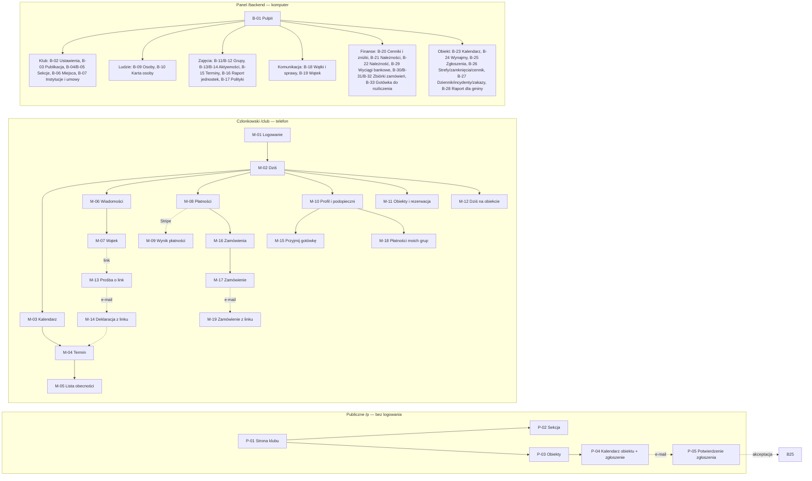

# Vereino — wstępna koncepcja UX

**Wersja:** 0.1 · **Data:** 2026-10-20 · **Status:** koncepcja do dyskusji (nie jest specyfikacją implementacyjną)

**Źródło prawdy:** [`.ai/specs/2026-10-20-vereino-club-management.md`](../../.ai/specs/2026-10-20-vereino-club-management.md) (Draft). Ten dokument przekłada specyfikację na ludzi, ścieżki i ekrany. Trasy, endpointy, statusy i reguły biznesowe są przepisane ze specyfikacji; jeśli się różnią, wygrywa specyfikacja. Identyfikatory wymagań (`REQ-…`), podróży (`J-…`) i decyzji (`DD-…`) odnoszą się do niej.

**Mockupy:** [`mockups/index.html`](mockups/index.html) — otwórz plik w przeglądarce (bez serwera). Źródło: `mockups/app.ts` + `mockups/styles.css`; `mockups/app.js` jest wygenerowany poleceniem `node docs/ux-concept/mockups/build.mjs`.

Konwencja identyfikatorów ekranów: **M-** interfejs członkowski `/club` (telefon), **B-** panel `/backend` (komputer), **P-** strony publiczne `/p/...` (bez logowania). Ten sam identyfikator jest widoczny na każdym ekranie mockupu.

---

## 1. Użytkownicy systemu i ich potrzeby

Podmiotem jest **mały klub wielosekcyjny** (stowarzyszenie), z akademią piłkarską jako główną sekcją i równorzędnymi sekcjami niepiłkarskimi (basen, zumba, pilates). Jedna osoba ma jeden rekord i jedno konto, a role się sumują (D-005) — np. Wojtek jest trenerem Żaków i koordynatorem akademii.

| Użytkownik | Kim jest (pilot: KS Gwiazda) | Najważniejsze potrzeby | Kluczowe zadania w systemie | Urządzenie / kanał | Ból dziś |
|---|---|---|---|---|---|
| **Opiekun prawny** („Kasia”) | rodzic dwójki dzieci w różnych sekcjach (Jaś — Żaki i basen, Ola — Trampkarze) | wiedzieć dziś, czy są zajęcia; jeden kalendarz wszystkich dzieci; „będzie / nie będzie” jednym dotknięciem; zapłacić bez szukania numeru konta; dowiedzieć się o odwołaniu na czas | Dziś, kalendarz, deklaracja, potwierdzenie deklaracji nastolatka, płatność online, zgody, wiadomość do trenera | telefon; e-mail; link z Messengera | 3–4 grupy na Messengerze, przegapione odwołania, płatność „jak sobie przypomni” |
| **Uczestnik 13+** („Ola”, 14 lat) | zawodniczka z własnym kontem o ograniczonym widoku | sprawdzić grafik bez pytania rodzica; zgłosić się na mecz | Dziś, kalendarz, deklaracja (wg polityki), wiadomości grupy — bez płatności (płaci opiekun) | telefon | grafik zna od rodzica |
| **Uczestnik dorosły** | uczestniczka zumby lub pilatesu | grafik, odwołania, składka | jak opiekun, ale za siebie | telefon | ogłoszenia w grupie |
| **Trener / instruktor** („Wojtek”, „Piotr”, „Anna”) | prowadzi 1–3 grupy, często na zleceniu; rozliczany „podstawa + jednostki” | wiedzieć, kto przyjdzie; obecność w 30 s; zastępstwo bez sporu o pieniądze; jeden komunikat do grupy; zarezerwować boisko na turniej bez dzwonienia | lista obecności, zamknięcie terminu, zgłoszenie nieobecności, odwołanie, komunikat + tekst na grupę, kalendarz obiektów i rezerwacja, turniej, podgląd własnych jednostek | telefon | ankiety giną w czacie; zastępstwa i rezerwacje telefonicznie |
| **Koordynator sekcji** („Wojtek” — akademia, „Aneta” — basen) | odpowiada za grupy, grafik i trenerów jednej lub kilku sekcji | grafik bez kolizji; widzieć terminy bez trenera; szybko wskazać zastępcę; komunikat do całej sekcji; rejestr trudnych spraw; prowadzić stronę sekcji | grupy i składy, kreator aktywności, terminy „do obsadzenia” i „nierozliczone”, zastępstwa, raport jednostek sekcji, sprawy, treści publiczne sekcji | komputer + telefon | grafik w głowie i w Excelu; zastępstwa przez telefon |
| **Administrator klubu** („Aneta”, może też pełnić funkcję skarbnika) | prowadzi klub po godzinach: osoby, role, pieniądze, obiekt | wiedzieć, kto zalega, bez Excela; naliczanie i zniżki automatycznie; rozliczenie trenerów i raport dla gminy jednym kliknięciem; decydować o zgłoszeniach zewnętrznych; kontrolować, co klub publikuje | kartoteka osób i rodzin, konta, role, cenniki, zniżki, należności, księgowanie wpłat, akceptacja zgłoszeń, strefy i stawki, raporty, konfiguracja publikacji | komputer | upomnienia ręcznie; jednostki trenerów i godziny orlika z pamięci |
| **Skarbnik** („Beata”) | odpowiada tylko za pieniądze klubu | wiedzieć, kto zalega i u kogo jest gotówka; rozliczyć wyciąg i gotówkę od trenerów bez Excela | należności, wyciągi, gotówka, zbiórki zamówień, rozliczenia z trenerami — bez kartoteki osób, grup i obiektów | komputer | gotówka od trenerów „na słowo”, zeszyt wpłat |
| **Animator obiektu** („Tomek”) | otwiera i zamyka Orlik, pilnuje regulaminu | wiedzieć, kto dziś jest na obiekcie; wpisać rezerwację po telefonie; prowadzić dziennik i zgłosić incydent | Dziś na obiekcie, dziennik, incydent, wynajem po telefonie, `no_show` | telefon na obiekcie | zeszyt, telefon do klubu |
| **Gość — rodzic szukający zajęć** | ktoś spoza klubu | zobaczyć, jakie sekcje i zajęcia są, dla kogo, kiedy, za ile, kto prowadzi; z kim się kontaktować | strona klubu, strona sekcji, materiały | telefon / komputer | brak jednej informacji o klubie |
| **Najemca z zewnątrz** (inny klub, szkoła, firma) | chce wynająć Orlik lub salkę | zobaczyć wolne terminy; złożyć zgłoszenie bez telefonu; wiedzieć, czy zostało przyjęte | publiczny kalendarz obiektów, zgłoszenie, potwierdzenie e-mailem, e-mail z decyzją | komputer / telefon | dzwoni do klubu, nie widzi wolnych godzin |
| **Administrator techniczny** | osoba instalująca instancję | uruchomić klub, moduły i konfigurację | wbudowane strony Open Mercato | komputer | — |
| **Gmina (właściciel obiektu)** | bez konta | rzetelny raport z wykorzystania Orlika | odbiera raport CSV/PDF od administratora | e-mail | raport składany ręcznie |

---

## 2. Najważniejsze use case'y i przepływy

### 2.1 Katalog use case'ów

| ID | Aktor | Cel | Priorytet | Wymagania | Faza |
|---|---|---|---|---|---|
| UC-01 | Administrator | Zbudować strukturę klubu: sekcje z koordynatorami, miejsca, instytucje | Must | REQ-003 | 1 |
| UC-02 | Administrator | Założyć rodzinę: opiekun, dzieci, opieka, zgody, konta | Must | REQ-001, REQ-002 | 1 |
| UC-03 | Opiekun | Sprawdzić „Dziś” i zadeklarować obecność dzieci z różnych sekcji | Must | REQ-006, REQ-007 | 2 |
| UC-04 | Opiekun | Potwierdzić lub odrzucić deklarację nastolatka na mecz | Must | REQ-007 | 2 |
| UC-05 | Trener | Odhaczyć obecność i zamknąć termin | Must | REQ-007, REQ-008 | 2 |
| UC-06 | Trener + koordynator | Zgłosić nieobecność i obsadzić zastępstwo | Must | REQ-008 | 2 |
| UC-07 | Koordynator | Utworzyć cykliczną aktywność bez kolizji | Must | REQ-005 | 2 |
| UC-08 | Trener | Odwołać termin i powiadomić rodziców (z tekstem na grupę) | Must | REQ-005, REQ-009 | 2–3 |
| UC-09 | Trener / instruktor | Zarezerwować obiekt na turniej lub szkolenie bez akceptacji | Must | REQ-023, REQ-027 | 2, 5 |
| UC-10 | Najemca z zewnątrz | Zgłosić rezerwację online i dostać decyzję | Must | REQ-024 | 5 |
| UC-11 | Administrator | Zaakceptować lub odrzucić zgłoszenie zewnętrzne | Must | REQ-024 | 5 |
| UC-12 | Animator | Wpisać wynajem po telefonie, prowadzić dziennik, zgłosić incydent | Must / Should | REQ-013, REQ-016 | 5 |
| UC-13 | Skarbnik | Naliczyć składki okresu i ściągnąć zaległości | Must | REQ-011 | 4 |
| UC-14 | Opiekun | Zapłacić należności online | Must | REQ-012 | 4 |
| UC-15 | Skarbnik | Rozliczyć trenerów (raport jednostek + CSV) | Must / Should | REQ-008, REQ-021 | 2 |
| UC-16 | Koordynator / rodzic | Prowadzić rozmowę w wątku i oznaczyć sprawę | Must | REQ-009, REQ-010 | 3 |
| UC-17 | Opiekun bez logowania | Zadeklarować obecność z osobistego linku | Should | REQ-017 | 3 |
| UC-18 | Gość | Poznać klub, sekcje i zajęcia | Must | REQ-025, REQ-026 | 1–4 |
| UC-19 | Administrator | Skonfigurować, co klub publikuje | Must | REQ-025 | 1 |
| UC-20 | Administrator | Wygenerować raport dla gminy | Must | REQ-015 | 5 |
| UC-21 | Administrator | Utworzyć formularz zamówień (np. stroje) i wysłać link na grupę w Messengerze | Must | REQ-032 | 4 |
| UC-22 | Opiekun | Zamówić strój dla dziecka (w aplikacji lub z osobistego linku) i zapłacić | Must | REQ-032 | 4 |
| UC-23 | Trener + skarbnik | Sprawdzić płatności swojej grupy (składki i stroje), przyjąć gotówkę, wydać strój, rozliczyć gotówkę od trenera | Must | REQ-033, REQ-034 | 4 |

### 2.2 Kompletne przepływy

Każdy przepływ: warunki wstępne → ścieżka główna (z ekranami) → odgałęzienia i błędy → wynik. Wszystkie odgałęzienia są przewidziane w mockupach przez przełącznik stanu lub dane testowe.

#### F-01 Rodzina na start (UC-01, UC-02)
- **Warunki:** administrator zalogowany; klub ma ustawienia.
- **Ścieżka:** B-01 Pulpit → B-04 Sekcje → „Dodaj sekcję” (B-05: nazwa, koordynator) → B-09 Osoby → „Dodaj osobę” (Kasia, e-mail) → zapisz → B-10 Karta osoby → zakładka „Opieka” → „Dodaj podopiecznego” (Jaś, data urodzenia; Ola) → zaznacz „główny płatnik”, zgody → zakładka „Konto” → „Załóż konto” → komunikat „Wysłano e-mail z ustawieniem hasła”.
- **Odgałęzienia:** e-mail zajęty → błąd przy polu (409); dla Jasia (9 lat) przycisk „Załóż konto” nieaktywny z wyjaśnieniem „poniżej progu wieku konta (13)”; drugi „główny płatnik” → 409 „Podopieczny ma już głównego płatnika”; nieaktualna wersja karty → okno konfliktu „Ktoś zmienił ten rekord” (odśwież / nadpisz niedostępne); brak uprawnień → strona „Brak uprawnień”.
- **Wynik:** Kasia loguje się (M-01) i na M-02 widzi profile dzieci.

#### F-02 Dziś i deklaracja obecności (UC-03, UC-04)
- **Warunki:** Kasia z kontem; terminy wygenerowane.
- **Ścieżka:** M-01 Logowanie → M-02 Dziś: kafel Kalendarz („Wt 17:00 Jaś — Trening Żaki, Boisko piłkarskie”, „Czw 16:00 Jaś — Zajęcia, Basen”) → „Będzie” przy terminie Jasia → przycisk zmienia się na „Będzie ✓”, ogłoszenie dla czytnika ekranu. Kafel Obecność: „Ola zgłosiła się na mecz w sobotę — potwierdzasz?” → M-04 Termin → „Potwierdź” → status „Potwierdzone”.
- **Odgałęzienia:** termin już się zaczął → „Deklaracje zamknięte” (409), przyciski nieaktywne; brak decyzji opiekuna w 24 h → wartość domyślna polityki, kafel znika; brak zajęć dziś → stan pusty z najbliższym terminem; błąd sieci → komunikat i „Spróbuj ponownie” (deklaracja nie jest tracona).
- **Wynik:** trener na M-05 widzi deklaracje.

#### F-03 Trening: obecność, zastępstwo, rozliczenie (UC-05, UC-06, UC-15)
- **Warunki:** Wojtek trenerem Żaków; Piotr trenerem Trampkarzy.
- **Ścieżka A (zastępstwo):** Wojtek → M-02 → termin piątkowy → M-04 → „Zgłoś nieobecność” (powód) → termin trafia do „Do obsadzenia”. Koordynator → B-01 widżet „Terminy do obsadzenia” → B-15 (perspektywa „Do obsadzenia”) → „Wskaż zastępcę” → wybór Piotra (lista pokazuje kolizje trenera) → zapis → powiadomienie u Piotra.
- **Ścieżka B (obecność):** Piotr → M-02 → termin → M-05 Lista obecności: zadeklarowani 11/2/3, przełączniki obecny/nieobecny/spóźniony → „Zamknij termin” (potwierdzenie) → termin `done`.
- **Ścieżka C (rozliczenie):** skarbnik → B-16 Raport jednostek → miesiąc → Wojtek: oddane 1, Piotr: przejęte 1 → „Eksport CSV”.
- **Odgałęzienia:** dwie osoby odhaczają naraz → drugi zapis 409, okno konfliktu, lista odświeżona bez utraty zaznaczeń; trener spoza grupy → 403; termin nierozliczony 24 h po końcu → B-15 „Nierozliczone” i widżet.

#### F-04 Nowa aktywność cykliczna (UC-07)
- **Ścieżka:** B-13 Aktywności → „Nowa aktywność” → B-14 kreator: sekcja/grupa, typ (dla `class_group` niedostępne mecz/sparing/turniej), nazwa, miejsce, trener, dni tygodnia, godziny, okres → podgląd pierwszych terminów i kolizji → „Utwórz” → lista terminów w B-15.
- **Odgałęzienia:** kolizja na miejscu (np. wtorek 17:00 Boisko piłkarskie z Żakami) → lista kolizji, przycisk „Utwórz” zablokowany do zmiany godzin/miejsca; godzina końca ≤ początku → błąd pola; okres bez żadnego terminu → „Reguła nie daje żadnego terminu”.

#### F-05 Odwołanie i komunikat (UC-08, UC-16)
- **Ścieżka:** trener → M-05 → „Odwołaj termin” → powód → potwierdzenie → adresaci dostają powiadomienie i e-mail → M-07 wątek terminu → „Skopiuj tekst na grupę” → tekst ze skrótem i linkiem w schowku.
- **Sprawa:** rodzic pisze w wątku grupy (M-07) → koordynator w B-19 → „Oznacz jako sprawę” (ostrzeżenie: nieodwracalne) → wątek z etykietą „Sprawa”, przycisk „Usuń” wiadomości znika; próba przez API → 409.

#### F-06 Deklaracja z linku bez logowania (UC-17)
- **Ścieżka:** rodzic klika link z Messengera → M-13 „Termin: Trening Żaki, wt 17:00 — aby zadeklarować, podaj e-mail” → „Wyślij mi link” → zawsze „Jeśli adres jest w klubie, wysłaliśmy link” → e-mail → M-14 z listą swoich dzieci w tej grupie → „Będzie”.
- **Odgałęzienia:** link wygasły (410) → „Link wygasł, poproś o nowy”; po rozpoczęciu terminu → „Deklaracje zamknięte”.

#### F-07 Składki: naliczenie, zaległości, płatność (UC-13, UC-14)
- **Ścieżka skarbnika:** B-20 Cenniki (Żaki 150 zł, Basen 120 zł, Trampkarze 160 zł; zniżka rodzeństwo −30%) → B-21 Należności → „Nalicz okres 2026-12” → podsumowanie „utworzono 12, pominięto 0, bez płatnika 1” (w pilocie: ok. 140) → perspektywa „Zaległości” → B-22 należność → „Zaksięguj wpłatę” (gotówka 100 zł) → status „częściowo opłacona”.
- **Ścieżka opiekuna:** M-02 kafel Płatności „349 zł do 10.11” → M-08 lista należności (Ola 160, Jaś Żaki 105 — zniżka, Jaś Basen 84 — zniżka) → zaznacz → „Zapłać 349 zł” → strona Stripe (mock) → powrót M-09 „Płatność przyjęta” → statusy „Opłacona”.
- **Odgałęzienia:** płatność anulowana → „Płatność przerwana — należności nadal otwarte”; webhook spóźniony → „Płatność w toku, odśwież za chwilę”; nadpłata przy księgowaniu → błąd pola „Kwota przekracza pozostałe 50 zł”; należność bez płatnika → nie da się zapłacić online, widoczna w widżecie administratora.

#### F-08 Trener rezerwuje boisko na turniej (UC-09) — J-006
- **Ścieżka:** Wojtek → M-11 Obiekty → „Boisko piłkarskie” → sobota → oś dnia ze strefami i zajętością → zaznacza 9:00–12:00 → „Rezerwuj” → okno: „Dla grupy” (Żaki lub Trampkarze) / „Cel ogólny”, typ „Turniej”, zaproszone drużyny → „Rezerwuj” → slot „Turniej o Puchar Gwiazdy” na osi; zgłoszenie zewnętrzne czekające na ten czas oznaczone „przebite” (e-mail do zgłaszającego).
- **Wariant:** instruktorka zumby rezerwuje „Salkę szkoleniową” na „Szkolenie instruktorów” (cel ogólny).
- **Odgałęzienia:** slot zajęty → 409 z listą kolizji (personel widzi nazwy); poza godzinami otwarcia lub w zamknięciu → „Obiekt zamknięty w tym czasie”; grupa spoza własnych → 403; `tournament` dla grupy zajęciowej → niedostępne w polu typu.

#### F-09 Zgłoszenie z zewnątrz i decyzja administratora (UC-10, UC-11) — J-007
- **Ścieżka najemcy:** P-01 strona klubu → „Obiekty” → P-03 → Orlik — Boisko piłkarskie → P-04 kalendarz miesiąca → slot „do rezerwacji” → „Zgłoś rezerwację” → formularz (organizacja, kontakt, e-mail, telefon, kategoria, jednostki, cel, regulamin ✓) → „Wyślij” → „Sprawdź skrzynkę i potwierdź zgłoszenie” → link → P-05 „Zgłoszenie czeka na akceptację administratora (do 48 h)”. Slot publicznie: „zgłoszone — oczekuje”.
- **Ścieżka administratora:** powiadomienie → B-01 widżet „Zgłoszenia do akceptacji” → B-25 kolejka → szczegóły (kolizje: brak; rejestr zakazów: brak; wygasa za 47 h) → „Akceptuj” (przypisz instytucję lub utwórz nową) → wynajem `requested` + należność na konto gminy → e-mail do najemcy z kwotą i kontem. P-04 pokazuje „zarezerwowane”.
- **Odgałęzienia:** drugie zgłoszenie na ten sam slot → „Ten termin jest już zgłoszony — wybierz inny”; brak akceptacji regulaminu → błąd pola; zgłoszenia wyłączone w konfiguracji → brak przycisku; „Odrzuć” wymaga powodu → e-mail; 48 h bez decyzji → „wygasło”; rezerwacja klubu → „przebite”; link po 1 h → „Link wygasł”.

#### F-10 Animator na obiekcie (UC-12)
- **Ścieżka:** M-12 Dziś na obiekcie → „Otwórz obiekt” → dziennik: stan przed, godzina → lista dzisiejszych grup i wynajmów (obecność pełnoletniego opiekuna ✓) → „Zgłoś incydent” (rodzaj, opis, działanie, zdjęcie) → „Zamknij obiekt” (stan po).
- **Wynajem po telefonie:** B-23 kalendarz obiektu → slot „do rezerwacji” → „Nowy wynajem” → najemca (wyszukiwarka instytucji), kategoria, jednostki → wyliczona kwota i terminy → „Zapisz”.
- **Odgałęzienia:** najemca z aktywnym zakazem → 409 „Najemca ma zakaz wstępu do 31.12”; `no_show` po czasie → status i należność pozostaje.

#### F-11 Gość poznaje klub; administrator konfiguruje publikację (UC-18, UC-19) — J-008
- **Ścieżka gościa:** P-01 → kafel „Basen” → P-02: opis, grupy (wiek, dni, godziny, miejsce), warunki, składka, prowadząca (za zgodą), materiały, kontakt.
- **Ścieżka administratora:** B-03 Publikacja → wyłącza „Ceny” → zapis → P-02 bez bloku cen (API go nie zwraca). B-05 sekcja → zakładka „Strona publiczna” → opis, warunki, kontakt, materiały, „Sekcja publiczna” ✓.
- **Odgałęzienia:** strona wyłączona → P-01 „Klub nie publikuje strony”; sekcja niepubliczna → 404; prowadzący bez zgody → „Prowadzący sekcji”.

#### F-12 Raport dla gminy (UC-20)
- **Ścieżka:** B-28 → obiekt, okres → godziny w strefach (w tym czas klubu: terminy + rezerwacje wewnętrzne), wynajmy (liczba, wartość), wpłaty na konto gminy, incydenty, konserwacja → „Eksport CSV”.

#### F-13 Zamówienie strojów i rozliczenie (UC-21, UC-22, UC-23)
- **Ścieżka administratora:** B-30 Zbiórki zamówień → „Nowy formularz” (B-31) → „Wczytaj szablon” (koszulka, spodenki, getry, komplet 120 zł, dres 180/200 zł, ortalion, czapka, bidon) → grupy Akademii, zamówienia do 20.11, płatność do 04.12, imię i numer do nadruku → „Zapisz i otwórz zbieranie” → tekst z linkiem w schowku → wklejenie na grupę w Messengerze.
- **Ścieżka opiekuna:** link → M-17 (zalogowana: dzieci z grup zbiórki; bez konta: e-mail → osobisty link → M-19) → komplet z rozmiarami, dres, nadruk „JAŚ 8” → suma na żywo → „Złóż zamówienie” → kopia e-mailem, należność w M-08 → „Zapłać online”, przelew z kodem płatnika albo gotówka u trenera.
- **Ścieżka trenera (telefon):** M-02 kafel „Płatności moich grup” → M-18: dzieci grupy ze składkami i strojami do zapłaty → „Przyjmij gotówkę” (KP, e-mail do rodzica) → „Gotówka u Ciebie” → „Przypomnij opiekunom”; po dostawie „Wydaj strój”.
- **Ścieżka skarbnika (Beata lub Aneta):** B-33 Gotówka do rozliczenia → „Przyjmij rozliczenie” (RG/2026/11/001); B-32 → „Zamknij zamówienia” → Zestawienie dla dostawcy (sztuki per produkt i rozmiar, nadruki, CSV) → „Zamówione u dostawcy” → „Dostarczone” (e-mail „do odbioru u trenera”) → „Zakończ zbiórkę”.
- **Odgałęzienia:** komplet bez rozmiaru getrów → błąd przy polu; numer zajęty w grupie → błąd z imieniem dziecka, które go ma; zmiana poniżej wpłaconej kwoty lub anulowanie opłaconego → 409; po terminie formularz zamknięty; wydanie przed dostawą → 409; wydanie nieopłaconego → ostrzeżenie i potwierdzenie; uczestniczka 14 lat → brak zamówień.

#### F-14 Płatności grupy u trenera i rozliczenie gotówki (UC-23)
- **Ścieżka administratora:** B-20 → „Trenerzy a płatności”: składki i zamówienia z gotówką (domyślnie) / składki tylko do podglądu / tylko zamówienia.
- **Ścieżka trenera (telefon):** M-02 kafel „Płatności moich grup: 5 osób ma należności, w tym 3 po terminie; gotówka u Ciebie 300 zł” → M-18 → chip „Orlik młodszy”, filtr „Do zapłaty” → Bartek: składka październikowa (po terminie), listopadowa i strój → „Przyjmij gotówkę”: zaznaczone składka 10/2026 i strój, 235 zł → jeden KP, e-mail do mamy → „Gotówka u Ciebie: 535 zł”; Adam: „Przypomnij” → e-mail do taty z listą zaległości.
- **Ścieżka skarbnika:** B-01 pulpit tylko z finansami → B-33 → Wojtek Malinowski 535 zł (3 wpłaty) → „Przyjmij rozliczenie” → RG/2026/11/001.
- **Odgałęzienia:** dziecko bez płatnika → widoczne, bez przyjmowania gotówki („sprawa skarbnika”); ustawienie „tylko podgląd” → brak „Przyjmij gotówkę” przy składkach; trener nie widzi składek innych sekcji ani powodów zniżek; kwota większa niż zaznaczone należności → 422.

---

## 3. Mapa ekranów i nawigacji

### 3.1 Nawigacja

| Powłoka | Struktura | Kto widzi |
|---|---|---|
| **Członkowska `/club`** | dolny pasek: **Dziś · Kalendarz · Wiadomości · Płatności · Więcej** (Więcej: Profil, Obiekty, Dziś na obiekcie, Zamówienia, Płatności moich grup, Przyjmij gotówkę, Wyloguj); w nagłówku przełącznik dziecka (opiekun) i kontekstu roli („jako opiekun / jako trener”) — tylko gdy osoba ma więcej niż jedną rolę | pozycje filtrowane funkcjami ACL: Płatności — `payments.view_own` (tylko osoby pełnoletnie: opiekun, dorosły uczestnik; niepełnoletni uczestnik nie ma tej pozycji); Obiekty — `facilities.view`; Dziś na obiekcie — `facilities.log.write` |
| **Panel `/backend`** | menu boczne w grupach: **Pulpit · Klub** (Sekcje, Miejsca, Instytucje, Umowy, Ustawienia, Publikacja) **· Ludzie** (Osoby) **· Zajęcia** (Grupy, Aktywności, Terminy, Raport jednostek, Polityki deklaracji) **· Komunikacja** (Wątki, Sprawy) **· Finanse** (Cenniki i zniżki, Należności, Wyciągi bankowe, Zbiórki zamówień, Gotówka do rozliczenia) **· Obiekt** (Kalendarz, Wynajmy, Zgłoszenia, Strefy i cennik, Dziennik i incydenty, Raport dla gminy) | grupy i pozycje według `requireFeatures` stron; koordynator nie widzi Finansów; animator widzi tylko Obiekt |
| **Publiczna `/p/[klub]`** | nagłówek: **Klub · Sekcje · Obiekty**; stopka: kontakt, regulamin, polityka prywatności (`/privacy` modułu `content`) | wszyscy; bloki według konfiguracji publikacji |

### 3.2 Indeks tras

| ID | Trasa | Nazwa | Role (funkcja) | Faza |
|---|---|---|---|---|
| M-01 | `/login` (moduł `auth`) | Logowanie | wszyscy z kontem | 1 |
| M-02 | `/club` | Dziś | `people.self` | 1–5 |
| M-03 | `/club/calendar` | Kalendarz | `people.self` | 2 |
| M-04 | `/club/occurrences/[id]` | Termin | uczestnik, opiekun, trener | 2 |
| M-05 | `/club/occurrences/[id]/attendance` | Lista obecności | `activities.coach` | 2 |
| M-06 | `/club/messages` | Wiadomości | `communication.view` | 3 |
| M-07 | `/club/messages/[threadId]` | Wątek | uczestnik wątku | 3 |
| M-08 | `/club/payments` | Płatności | `payments.view_own` (tylko pełnoletni) | 4 |
| M-09 | `/club/payments/return` | Wynik płatności | `payments.pay_online` | 4 |
| M-10 | `/club/profile`, `/club/wards/[personId]` | Profil i podopieczni | `people.self` | 1 |
| M-11 | `/club/places`, `/club/places/[placeId]` | Obiekty i rezerwacja | `facilities.view` + `facilities.bookings.create` | 5 (turniej z poziomu grupy — 2) |
| M-12 | `/club/facility` | Dziś na obiekcie | `facilities.log.write` | 5 |
| M-13 | `/club/link` | Prośba o link | bez logowania | 3 |
| M-14 | `/club/d/[token]` | Deklaracja z linku | token | 3 |
| M-15 | `/club/cash` | Przyjmij gotówkę | `payments.cash.record` | 4 |
| M-16 | `/club/orders` | Zamówienia | `payments.orders.place` | 4 |
| M-17 | `/club/orders/[campaignId]` | Zamówienie (formularz i podsumowanie) | `payments.orders.place`; bez sesji — wejście z logowaniem lub prośbą o link | 4 |
| M-18 | `/club/coach/payments` | Płatności moich grup | `payments.groups.view` (+ `payments.groups.collect`) | 4 |
| M-19 | `/club/o/[token]` | Zamówienie z linku | token | 4 |
| B-01 | `/backend` | Pulpit | personel | 1–5 |
| B-02 | `/backend/club/settings` | Ustawienia klubu | `club_core.manage` | 1 |
| B-03 | `/backend/club/publication` | Publikacja | `club_core.publication.manage` | 1 |
| B-04 / B-05 | `/backend/club/sections`, `…/[id]/edit` | Sekcje | `club_core.view` / `club_core.manage` | 1 |
| B-06 | `/backend/club/places` | Miejsca | `club_core.manage` | 1 |
| B-07 | `/backend/club/institutions`, `/backend/club/contracts` | Instytucje i umowy | `club_core.manage`, `club_core.contracts.manage` | 1–2 |
| B-09 / B-10 | `/backend/people/persons`, `…/[id]` | Osoby, karta osoby | `people.view` / `people.manage` | 1 |
| B-11 / B-12 | `/backend/groups/groups`, `…/[id]` | Grupy | `groups.view` / `groups.manage` | 2 |
| B-13 / B-14 | `/backend/activities/activities`, `…/create` | Aktywności, kreator | `activities.manage` | 2 |
| B-15 | `/backend/activities/occurrences` | Terminy | `activities.view` | 2 |
| B-16 | `/backend/activities/reports/coach-units` | Raport jednostek | `activities.reports.view` | 2 |
| B-17 | `/backend/activities/policies` | Polityki deklaracji | `activities.manage` | 2 |
| B-18 / B-19 | `/backend/communication/threads`, `…/[id]` | Wątki i sprawy | `communication.view` | 3 |
| B-20 | `/backend/payments/fees` | Cenniki i zniżki | `payments.manage` | 4 |
| B-21 / B-22 | `/backend/payments/charges`, `…/[id]` | Należności | `payments.view` / `payments.manage` | 4 |
| B-29 | `/backend/payments/bank` | Wyciągi bankowe | `payments.bank.import` | 4 |
| B-30 | `/backend/payments/orders` | Zbiórki zamówień | `payments.orders.manage` | 4 |
| B-31 | `/backend/payments/orders/create`, `…/[id]/edit` | Kreator formularza zamówień | `payments.orders.manage` | 4 |
| B-32 | `/backend/payments/orders/[id]` | Zbiórka: zamówienia, zestawienie, etapy | `payments.orders.manage` | 4 |
| B-33 | `/backend/payments/cash-custody` | Gotówka do rozliczenia | `payments.cash.settle` (skarbnik, administrator) | 4 |
| B-23 | `/backend/facilities/calendar` | Kalendarz obiektu | `facilities.view` | 5 |
| B-24 | `/backend/facilities/rentals` | Wynajmy | `facilities.rentals.manage` | 5 |
| B-25 | `/backend/facilities/requests` | Zgłoszenia do akceptacji | `facilities.rentals.approve` | 5 |
| B-26 | `/backend/facilities/zones` (+ `/closures`, `/rates`) | Strefy, zamknięcia, cennik | `facilities.manage` | 5 |
| B-27 | `/backend/facilities/logs` (+ `/incidents`, `/bans`) | Dziennik, incydenty, zakazy | `facilities.log.write` / `facilities.incidents.manage` | 5 |
| B-28 | `/backend/facilities/reports/owner` | Raport dla gminy | `facilities.reports.view` | 5 |
| P-01 | `/p/[clubSlug]` | Strona klubu | publiczna | 1 |
| P-02 | `/p/[clubSlug]/sections/[sectionSlug]` | Strona sekcji | publiczna | 1–4 |
| P-03 | `/p/[clubSlug]/places` | Obiekty klubu | publiczna | 5 |
| P-04 | `/p/[clubSlug]/places/[placeSlug]` | Kalendarz obiektu + zgłoszenie | publiczna | 5 |
| P-05 | `/p/[clubSlug]/requests/verify/[token]` | Potwierdzenie zgłoszenia | token | 5 |

---

## 4. Specyfikacja ekranów

Wspólne zasady (dotyczą każdego ekranu, nie są powtarzane):

- **Komponenty:** panel — `Page`, `PageBody`, `DataTable` (filtry, wyszukiwanie, perspektywy, eksport, `RowActions`), `CrudForm` (grupy pól, `updatedAt` → 409), `StatusBadge`, `EmptyState`, `LoadingMessage`, `ErrorMessage`, `useConfirmDialog`, okna z Ctrl/Cmd+Enter i Escape; odwołania do innych rekordów zawsze jako selektor z trasą źródła opcji, nigdy UUID. Strony członkowskie i publiczne — te same prymitywy design systemu w układzie mobilnym.
- **Stany:** **loading** — szkielet (skeleton) w miejscu treści, akcje nieaktywne; **empty** — wyjaśnienie + następna akcja; **error** — komunikat bez szczegółów technicznych + „Spróbuj ponownie”, dane formularza zachowane; **success** — toast lub zmiana statusu w miejscu; **conflict (409)** — wspólne okno „Rekord zmienił się w międzyczasie”; **403** — „Brak uprawnień”.
- **Walidacje:** po stronie klienta dla wygody, po stronie serwera (Zod w trasie) jako źródło prawdy; błąd serwera trafia do pola przez wspólny adapter błędów.
- **API:** wszystkie wywołania przez `apiCall`/`apiCallOrThrow`; zakres klubu z sesji.

### Interfejs członkowski (telefon)

#### M-01 Logowanie — `/login`
- **Cel:** wejście do aplikacji jednym kontem dla wszystkich ról (Q-001).
- **Funkcje:** e-mail + hasło, „Nie pamiętam hasła” (`/reset`), zapamiętanie urządzenia.
- **Komponenty:** zainstalowana strona `auth`; po zalogowaniu przekierowanie do `/club` (personel bez roli członka → `/backend`).
- **Stany:** loading — przycisk z wskaźnikiem; error — „Nieprawidłowy e-mail lub hasło” (bez rozróżnienia); success — przekierowanie.
- **Walidacje:** e-mail wymagany i poprawny; hasło wymagane.
- **API:** logowanie modułu `auth` (zainstalowane); `GET /api/people/me` po zalogowaniu.

#### M-02 Dziś — `/club`
- **Cel:** w 5 sekund wiedzieć, co dziś i jutro dzieje się u mnie i moich dzieci, i zareagować.
- **Funkcje:** kafel **Kalendarz** (terminy dziś/jutro wszystkich podopiecznych i własne, z sekcją i miejscem; „Będzie / Nie będzie” w miejscu); kafel **Obecność** (decyzje `pending_guardian` do podjęcia; dla trenera — „Moje terminy dziś” z wejściem w listę); kafel **Wiadomości** (nieprzeczytane); kafel **Płatności** (suma otwartych należności, najbliższy termin, „Zapłać”) — tylko dla osób pełnoletnich; uczestnik niepełnoletni go nie widzi; przełącznik dziecka i kontekstu roli.
- **Komponenty:** nagłówek z powitaniem i przełącznikami; siatka 4 kafli (1 kolumna < 640 px); przyciski segmentowe deklaracji; `StatusBadge` (odwołany, deklaracje zamknięte, czeka na potwierdzenie); dolny pasek nawigacji.
- **Stany:** loading — szkielet kafli; empty — „Dziś nie ma zajęć. Najbliższy termin: czw 16:00 Basen” + link do kalendarza; kafle faz 3–4 nie są renderowane, dopóki moduł nie jest włączony; error — per kafel („Nie udało się wczytać płatności” + ponów), reszta działa; success — przy deklaracji „Zapisano: Jaś będzie”.
- **Walidacje:** deklaracja tylko do `start_at`; podopieczny z polityką `guardian_only` — przyciski tylko u opiekuna.
- **API:** `GET /api/people/me`; `GET /api/activities/calendar?as=self&from&to`; `POST /api/activities/attendance/declare`; `GET /api/communication/threads?unread=1` (f3); `GET /api/payments/my-charges?status=open` (f4).

#### M-03 Kalendarz — `/club/calendar`
- **Cel:** jeden kalendarz wszystkich dzieci ze wszystkich sekcji (REQ-006).
- **Funkcje:** widok tygodnia (domyślnie) / listy miesiąca; filtr osoby (wszyscy / Jaś / Ola / ja); legenda sekcji; status deklaracji przy każdym terminie; przejście do M-04.
- **Komponenty:** przełącznik tydzień/miesiąc, lista dni z kartami terminów (godzina, aktywność, grupa, sekcja, miejsce, osoba, status), rodzina komponentów harmonogramu (V-8).
- **Stany:** loading — szkielet dni; empty — „Brak terminów w tym tygodniu” + „Następny tydzień”; error — komunikat + ponów; success — n/d.
- **Walidacje:** zakres ≤ 62 dni (400 z serwera → przycięcie zakresu w UI).
- **API:** `GET /api/activities/calendar?as=guardian|self|coach&from&to&personId`.

#### M-04 Termin — `/club/occurrences/[id]`
- **Cel:** szczegóły jednego terminu i decyzje dotyczące obecności.
- **Funkcje:** data, godziny, miejsce (z adresem i mapą — Could), trener (z oznaczeniem zastępstwa), status; dla każdego mojego podopiecznego „Będzie / Nie będzie”; decyzja opiekuna przy `pending_guardian` (Potwierdź / Odrzuć); dla meczu — przeciwnik, wyjazd; dla trenera — przyciski „Lista obecności”, „Zgłoś nieobecność”, „Odwołaj”, „Napisz do grupy”; dyżur rodzica — „Zgłoś się na dyżur” (Could).
- **Komponenty:** nagłówek terminu, `StatusBadge`, lista osób z przyciskami segmentowymi, okna z powodem (nieobecność, odwołanie) z `useConfirmDialog`.
- **Stany:** loading — szkielet; empty — n/d (404 → „Termin nie istnieje lub nie masz do niego dostępu”); error — ponów; success — toasty „Zapisano deklarację”, „Zgłoszono nieobecność — koordynator dostał powiadomienie”, „Termin odwołany — wysłano powiadomienia”.
- **Walidacje:** deklaracja przed `start_at` (inaczej 409 `declaration_closed`); powód odwołania wymagany (3–200 znaków); powód nieobecności opcjonalny.
- **API:** `GET /api/activities/occurrences/{id}`; `POST /api/activities/attendance/declare`; `POST /api/activities/attendance/{id}/guardian-decision`; `POST /api/activities/occurrences/{id}/absence`; `POST /api/activities/occurrences/{id}/cancel`.

#### M-05 Lista obecności — `/club/occurrences/[id]/attendance`
- **Cel:** odhaczyć obecność w 30 sekund i zamknąć termin (REQ-007, REQ-008).
- **Funkcje:** podsumowanie deklaracji (tak / nie / brak); lista członków grupy w dniu terminu ∪ osoby z deklaracją; dla każdego: obecny / nieobecny / spóźniony; „Wszyscy zadeklarowani obecni” (szybkie wypełnienie); „Zamknij termin”.
- **Komponenty:** lista z przełącznikami (duże pola dotyku), licznik, pasek akcji na dole, `useConfirmDialog` przy zamknięciu, okno konfliktu.
- **Stany:** loading — szkielet listy; empty — „Grupa nie ma członków w dniu terminu” (koordynator: link do składu); error — zapis nieudany, zaznaczenia zachowane, ponów; success — „Termin zamknięty — 14 obecnych”, przejście do M-02.
- **Walidacje:** termin nie może być odwołany; zamknięcie przed końcem terminu wymaga potwierdzenia; wersja terminu (409 przy równoczesnej edycji).
- **API:** `GET /api/activities/occurrences/{id}/attendance`; `PUT /api/activities/occurrences/{id}/attendance` (`entries`, `complete`).

#### M-06 Wiadomości — `/club/messages`
- **Cel:** jedno miejsce na komunikaty klubu zamiast grup na Messengerze (REQ-009).
- **Funkcje:** lista wątków (zakres: klub / sekcja / grupa / termin / bezpośredni), nieprzeczytane, etykieta „Sprawa”; filtr po dziecku; trener/koordynator: „Nowy komunikat” (wybór zakresu ze swoich).
- **Komponenty:** lista wątków z ikoną zakresu, licznik nieprzeczytanych, przycisk pływający „Nowy”, okno nowego komunikatu (`CrudForm`).
- **Stany:** loading — szkielet; empty — „Brak wiadomości. Tu pojawią się komunikaty trenerów i klubu”; error — ponów; success — „Wysłano do 18 osób (e-mail + w aplikacji)”.
- **Walidacje:** zakres wymagany i w uprawnieniach autora (403); temat 3–120 znaków; treść 1–5000 znaków.
- **API:** `GET /api/communication/threads`; `POST /api/communication/threads`.

#### M-07 Wątek — `/club/messages/[threadId]`
- **Cel:** przeczytać i odpowiedzieć; trener — udostępnić tekst na grupę.
- **Funkcje:** wiadomości z autorem i rolą; odpowiedź; „Skopiuj tekst na grupę” (skrót + link); status doręczenia e-mail przy adresatach (autor); etykieta „Sprawa — wiadomości nie można usuwać”.
- **Komponenty:** rodzina komponentów wiadomości, pole odpowiedzi, przycisk kopiowania ze schowkiem i potwierdzeniem.
- **Stany:** loading; empty — n/d; error — wysłanie nieudane, treść zachowana; success — „Skopiowano tekst — wklej go na grupę”.
- **Walidacje:** treść odpowiedzi 1–5000 znaków; tylko uczestnicy wątku (403).
- **API:** `GET /api/communication/threads/{id}`; `POST /api/communication/threads/{id}/replies`; `GET /api/communication/share-text?threadId|occurrenceId`.

#### M-08 Płatności — `/club/payments`
- **Cel:** zobaczyć, ile i za co płacę, i zapłacić w dwóch dotknięciach (REQ-012). Ekran istnieje tylko dla osób pełnoletnich (opiekun, dorosły uczestnik); uczestnik poniżej 18 lat dostaje 403, a pozycja nie pojawia się w nawigacji (REQ-002).
- **Funkcje:** lista otwartych należności płatnika (osoba, opis, okres, kwota, zniżka z nazwą reguły, termin); zaznaczenie i „Zapłać X zł” (Stripe); historia opłaconych; informacja o płatności przelewem (numer konta klubu).
- **Komponenty:** `DataTable` w układzie mobilnym (karty), pola wyboru, suma, przycisk główny, `StatusBadge` (otwarta, częściowo opłacona, opłacona, po terminie).
- **Stany:** loading; empty — „Wszystko opłacone” + historia wpłat; error — ponów; success — przejście do Stripe.
- **Walidacje:** co najmniej jedna należność; tylko `open`; należność z `payer_missing` niewybieralna z wyjaśnieniem.
- **API:** `GET /api/payments/my-charges`; `POST /api/payments/checkout` → `{ redirectUrl }`.

#### M-09 Wynik płatności — `/club/payments/return`
- **Cel:** potwierdzić wynik płatności po powrocie ze Stripe.
- **Funkcje:** „Płatność przyjęta” z listą należności; „Płatność w toku” (webhook jeszcze nie dotarł — automatyczne odświeżenie co kilka sekund przez 30 s); „Płatność przerwana” z powrotem do M-08.
- **Komponenty:** komunikat stanu (`Alert`), lista, przycisk powrotu.
- **Stany:** loading — „Sprawdzamy płatność…”; error — „Nie udało się sprawdzić statusu”; success — opłacone.
- **Walidacje:** brak.
- **API:** `GET /api/payments/my-charges` (status należności po webhooku `payment_gateways.payment.captured`).

#### M-10 Profil i podopieczni — `/club/profile`, `/club/wards/[personId]`
- **Cel:** dane kontaktowe, zgody za dzieci, zgoda na publikację nazwiska (trener).
- **Funkcje:** moje dane (telefon, e-mail kontaktowy); lista podopiecznych z grupami i sekcjami; zgody (regulamin, wizerunek, wyjazdy) z datą; trener: „Zgadzam się na publikację imienia i nazwiska na stronie klubu”; zmiana hasła (link do `auth`).
- **Komponenty:** `CrudForm`, przełączniki zgód z datą i autorem.
- **Stany:** loading; empty — „Nie masz podopiecznych” (dla osoby bez dzieci sekcja ukryta); error; success — „Zapisano zgody”; conflict — 409.
- **Walidacje:** telefon w formacie PL/E.164; e-mail; zgody zmienia tylko opiekun (podopieczny widzi tylko do odczytu).
- **API:** `GET /api/people/me`; `PUT /api/people/persons/{id}`; `PUT /api/people/guardianships/{id}`.

#### M-11 Obiekty i rezerwacja — `/club/places`, `/club/places/[placeId]`
- **Cel:** personel każdej sekcji widzi zajętość obiektów i rezerwuje od razu (REQ-023, REQ-027).
- **Funkcje:** lista obiektów klubu (Orlik — boiska, salka, basen) z dzisiejszą zajętością; oś dnia 8–22 ze strefami i wpisami (zajęcia, rezerwacje wewnętrzne, wynajmy, zgłoszenia oczekujące, zamknięcia); wybór dnia; zaznaczenie wolnego przedziału → **Rezerwuj**: „Dla grupy” (wydarzenie: turniej/inne, zaproszone drużyny) albo „Cel ogólny” (opis); anulowanie własnej rezerwacji.
- **Komponenty:** lista kart obiektów, selektor dnia, oś czasu z blokami (legenda tekstowa), okno rezerwacji (`CrudForm`), lista kolizji w błędzie.
- **Stany:** loading — szkielet osi; empty — „Obiekt nie ma reguł stref — skontaktuj się z administratorem”; error — ponów; success — blok pojawia się na osi + „Zarezerwowano: sob 9:00–12:00 Boisko piłkarskie”; conflict — 409 z listą kolizji (z nazwami, bo to personel).
- **Walidacje:** koniec > początek; w godzinach otwarcia; nie w zamknięciu; bez kolizji; grupa z własnego zakresu; `tournament` tylko dla `team`; cel wymagany dla rezerwacji ogólnej (3–120 znaków).
- **API:** `GET /api/facilities/calendar?placeId&from&to`; `POST /api/facilities/internal-bookings`; `DELETE /api/facilities/internal-bookings/{id}`; `POST /api/activities/events`.

#### M-12 Dziś na obiekcie — `/club/facility`
- **Cel:** animator prowadzi dzień na obiekcie z telefonu (REQ-013, REQ-016).
- **Funkcje:** „Otwórz obiekt” (stan przed, godzina); lista dzisiejszych zajęć i wynajmów z polami: liczba osób, pełnoletni opiekun obecny; „Nie stawił się” (`no_show`); „Zgłoś incydent” (rodzaj, opis, działanie, zdjęcie, osoby); „Zamknij obiekt” (stan po, uwagi).
- **Komponenty:** lista kart dnia, okna `CrudForm`, wgrywanie zdjęcia (`attachments`).
- **Stany:** loading; empty — „Dziś na obiekcie nic nie zaplanowano”; error; success — „Obiekt otwarty 15:58”, „Incydent zgłoszony”.
- **Walidacje:** stan przed wymagany przy otwarciu; stan po przy zamknięciu; opis incydentu 10–2000 znaków; `no_show` dopiero po `starts_at`.
- **API:** `GET /api/facilities/today`; `POST/PUT /api/facilities/logs`; `POST /api/facilities/incidents`; `POST /api/facilities/rentals/{id}/no-show`.

#### M-13 Prośba o link — `/club/link`
- **Cel:** rodzic z linku z Messengera dostaje osobisty link bez zakładania konta (REQ-017).
- **Funkcje:** podstawowe informacje o terminie (bez danych osób); pole e-mail; „Wyślij mi link”.
- **Komponenty:** strona publiczna z formularzem design systemu.
- **Stany:** loading — przycisk z wskaźnikiem; error — „Spróbuj ponownie za chwilę” (429); success — zawsze „Jeśli adres jest zapisany w klubie, wysłaliśmy link”.
- **Walidacje:** e-mail poprawny; limit żądań.
- **API:** `POST /api/activities/declaration-links`.

#### M-14 Deklaracja z linku — `/club/d/[token]`
- **Cel:** zadeklarować obecność dzieci bez logowania.
- **Funkcje:** termin; lista moich dzieci w tej grupie z „Będzie / Nie będzie”; link „Zaloguj się, aby zobaczyć cały kalendarz”.
- **Komponenty:** strona publiczna, przyciski segmentowe.
- **Stany:** loading; error — 410 „Link wygasł — poproś o nowy” (link do M-13), 404; success — „Zapisano”.
- **Walidacje:** tylko osoby z tokenu (403); przed `start_at`.
- **API:** `GET /api/activities/declaration-links/{token}`; `POST /api/activities/declaration-links/{token}`.

### Panel (komputer)

#### B-01 Pulpit — `/backend`
- **Cel:** jedno spojrzenie na to, co wymaga działania dziś.
- **Funkcje:** widżety zależne od uprawnień: **Terminy do obsadzenia** (14 dni), **Nierozliczone terminy**, **Zaległości** (suma, liczba rodzin), **Należności bez płatnika**, **Zgłoszenia do akceptacji** (z czasem do wygaśnięcia), **Dziś na obiekcie**, **Sekcje bez koordynatora**; każdy wiersz prowadzi do listy z perspektywą.
- **Komponenty:** `dashboards` (widżety modułów), karty KPI, listy.
- **Stany:** loading — szkielet widżetów; empty per widżet („Wszystkie terminy mają trenera”); error per widżet; success — n/d.
- **Walidacje:** brak.
- **API:** `GET /api/activities/occurrences?unassigned=1`, `?unsettled=1`; `GET /api/payments/overdue`; `GET /api/payments/charges?payerMissing=1`; `GET /api/facilities/rentals?status=pending_approval`; `GET /api/facilities/today`; `GET /api/club_core/sections`.

#### B-02 Ustawienia klubu — `/backend/club/settings`
- **Cel:** dane klubu i parametry działania.
- **Funkcje:** nazwa skrócona, **logo klubu** (wgraj, podmień, usuń; podgląd w nagłówku), strefa czasowa, waluta, próg wieku konta (13–18), publiczny slug, telefon kontaktowy.
- **Komponenty:** `CrudForm` (`pageContext: 'settings'`).
- **Stany:** loading, error, success („Zapisano”), conflict.
- **Walidacje:** slug `^[a-z0-9-]{3,40}$`, unikalny globalnie (409); próg 13–18; telefon; logo PNG/JPG/WebP do 2 MB (SVG odrzucany, 422), zalecany kwadrat ≥ 256 px.
- **API:** `GET/PUT /api/club_core/settings`.

#### B-03 Publikacja — `/backend/club/publication`
- **Cel:** zdecydować, co klub pokazuje publicznie (REQ-025, Q-024).
- **Funkcje:** włącz stronę klubu; bloki: opis i harmonogram, warunki, ceny, prowadzący, materiały, kontakt, kalendarz obiektów, zgłoszenia online — każdy z opisem skutku; podgląd strony publicznej.
- **Komponenty:** `CrudForm` z przełącznikami, link „Podgląd”.
- **Stany:** loading, error, success, conflict.
- **Walidacje:** „Zgłoszenia online” wymagają „Kalendarza obiektów”; strona wymaga publicznego slugu klubu.
- **API:** `GET/PUT /api/club_core/settings` (`publication`).

#### B-04 Sekcje — `/backend/club/sections`
- **Cel:** lista sekcji z koordynatorami (byt pierwszej klasy, D-011).
- **Funkcje:** kolumny: nazwa, koordynatorzy, liczba grup, publiczna, aktywna; ostrzeżenie „bez koordynatora”; dodaj; dezaktywuj.
- **Komponenty:** `DataTable`, `StatusBadge`, `RowActions`.
- **Stany:** loading; empty — „Klub nie ma jeszcze sekcji” + „Dodaj sekcję”; error; success; dezaktywacja sekcji z grupami → 409 z listą grup.
- **Walidacje:** n/d (formularz w B-05).
- **API:** `GET /api/club_core/sections`.

#### B-05 Sekcja — `/backend/club/sections/[id]/edit`
- **Cel:** dane sekcji, koordynatorzy i treści strony publicznej.
- **Funkcje:** zakładki **Dane** (nazwa, opis wewnętrzny, **logo sekcji** — wgraj lub usuń; bez własnego logo sekcja używa logo klubu, co widać w podglądzie), **Koordynatorzy** (przypisz osobę, okres), **Strona publiczna** (publiczna ✓, slug, opis, warunki, kontakt do publikacji, materiały z flagą „publiczny”).
- **Komponenty:** `CrudForm` z `CollapsibleSection`/zakładkami, selektor osób, wgrywanie plików.
- **Stany:** loading, error, success, conflict.
- **Walidacje:** nazwa 2–80 znaków, unikalna; publiczna wymaga slugu; logo jak w B-02; e-mail i telefon kontaktowy w formacie; materiały PDF/JPG/PNG ≤ 10 MB.
- **API:** `GET/PUT /api/club_core/sections/{id}`; `POST/DELETE /api/people/role-assignments`; załączniki `attachments`.

#### B-06 Miejsca — `/backend/club/places`
- **Cel:** hierarchia obiektów (kompleks → boisko, salka, basen).
- **Funkcje:** lista z rodzicem, rodzajem, właścicielem, `capacity_groups`, „harmonogram publiczny”, „przyjmuje zgłoszenia”; formularz z regulaminem i kontaktami.
- **Komponenty:** `DataTable` (kolumna rodzica, wcięcia), `CrudForm`.
- **Stany:** loading, empty („Dodaj pierwszy obiekt”), error, success, conflict.
- **Walidacje:** brak cyklu (409); terminy tylko na liściach (422 przy wyborze kompleksu z dziećmi); slug unikalny; `capacity_groups` ≥ 1.
- **API:** `/api/club_core/places`.

#### B-07 Instytucje i umowy — `/backend/club/institutions`, `/backend/club/contracts`
- **Cel:** strony umów i płatnicy instytucjonalni; stawki trenerów.
- **Funkcje:** instytucje (typ, kontakt, konto bankowe); umowy (strona, rodzaj, okres, warunki per rodzaj: trener — podstawa, stawka za jednostkę, mecz, wyjazd; administracyjna — dni na wpłatę, automatyczne wygaszanie).
- **Komponenty:** `DataTable`, `CrudForm` z polami zależnymi od rodzaju.
- **Stany:** standardowe.
- **Walidacje:** nakładające się aktywne umowy tego samego rodzaju dla strony → 409; kwoty ≥ 0; konto bankowe — format NRB (26 cyfr).
- **API:** `/api/club_core/institutions`, `/api/club_core/contracts`.

#### B-09 Osoby — `/backend/people/persons`
- **Cel:** jedna kartoteka osób klubu.
- **Funkcje:** wyszukiwanie po nazwisku; filtry: sekcja, grupa, rola, z kontem / bez, wiek; kolumny: osoba, wiek, role, grupy, konto, opiekunowie; dodaj.
- **Komponenty:** `DataTable` z perspektywami.
- **Stany:** loading, empty („Dodaj pierwszą osobę lub rodzinę”), error.
- **Walidacje:** n/d.
- **API:** `GET /api/people/persons`.

#### B-10 Karta osoby — `/backend/people/persons/[id]`
- **Cel:** wszystko o osobie w jednym miejscu.
- **Funkcje:** zakładki **Dane** (PESEL tylko z `people.pesel.view`), **Opieka i zgody**, **Role** (z zakresem sekcji/miejsca), **Konto** (załóż / stan / zablokowane poniżej progu), **Grupy** (historia członkostw), **Należności**.
- **Komponenty:** `Page` z sekcjami, `CrudForm`, `DataTable` w zakładkach, okna dodawania.
- **Stany:** loading, error, success, conflict, 403.
- **Walidacje:** imię i nazwisko wymagane; PESEL — suma kontrolna, zgodność z datą urodzenia, unikalność (409); jeden aktywny główny płatnik; konto tylko ≥ próg wieku (422); koordynator wymaga sekcji, animator — miejsca.
- **API:** `GET/PUT /api/people/persons/{id}`; `/api/people/guardianships`; `/api/people/role-assignments`; `POST /api/people/persons/{id}/account`; `GET /api/groups/memberships?personId`; `GET /api/payments/charges?personId`.

#### B-11 Grupy — `/backend/groups/groups`
- **Cel:** grupy obu rodzajów na równych prawach (D-003).
- **Funkcje:** filtry: sekcja, rodzaj (drużyna / grupa zajęciowa), sezon, publiczna; kolumny: nazwa, sekcja, rodzaj, kategoria/poziom, trenerzy, liczba uczestników.
- **Komponenty:** `DataTable`.
- **Stany:** standardowe; empty — „Dodaj pierwszą grupę w sekcji”.
- **API:** `GET /api/groups/groups`.

#### B-12 Grupa — `/backend/groups/groups/[id]`
- **Cel:** dane grupy, skład z historią, treści publiczne.
- **Funkcje:** zakładki **Dane** (rodzaj; dla drużyny: kategoria PZPN, liga, sezon), **Skład** (dodaj uczestnika/trenera, okres), **Strona publiczna** (publiczna, opis, warunki, wiek od–do, poziom).
- **Komponenty:** `CrudForm`, `DataTable` składu, selektor osób.
- **Stany:** standardowe.
- **Walidacje:** pola drużyny dla grupy zajęciowej → 422; nakładające się członkostwo → 409; wiek od ≤ wiek do.
- **API:** `/api/groups/groups/{id}`; `/api/groups/memberships`.

#### B-13 Aktywności — `/backend/activities/activities`
- **Cel:** lista serii i wydarzeń.
- **Funkcje:** filtry: sekcja, grupa, typ, aktywne; kolumny: nazwa, grupa, typ, reguła (np. „wt 17:00–18:30, co tydzień do 30.06”), miejsce, trener.
- **Komponenty:** `DataTable`.
- **Stany:** standardowe.
- **API:** `GET /api/activities/activities`.

#### B-14 Kreator aktywności — `/backend/activities/activities/create`
- **Cel:** utworzyć serię bez kolizji (REQ-005).
- **Funkcje:** grupa, typ, nazwa, miejsce, trener domyślny, dni tygodnia, godziny, okres; przeciwnik (mecz); **podgląd** pierwszych 8 terminów i **kolizji** przed zapisem; „Utwórz”.
- **Komponenty:** `CrudForm` z grupą „Powtarzanie”, `DataTable` podglądu, `Alert` kolizji.
- **Stany:** loading podglądu; empty — „Reguła nie daje żadnego terminu”; error; success — przejście do terminów; conflict — lista kolizji, „Utwórz” zablokowane.
- **Walidacje:** wymagane: grupa, typ, nazwa, miejsce, dni, godziny, data od; koniec > początek; data do ≥ data od; typy meczowe tylko dla drużyny; miejsce — liść hierarchii.
- **API:** `POST /api/activities/activities/preview`; `POST /api/activities/activities`.

#### B-15 Terminy — `/backend/activities/occurrences`
- **Cel:** operacyjna lista terminów sekcji.
- **Funkcje:** perspektywy **Wszystkie / Do obsadzenia / Nierozliczone / Odwołane**; filtry; akcje wiersza: **Wskaż zastępcę**, Odwołaj, Edytuj (odłącza termin od serii), Otwórz listę obecności.
- **Komponenty:** `DataTable` z perspektywami, okno wyboru trenera (pokazuje kolizje trenera), `StatusBadge`.
- **Stany:** standardowe; empty perspektywy — „Wszystkie terminy w najbliższych 14 dniach mają trenera”.
- **Walidacje:** zastępca bez kolizji w tym czasie (409); powód odwołania wymagany.
- **API:** `GET /api/activities/occurrences`; `POST …/{id}/coach`; `POST …/{id}/cancel`; `PATCH …/{id}`.

#### B-16 Raport jednostek — `/backend/activities/reports/coach-units`
- **Cel:** rozliczenie trenerów bez sporów (REQ-008, REQ-021).
- **Funkcje:** miesiąc, sekcja; kolumny: planowe, oddane, przejęte, bilans, mecze, wyjazdy, kwota (tylko administrator); rozwinięcie wiersza → lista terminów; link do nierozliczonych; eksport CSV.
- **Komponenty:** `DataTable` z rozwinięciem i eksportem.
- **Stany:** loading; empty — „Brak zamkniętych terminów w tym miesiącu”; error.
- **Walidacje:** miesiąc `YYYY-MM`.
- **API:** `GET /api/activities/reports/coach-units?month&sectionId&format=csv`.

#### B-17 Polityki deklaracji — `/backend/activities/policies`
- **Cel:** jak deklarują nastolatki (D-006).
- **Funkcje:** zakres (klub / grupa / typ aktywności), tryb (`immediate` / `guardian_confirm` / `guardian_only`), limit godzin, wartość po limicie.
- **Komponenty:** `DataTable`, `CrudForm`.
- **Stany:** standardowe.
- **Walidacje:** unikalny zakres (409); limit 1–168 h.
- **API:** `/api/activities/attendance-policies`.

#### B-18 Wątki i sprawy — `/backend/communication/threads`, `/backend/communication/cases`
- **Cel:** przegląd komunikacji w zakresie koordynatora; rejestr spraw.
- **Funkcje:** filtry zakresu, sekcji, „tylko sprawy”; nowy komunikat do sekcji.
- **Komponenty:** `DataTable`, rodzina komponentów wiadomości.
- **Stany:** standardowe.
- **API:** `GET/POST /api/communication/threads`.

#### B-19 Wątek — `/backend/communication/threads/[id]`
- **Cel:** odpowiedź i oznaczenie sprawy (REQ-010).
- **Funkcje:** wiadomości z doręczeniem e-mail; odpowiedź; **Oznacz jako sprawę** (ostrzeżenie o nieodwracalności).
- **Komponenty:** wiadomości, `useConfirmDialog`.
- **Stany:** standardowe; po oznaczeniu — `Alert` „Sprawa — wiadomości nieusuwalne”.
- **Walidacje:** oznaczenie tylko z `communication.cases.manage` w zakresie sekcji; ponowne → 409.
- **API:** `GET /api/communication/threads/{id}`; `POST …/replies`; `POST …/case`.

#### B-20 Cenniki i zniżki — `/backend/payments/fees`, `/backend/payments/discounts`
- **Cel:** stawki składek i reguły zniżek.
- **Funkcje:** cennik: nazwa, grupa **albo** aktywność, okres (miesięczny / jednorazowy / za termin), kwota, dzień płatności, ważność; zniżki: rodzeństwo (%) / własna; ustawienie **„Trenerzy a płatności”**: składki i zamówienia z gotówką (domyślnie) / składki do podglądu, gotówka tylko za zamówienia / tylko zamówienia.
- **Komponenty:** `DataTable`, `CrudForm`.
- **Stany:** standardowe.
- **Walidacje:** dokładnie jedno z grupa/aktywność (422); kwota > 0; procent 1–100; dzień płatności 1–28.
- **API:** `/api/payments/fees`, `/api/payments/discount-rules`.

#### B-21 Należności — `/backend/payments/charges`
- **Cel:** kto ile winien; naliczanie okresu; zaległości.
- **Funkcje:** perspektywy **Wszystkie / Zaległości / Bez płatnika / Gmina (wynajmy) / Wpłaty gotówką**; „Nalicz okres” (z podsumowaniem i postępem); **„Przyjmij gotówkę”** (okno jak M-15); **„Importuj wyciąg”** (B-29); eksport.
- **Komponenty:** `DataTable`, okno naliczania (`ProgressJob`), `StatusBadge`.
- **Stany:** loading; empty — „Brak należności — nalicz okres”; error; success — „Utworzono 142, pominięto 0, bez płatnika 2”; conflict — „Naliczanie w toku” (409).
- **Walidacje:** okres `YYYY-MM`, nie wcześniejszy niż 12 miesięcy wstecz.
- **API:** `GET /api/payments/charges`, `/overdue`; `POST /api/payments/charges/generate`.

#### B-22 Należność — `/backend/payments/charges/[id]`
- **Cel:** szczegóły i księgowanie wpłat.
- **Funkcje:** dłużnik, płatnik, kwota, zniżka, wpłaty; **Zaksięguj wpłatę** (gotówka / przelew, kwota, data, tytuł); Anuluj (bez wpłat).
- **Komponenty:** sekcje szczegółów, `CrudForm` w oknie.
- **Stany:** standardowe; success — status zmienia się na „częściowo opłacona” / „opłacona”.
- **Walidacje:** kwota > 0 i ≤ pozostałej (422 nadpłata); data ≤ dziś; anulowanie należności z wpłatami → 409.
- **API:** `GET /api/payments/charges/{id}`; `POST …/{id}/payments`; `POST …/{id}/cancel`.

#### B-29 Wyciągi bankowe — `/backend/payments/bank`
- **Cel:** rozliczyć wpłaty z rachunku klubu bez ręcznego przepisywania (REQ-030).
- **Funkcje:** import pliku wyciągu (CSV z kolumnami data, kwota, nadawca, tytuł albo MT940); przełącznik „Księguj automatycznie pewne dopasowania”; perspektywy **Do potwierdzenia / Niedopasowane / Zaksięgowane / Pominięte / Wszystkie**; przy przelewie: płatnik z kodem, rozdział kwoty na należności (od najstarszej), powód dopasowania; akcje **Potwierdź**, **Zmień / Przypisz** (wybór płatnika z kodem i saldem), **Pomiń** (darowizna, dotacja, zwrot, inne), **Cofnij**; historia importów z liczbami; skrót „Przyjmij gotówkę”.
- **Reguły:** kod płatnika (`GW-XXXX`) w tytule + kwota pokrywająca całe należności → zaksięgowane automatycznie; nadpłata, niedopłata albo dopasowanie po nazwisku (całe słowo) i kwocie → do potwierdzenia; reszta → niedopasowane; obciążenia i duplikaty → pominięte.
- **Komponenty:** wgrywanie pliku, `DataTable` z perspektywami, `StatusBadge`, okna `CrudForm`, `ProgressJob` dla dużych plików.
- **Stany:** loading; empty — „Zaimportuj wyciąg bankowy”; error — „Nie rozpoznano kolumn: wymagane data, kwota, nadawca, tytuł” przy polu pliku; success — podsumowanie importu (automatycznie / do potwierdzenia / niedopasowane / pominięte); conflict — pozycja zmieniona w międzyczasie (409).
- **Walidacje:** format pliku; wymagane kolumny; płatnik przy przypisaniu musi mieć otwarte należności; powód przy pominięciu.
- **API:** `POST /api/payments/bank-imports`; `GET /api/payments/bank-transactions?status=`; `POST /api/payments/bank-transactions/{id}/confirm|assign|ignore|undo`.

#### B-30 Zbiórki zamówień — `/backend/payments/orders`
- **Cel:** zebrać zamówienia (np. stroje) bez Formularza Google i arkusza (REQ-032).
- **Funkcje:** lista zbiórek z sekcją, liczbą grup, terminem, etapem, zamówieniami / dziećmi w grupach, wartością, wpłatami i liczbą wydanych; „Nowy formularz”.
- **Komponenty:** `DataTable`, `StatusBadge`.
- **Stany:** loading; empty — „Utwórz formularz zamówień — np. stroje dla Akademii”; error.
- **API:** `GET /api/payments/order-campaigns`.

#### B-31 Kreator formularza zamówień — `/backend/payments/orders/create`, `/[id]/edit`
- **Cel:** w kilka minut zbudować formularz jak dotychczasowy Formularz Google.
- **Funkcje:** nazwa, opis dla rodziców (trafia do tekstu na Messengera), sekcja i grupy („Zaznacz wszystkie”), termin zamówień i termin płatności, dostawca (tylko dla klubu); personalizacja: imię i numer do nadruku, pytanie o uwagi; produkty: nazwa, rozmiary dziecięce i dorosłe, cena i osobna cena rozmiarów dorosłych, „wymagana odpowiedź” (rozmiar albo „nie zamawiam”); komplet z wybranych produktów w cenie kompletu; start od kopii poprzedniej zbiórki (w makiecie: szablon strojów Akademii); „Zapisz szkic” albo „Zapisz i otwórz zbieranie” → okno z tekstem do wklejenia na grupę.
- **Reguły:** formularz edytowalny w szkicu i podczas zbierania; złożone zamówienia zachowują ceny; produktu użytego w zamówieniach nie da się usunąć ani zmienić jego rodzaju.
- **Komponenty:** `CrudForm` z grupami pól i powtarzalną grupą produktów, wybór grup jako chipy.
- **Stany:** błędy per pole; 409 — zbiórka zamknięta; success → B-32.
- **Walidacje:** nazwa ≥ 3 znaki; co najmniej jedna grupa; termin zamówień ≥ dziś; termin płatności ≥ termin zamówień; każdy produkt z nazwą i ceną > 0; komplet z co najmniej dwóch produktów; najwyżej jeden komplet.
- **API:** `POST /api/payments/order-campaigns`; `GET/PUT /api/payments/order-campaigns/{id}`.

#### B-32 Zbiórka zamówień — `/backend/payments/orders/[id]`
- **Cel:** prowadzić zbiórkę od zbierania do wydania i wiedzieć, kto zapłacił.
- **Funkcje:** etapy (szkic → zbieranie → zamknięta → zamówiona u dostawcy → dostarczona → zakończona) z jedną akcją „dalej”; KPI: zamówienia / dzieci w grupach, wpłacono z wartości, wydano; perspektywy **Zamówienia** (dziecko i grupa, zamawiający i kanał, pozycje, nadruk, kwota, płatność z przyjmującym gotówkę, wydanie; akcje Gotówka, Wydaj, Należność), **Zestawienie dla dostawcy** (sztuki per produkt i rozmiar z liczbą w kompletach, lista nadruków, CSV), **Bez zamówienia** (dzieci i opiekunowie, „Przypomnij wszystkim”); „Tekst na Messengera”, „Edytuj formularz”.
- **Komponenty:** `DataTable` z perspektywami, `StatusBadge`, okna potwierdzeń (`useConfirmDialog`).
- **Stany:** loading; empty — „Wyślij rodzicom tekst z linkiem”; error; conflict — przejście spoza kolejności (409).
- **Walidacje:** zamknięcie z liczbą dzieci bez zamówienia; zakończenie z niewydanymi strojami — ostrzeżenie.
- **API:** `GET /api/payments/order-campaigns/{id}`; `GET /api/payments/orders?campaignId=`; `GET …/{id}/summary?format=csv`; `POST …/{id}/open|close|mark-ordered|mark-delivered|complete`; `POST …/{id}/remind`; `GET …/{id}/share-text`; `POST /api/payments/cash`; `POST /api/payments/orders/{id}/hand-over`.

#### B-33 Gotówka do rozliczenia — `/backend/payments/cash-custody`
- **Cel:** skarbnik wie, u kogo jest gotówka klubu, i potwierdza jej odbiór na podstawie wpisów trenera (REQ-033, REQ-034).
- **Funkcje:** osoby z nierozliczoną gotówką (trenerzy, inne osoby z prawem przyjmowania): wpłaty z numerami KP, najstarsza, suma; „Przyjmij rozliczenie” — wybór wpłat, numer `RG/RRRR/MM/NNN`; historia rozliczeń. Gotówka przyjęta przez skarbnika jest rozliczona od razu.
- **Komponenty:** `DataTable`, okno `CrudForm`.
- **Stany:** loading; empty — „Cała przyjęta gotówka jest u skarbnika”; conflict — wpłata już rozliczona (409).
- **API:** `GET /api/payments/cash-custody`; `GET/POST /api/payments/cash-handovers`.

#### B-23 Kalendarz obiektu — `/backend/facilities/calendar`
- **Cel:** pełny obraz obiektu dla animatora i administratora.
- **Funkcje:** wybór miejsca, tydzień/dzień; strefy, zajęcia, rezerwacje wewnętrzne, wynajmy (z najemcą), zgłoszenia, zamknięcia; „Nowy wynajem” ze slotu; filtr „do przeniesienia”; **„Ustaw dostępność do rezerwacji”** (REQ-029) — okno hurtowego ustawiania godzin, w których osoby z zewnątrz mogą zgłaszać rezerwacje: jeden lub kilka obiektów, dni tygodnia jako chipy ze skrótami (pn–pt, weekend, codziennie, wyczyść) i jedne godziny (np. 16:00–22:00) albo siatka „różne godziny dla poszczególnych dni”, okres obowiązywania, „zastąp dotychczasową dostępność” (domyślnie) lub „dopisz”; nad kalendarzem tabela tygodniowej dostępności z przyciskiem „Usuń” przy dniu.
- **Komponenty:** rodzina harmonogramu, okno `CrudForm`.
- **Stany:** loading; empty — „Brak reguł stref — dodaj strefy”; error; conflict.
- **Walidacje:** jak wynajem (B-24); dostępność: co najmniej jeden obiekt i dzień, „do” > „od”, okno ≥ 90 min, w godzinach otwarcia z regulaminu (pn–pt 8:00–22:00, sob–nd 9:00–20:30), „obowiązuje do” ≥ „od”; błąd pokazany przy dniu; po zapisie ostrzeżenie o zajęciach klubu w tych godzinach (zostają zajęte) i o zgłoszeniach czekających poza nową dostępnością.
- **API:** `GET /api/facilities/calendar`; `POST /api/facilities/rentals`, `/quote`; `POST /api/facilities/zone-rules/bulk`.

#### B-24 Wynajmy — `/backend/facilities/rentals`
- **Cel:** wszystkie wynajmy zewnętrzne i ich statusy.
- **Funkcje:** filtry statusu; nowy wynajem (po telefonie): najemca (instytucja/osoba), kategoria, start, jednostki × 90 min, kontakt, regulamin zaakceptowany (sposób) → wyliczona kwota, termin wpłaty i bezpłatnego odwołania; akcje: potwierdź, odwołaj, przesuń, `no_show`.
- **Komponenty:** `DataTable`, `CrudForm`, `StatusBadge`.
- **Stany:** standardowe; conflict — kod błędu z opisem.
- **Walidacje:** jednostki 1–4; tylko strefa `reservable_paid` (409 `zone_not_reservable`); kolizja (409 `rental_conflict`); zamknięcie (409 `place_closed`); zakaz (409 `entry_ban_active`).
- **API:** `/api/facilities/rentals`, `/quote`, `/{id}/confirm|cancel|move|no-show`.

#### B-25 Zgłoszenia do akceptacji — `/backend/facilities/requests`
- **Cel:** decyzja o zgłoszeniach z publicznego kalendarza (REQ-024).
- **Funkcje:** kolejka `pending_approval`: obiekt, termin, zgłaszający, kategoria, cel, kwota orientacyjna, **czas do wygaśnięcia**, kolizje, zgodność z rejestrem zakazów; **Akceptuj** (przypisz istniejącą instytucję/osobę lub utwórz nową, opcjonalna korekta kwoty z notatką) / **Odrzuć** (powód).
- **Komponenty:** `DataTable`, okno decyzji, `StatusBadge`, `Alert` ostrzeżeń.
- **Stany:** loading; empty — „Brak zgłoszeń do akceptacji”; error; success — „Zaakceptowano — wysłano e-mail z danymi do wpłaty”; conflict — zgłoszenie już rozstrzygnięte lub wygasłe (409).
- **Walidacje:** powód odrzucenia 5–500 znaków; korekta kwoty wymaga notatki.
- **API:** `GET /api/facilities/rentals?status=pending_approval`; `POST /api/facilities/rentals/{id}/approve`; `POST /api/facilities/rentals/{id}/reject`.

#### B-26 Strefy, zamknięcia, cennik — `/backend/facilities/zones`, `/closures`, `/rates`
- **Cel:** reguły obiektu z regulaminu.
- **Funkcje:** strefy tygodniowe (dni, godziny, strefa, priorytet, ważność) z podglądem tygodnia; zamknięcia (od–do, powód: śnieg, konserwacja, impreza gminna, szkoła); cennik 3 kategorii, sezon zimowy, oświetlenie.
- **Komponenty:** `DataTable`, `CrudForm`, podgląd tygodnia.
- **Stany:** standardowe; zapis zamknięcia pokazuje „Oznaczono do przeniesienia: 3 terminy, 1 wynajem”.
- **Walidacje:** nakładanie stref o równym priorytecie → 409; od < do; ceny ≥ 0; sezon `MM-DD`.
- **API:** `/api/facilities/zone-rules`, `/closures`, `/rental-rates`.

#### B-27 Dziennik, incydenty, zakazy — `/backend/facilities/logs`, `/incidents`, `/bans`
- **Cel:** ewidencja i dowody (§6 regulaminu).
- **Funkcje:** dziennik dzienny; incydenty (bez usuwania) z powiązaniem ze sprawą; zakazy (podmiot, okres, powód, incydent, wydający, odwołanie).
- **Komponenty:** `DataTable`, `CrudForm`, załączniki.
- **Stany:** standardowe.
- **Walidacje:** edycja dziennika po następnym dniu tylko administrator (403); zakaz: od ≤ do lub stały.
- **API:** `/api/facilities/logs`, `/incidents`, `/entry-bans`.

#### B-28 Raport dla gminy — `/backend/facilities/reports/owner`
- **Cel:** rozliczenie umowy administracyjnej (REQ-015).
- **Funkcje:** obiekt, okres (miesiąc/kwartał); godziny w strefach (w tym czas klubu), wynajmy (liczba, wartość), wpłaty na konto gminy, incydenty, konserwacja; eksport CSV.
- **Komponenty:** karty KPI, `DataTable`.
- **Stany:** loading; empty — „Brak danych w okresie”; error.
- **Walidacje:** od ≤ do, okres ≤ 1 rok.
- **API:** `GET /api/facilities/reports/owner?placeId&from&to&format=csv`.

#### M-15 Przyjmij gotówkę — `/club/cash`
- **Cel:** przyjąć gotówkę od rodzica, np. przed treningiem, w trzech krokach (REQ-031).
- **Funkcje:** wybór płatnika (z dziećmi i sumą do zapłaty), zaznaczenie należności, kwota (podpowiadana; mniejsza = wpłata częściowa od najstarszej), data, „wyślij potwierdzenie e-mail”; po zapisie numer potwierdzenia KP; lista „przyjęte dziś przeze mnie” z sumą do przekazania skarbnikowi. Ten sam formularz jest oknem „Przyjmij gotówkę” w panelu (B-21, B-22, B-29, pulpit).
- **Komponenty:** formularz design systemu w układzie mobilnym, lista.
- **Stany:** loading; empty — „Wybierz płatnika, aby zobaczyć jego należności”; error — 422 przy kwocie; success — „Przyjęto 100 zł gotówką od … — potwierdzenie KP/2026/11/007”.
- **Walidacje:** płatnik i co najmniej jedna należność wymagane; kwota > 0 i ≤ suma wybranych należności; data ≤ dziś.
- **API:** `GET /api/payments/charges?payer=&status=open`; `POST /api/payments/cash`.

#### M-16 Zamówienia — `/club/orders`
- **Cel:** jedno miejsce na zamówienia klubowe opiekuna (REQ-032).
- **Funkcje:** zbiórki z dziećmi opiekuna: etap, termin zamówień i płatności, per dziecko „nie zamówiono” albo status płatności i odbioru. Wejścia: kafel „Zamówienie” w M-02 (do terminu), karta nad listą w M-08, „Więcej”.
- **Stany:** loading; empty — „Gdy klub otworzy zamówienie strojów, znajdziesz je tutaj”.
- **API:** `GET /api/payments/order-campaigns?for=me`.

#### M-17 Zamówienie — `/club/orders/[campaignId]`
- **Cel:** zamówić strój dla dziecka w mniej niż 2 minuty.
- **Funkcje:** opis i terminy; przełącznik dziecka (tylko dzieci z grup zbiórki); komplet z ceną i oszczędnością; produkty jako listy rozmiarów z cenami („nie zamawiam” przy wymaganych); imię (domyślnie imię dziecka) i numer do nadruku z listą zajętych numerów w grupie; e-mail i telefon (z profilu); uwagi; suma na żywo; „Złóż zamówienie” / „Zapisz zmiany”. Po złożeniu: podsumowanie z pozycjami, statusem płatności, „Zapłać online”, instrukcją przelewu z kodem płatnika i informacją o gotówce u trenera; „Zmień zamówienie” i „Anuluj” do terminu; po dostawie „Do odbioru u trenera”, po wydaniu „Odebrane”. Bez sesji (link z Messengera): opis zbiórki, „Zaloguj się” albo e-mail do wysłania osobistego linku — odpowiedź zawsze ta sama.
- **Komponenty:** formularz design systemu w układzie mobilnym, chipy dzieci, karta podsumowania.
- **Stany:** loading; empty — brak dzieci w grupach zbiórki; error; 409 — zamówienia zamknięte; success — „Zamówienie złożone: 150 zł. Kopia poszła na …”.
- **Walidacje:** odpowiedź przy produktach wymaganych; komplet wymaga rozmiarów elementów; co najmniej jedna pozycja; numer 1–99, wolny w grupie; imię do 12 znaków; e-mail i telefon poprawne; zmiana nie poniżej wpłaconej kwoty; anulowanie tylko bez wpłat.
- **API:** `GET /api/payments/order-campaigns/{id}/form`; `POST /api/payments/orders`; `PUT /api/payments/orders/{id}`; `POST /api/payments/orders/{id}/cancel`; `POST /api/payments/public/order-campaigns/{id}/link-request`.

#### M-18 Płatności moich grup — `/club/coach/payments`
- **Cel:** trener przy boisku wie, kto ma coś do zapłaty, przyjmuje gotówkę za składki i stroje i wydaje stroje (REQ-033).
- **Funkcje:** „Gotówka u Ciebie” z listą KP i sumą do przekazania skarbnikowi; chipy grup z liczbą osób do zapłaty (koordynator widzi też pozostałe grupy sekcji); filtr **Wszyscy / Do zapłaty**; suma grupy i liczba osób po terminie; per dziecko: składki grupy (bieżący okres i zaległości) i zamówienia ze strojami — kwota do zapłaty, termin, status, bez powodu zniżki; „Przyjmij gotówkę” (zaznaczenie kilku należności, kwota, data, e-mail do każdego płatnika; częściowa od najstarszej), „Przypomnij” (zaległości), „Wydaj strój” po dostawie (nieopłacony — z ostrzeżeniem); pod listą zbiórki grupy z „Przypomnij opiekunom” i „Tekst z linkiem na grupę”.
- **Reguły:** tylko należności powiązane z grupą — składki z cennika tej grupy i zamówienia ze zbiórek obejmujących grupę; zakres składek według ustawienia klubu; dziecko bez płatnika — widoczne, bez gotówki.
- **Stany:** loading; empty — „Wszystko opłacone”; 403 — dziecko lub należność spoza zakresu; 409 — wydanie przed dostawą; 422 — kwota większa niż zaznaczone należności.
- **API:** `GET /api/payments/group-charges?groupId=&due=`; `POST /api/payments/cash`; `POST /api/payments/group-charges/remind`; `POST /api/payments/orders/{id}/hand-over`; `POST /api/payments/order-campaigns/{id}/remind`.

#### M-19 Zamówienie z linku — `/club/o/[token]`
- **Cel:** opiekun bez konta zamawia tak samo jak w aplikacji.
- **Funkcje:** jak M-17 dla dzieci właściciela linku; bez płatności online (przelew z kodem lub gotówka u trenera); informacja, że link jest osobisty.
- **Stany:** 410 — link wygasł lub zbiórka zakończona (z „Zaloguj się”).
- **API:** `GET /api/payments/order-links/{token}`; `POST /api/payments/order-links/{token}/orders`.

### Strony publiczne

#### P-01 Strona klubu — `/p/[clubSlug]`
- **Cel:** wizytówka klubu wielosekcyjnego (REQ-025).
- **Funkcje:** nazwa, logo klubu, opis; kafle sekcji z logo sekcji (albo klubu, gdy sekcja nie ma własnego), nazwą, krótkim opisem i liczbą grup publicznych; „Obiekty i rezerwacje” (gdy blok włączony); kontakt.
- **Komponenty:** nagłówek strony publicznej, karty, stopka z regulaminem i polityką prywatności.
- **Stany:** loading; empty — „Klub nie opublikował jeszcze sekcji”; error — „Strona chwilowo niedostępna”; 404 — „Klub nie publikuje strony”.
- **Walidacje:** n/d.
- **API:** `GET /api/club_core/public/{clubSlug}`.

#### P-02 Strona sekcji — `/p/[clubSlug]/sections/[sectionSlug]`
- **Cel:** wszystko, czego potrzebuje rodzic szukający zajęć.
- **Funkcje:** logo sekcji (albo klubu) w nagłówku strony; opis sekcji; karty grup publicznych: wiek/poziom, dni i godziny, miejsce, najbliższe terminy (z odwołaniami), warunki, składka i zniżka, prowadzący (za zgodą); materiały; kontakt do koordynatora — **tylko bloki włączone w B-03**.
- **Komponenty:** sekcje strony, karty grup, lista plików.
- **Stany:** loading; empty — „Sekcja nie ma obecnie zajęć otwartych dla nowych osób”; error; 404.
- **Walidacje:** n/d.
- **API:** `GET /api/club_core/public/{clubSlug}/sections/{sectionSlug}`.

#### P-03 Obiekty — `/p/[clubSlug]/places`
- **Cel:** lista obiektów klubu z publicznym kalendarzem.
- **Funkcje:** karty obiektów (zdjęcie, adres, nawierzchnia, „przyjmuje zgłoszenia online”).
- **Komponenty:** karty.
- **Stany:** loading; empty — „Klub nie udostępnia kalendarzy obiektów”; error; 404.
- **API:** `GET /api/facilities/public/{clubSlug}/places`.

#### P-04 Kalendarz obiektu i zgłoszenie — `/p/[clubSlug]/places/[placeSlug]`
- **Cel:** zobaczyć wolne terminy i zgłosić rezerwację (REQ-014, REQ-024).
- **Funkcje:** miesiąc z listą dni: strefy, „zajęte przez klub”, „zarezerwowane”, „zgłoszone — oczekuje”, „zamknięte”; godziny otwarcia, cennik, regulamin, telefon; przy slocie „do rezerwacji” — **Zgłoś rezerwację** (okno formularza z komunikatem „Zgłoszenie jest ważne dopiero po akceptacji administratora”).
- **Komponenty:** lista dni / siatka miesiąca, legenda tekstowa, okno formularza.
- **Stany:** loading; empty — „W tym miesiącu obiekt nie ma opublikowanego harmonogramu”; error; success — „Sprawdź skrzynkę i potwierdź zgłoszenie linkiem (ważny 1 h)”; conflict — „Ten termin jest już zgłoszony lub zajęty”.
- **Walidacje:** organizacja/osoba 2–120 znaków; imię i nazwisko kontaktu; telefon; e-mail; kategoria; jednostki 1–4 (w granicach strefy); cel ≤ 300 znaków; regulamin ✓ (wymagany); pole-pułapka puste; limit żądań.
- **API:** `GET /api/facilities/public/{clubSlug}/places/{placeSlug}/schedule?month`; `POST …/requests`.

#### P-05 Potwierdzenie zgłoszenia — `/p/[clubSlug]/requests/verify/[token]`
- **Cel:** zamienić zgłoszenie w oczekujące na akceptację.
- **Funkcje:** wynik potwierdzenia, podsumowanie zgłoszenia, termin decyzji (48 h), co dalej.
- **Komponenty:** `Alert`, podsumowanie.
- **Stany:** loading — „Potwierdzamy zgłoszenie…”; success — „Zgłoszenie czeka na akceptację administratora do …”; error — 410 „Link wygasł — złóż zgłoszenie ponownie”, 409 „Termin został w międzyczasie zajęty”.
- **Walidacje:** n/d.
- **API:** `POST /api/facilities/public/requests/verify/{token}`.

---

## 5. Klikalne mockupy

Plik [`mockups/index.html`](mockups/index.html) otwiera się bezpośrednio w przeglądarce. Pasek nad aplikacją pozwala:

- **Osoba** — zalogować się jako: Kasia (opiekun), Ola (uczestniczka 14), Wojtek (trener + koordynator akademii), Anna (instruktorka basenu), Aneta (administratorka z prawami skarbnika + koordynatorka basenu), Beata (skarbniczka — tylko finanse), Tomek (animator) lub Gość (strona publiczna, także jako najemca składający zgłoszenie).
- **Stan ekranu** — wymusić *Normalny*, *Ładowanie*, *Pusty*, *Błąd* na dowolnym ekranie (punkt 4: stany).
- **Ścieżki** — panel z przewodnikami F-01…F-14: kroki z linkami do ekranów.
- **Ekrany** — indeks wszystkich ekranów M/B/P.
- **Motyw** — jasny / ciemny (tokeny odwzorowują `src/app/globals.css` Open Mercato).

Dane są w pamięci przeglądarki — akcje zmieniają stan (deklaracja, zamknięcie terminu, zastępca, rezerwacja, zgłoszenie → akceptacja, płatność, księgowanie, publikacja), a „Resetuj dane” przywraca stan początkowy. Mockupy nie wywołują prawdziwego API; nazwy endpointów są pokazane w stopce każdego ekranu.

**Ograniczenia:** mockup odwzorowuje układ i zachowanie, nie wygląd 1:1 komponentów Open Mercato (`DataTable`, `CrudForm` są stylizowane podobnie); kalendarze są uproszczone; logowanie jest symulowane wyborem osoby.

## 6. Uwagi do specyfikacji

Koncepcja nie wprowadza nowych wymagań. Doprecyzowuje dla UX:

1. Przekierowanie po zalogowaniu: osoba z rolą członkowską → `/club`, wyłącznie personel → `/backend`.
2. „Kontakt do publikacji” sekcji to osobne pola, nie dane z kartoteki (zgodne z DD-29).
3. Ekran wyniku płatności (M-09) odczytuje status przez `GET /api/payments/my-charges` — bez nowego endpointu.
4. Widżet „Sekcje bez koordynatora” na pulpicie administratora (spec: ostrzeżenie na liście sekcji i widżecie).
5. Uczestnik niepełnoletni z kontem nie widzi płatności — ani kafla w M-02, ani M-08 (decyzja z 2026-10-20, wpisana do specyfikacji: REQ-002, rola `vereino_payer`).
6. Logo klubu i logo sekcji (REQ-028): sekcja bez własnego logo pokazuje logo klubu; logo klubu w nagłówkach panelu, interfejsu członkowskiego i strony publicznej.
7. Hurtowe ustawianie dostępności do rezerwacji z zewnątrz w kalendarzu obiektu (REQ-029) — opis w B-23.
8. Rozliczanie należności: import wyciągu bankowego z automatycznym dopasowaniem (B-29, REQ-030) i przyjmowanie gotówki w panelu i na telefonie (M-15, REQ-031); rodzic widzi swój kod płatnika do tytułu przelewu w M-08.
9. Zbiórki zamówień (np. stroje) zamiast Formularza Google: kreator w panelu (B-30…B-32), zamówienie opiekuna w aplikacji lub z osobistego linku (M-16, M-17, M-19), trener w aplikacji przyjmuje gotówkę i wydaje stroje (M-18), skarbnik rozlicza gotówkę od trenerów (B-33) — REQ-032, REQ-033.
10. „Płatności moich grup” u trenera (M-18) zamiast samych zamówień: składki grupy i stroje, gotówka za kilka należności naraz, ustawienie klubu „Trenerzy a płatności” (B-20); osobna rola skarbnika (persona Beata) z prawem przyjmowania gotówki od trenerów (B-33) — REQ-033, REQ-034.
